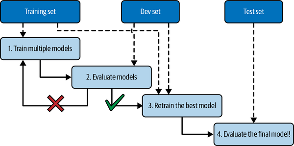

# Capítulo 1: EL panorama del Machine Learning

[← Índice](00-indice.md)

>**Resumen:** Introducción a conceptos básicos del ML.
> **Conceptos claves:** Definición ML, tipos de ML, usos del ML, problemas del ML.

## Contenido
- [Qué es ML](#qué-es-el-aprendizaje-automático): Definición de Aprendizaje Automático
- [Por qué usar ML](#por-qué-usar-ml): Ventajas del ML frente al paradigma clásico
- [Aplicaciones del ML](#ejemplos-de-usos): Aplicaciones y usos específicos del ML.
- [Tipos de ML](#tipos-de-ml): Distintas tipologías de ML y criterios de clasificación.
- [Problemas del ML](#principales-desafíos-y-problemas-del-ml): Principales desventajas del ML, los problemas de este paradigma.
- [Pruebas](#testeo-y-validación): 

## ¿Qué es el Aprendizaje Automático?

ML es la ciencia de programar ordenadores que aprendan de los datos. O una más rigurosa:
> Se dice que un programa aprende con la experiencia *E* en una tarea *T* medida en rendimiento a través de *P*, si el rendimiento
> en *T*, medido con *P*, mejora con la experiencia *E*.

Los ejemplos con los que aprende el programa son el *conjunto de entrenamiento(training set)*. Cada ejemplo de entrenamiento se 
le denomina *instancia o ejemplo de entrenamiento(training instance/sample)*. Y la parte del sistema que aprende y hace las predicciones
se llama *modelo(model)*.

## ¿Por qué usar ML?

Considera cómo implementarías un detector de spam basado en programación tradicional:
1. Primero examinas como son los correos de spam. Detectas patrones y defines las reglas que clasifican un correo como spam.
2. Implementas un algoritmo de detección de spam con estas reglas.
3. Pruebas tu programa repitiendo los anteriores pasos hasta alcanzar un rendimiento bueno para producción.

Debido a qué este problema es difícil, tu programa lo más posible que se convierta en una larga lista de reglas complejas
difíciles de mantener.

Por el contrario, un filtro de spam basado en ML aprenderá por su cuenta esas reglas de detección de spam. Concluyendo
en un programa más corto, fácil de mantener y en general con mejores resultados.

Otra ventaja de ML es frente a los entornos cambiantes. En el caso de la programación tradicional tendrías que modificar el 
código para añadir las nuevas reglas de spam, con ML el sistema se ajusta automáticamente. P.e, imagina que los correos empiezan
a usar "For U" em vez de "4U", en el enfoque tradicional tendrías que añadir "For U" a las reglas. Mientras que ML detectaría que 
"4U" ha dejado de usarse y al recibir reportes de que "4U" es spam aprendería esta nueva regla.

Otro ámbito en el que ML brilla es para problemas que son demasiado complejos para el enfoque tradicional o no tienen algoritmo conocido.
Un ejemplo de esto es el reconocimiento de voz. La mejor solución actual es escribir un algoritmo que aprenda por sí mismo pasándole 
ejemplos de audios de voz.

Finalmente, ML puede ayudar a los humanos a aprender, podemos mirar que ha aprendido el modelo de ML para resolver el problema(aunque esto
algunas veces puede ser difícil). Algunas veces esto revelará correlaciones inesperadas o nuevas modas, concluyendo en un mejor 
entendimiento del problema. Excavar en grandes cantidades de datos para descubrir patrones ocultos se conoce como *data mining*,
y ML es excelente en ello.

Para resumir, ML es buena para:
- Problemas cuya solución existente requiere mucho fine-tuning o largas listas de reglas.
- Problemas complejos que el enfoque tradicional no ofrece ninguna buena solución.
- Entornos cambiantes, un algoritmo de ML puede ser reentrenado para resolver el problema en el nuevo entorno.
- Obtener conocimiento oculto/profundo de problemas complejos y gran cantidad de datos.

## Ejemplos de usos

Algunas tareas concretas para ML junto a soluciones aplicables son las siguientes:
- Analizar imágenes de productos en una línea de producción para clasificarlos.
  -  Problema de clasificación en imágenes, se resuelven con *redes neuronales convolucionales(CNN)* o *transformadores(transformers)*.
- Detectar tumores en escáneres cerebrales
  - Esto es segmentación semántica de imágenes, donde cada pixel es clasificado(para determinar forma y localización del tumor). Se suele
  resolver con *CNN* o *transformers*.
- Clasificación automática de nuevos artículos
  -  Esto es *natural language processing(NLP)*, y más específicamente clasificación de texto, que puede ser atajado usando *recurrent neural networks(RNN)* y CNN. 
  Los *transformadores* funcionan mejor aún.
- Etiquetación automática de comentarios negativos u ofensivos.
  - También es clasificación de texto mediante NLP.
- Resumir automáticamente documentos largos
  - Es una rama de NLP denominada *text summarization*, usando las mismas herramientas.
- Etc.

Estos son solo algunas aplicaciones, hay muchas más usos de ML, además de diversidad de técnicas para resolver el mismo problema con ML.

## Tipos de ML

Los criterios de clasificación de la tipología de los sistemas ML son los siguientes:
- Cómo son supervisados durante el entrenamiento
- Si pueden o no aprender incrementalmente sobre la marcha
- Si funcionan comparando los nuevos datos con datos ya conocidos o identificando patrones en los datos de entrenamiento y 
construyendo un modelo predictivo.

Estos criterios no son excluyentes entre sí, pueden combinarse. Puedes tener una red neuronal profunda que aprenda sobre la marcha con 
ejemplos etiquetados.

### Supervision en el entrenamiento 

Los sistemas ML pueden ser clasificados en función de la cantidad y tipos de supervision que reciben durante el entrenamiento.
Hay muchas categorías, exploraremos solo las siguientes:
- Aprendizaje supervisado(supervised learning).
- Aprendizaje no supervisado(unsupervised learning).
- Self-supervised learning.
- Semi-supervised learning
- Aprendizaje por refuerzo(Reinforcement learning).

#### Supervised Learning

En el entrenamiento supervisado, el conjunto de entrenamiento que alimenta el modelo tiene las soluciones incluidas, denominadas
*labels o etiquetas*.

Una tarea típica del entrenamiento supervisado es la clasificación. El clasificador de spam es un buen ejemplo, ya que puedes tener 
muchos ejemplos con su respectiva *clase*.

Otra tarea típica es la predicción de un valor numérico objetivo, como p.e el precio de un coche, dado un conjunto de *características/features*.
A este tipo se las conoce como *regresión*.

Además, algunos modelos de regresión pueden ser usados para clasificación y viceversa. P.e, la regresión logística es usada para clasificar,
ya que proporciona como salida la probabilidad de pertenecer a una clase.

#### Unsupervised Learning

Los datos de entrenamiento no están etiquetados. Intenta aprender sin un profesor.

P.e imagina que tienes los datos de los visitantes de tu blog. Tal vez querrías ejecutar un algoritmo de *clustering* para
identificar los grupos de visitantes similares. En ningún momento le dices al algoritmo los grupos de los visitantes El algoritmo
encuentra estas conexiones sin tu ayuda. Si usas un algoritmo *hierarchical clustering*, tal vez divida los grupos en múltiples subgrupos
más pequeños. Esto podría ayudarte en ciertas tareas.

Los algoritmos de *visualización(visualization)* son otro ejemplo de entrenamiento no supervisado: les alimentas datos complejos
y sin etiquetar, y tu salida es una representación 2D o 3D de tus datos fácil de representar gráficamente. Estos algoritmos tratan de 
conservar tanta estructura como puedan(intentando que los distintos clústeres de salida no se solapen demasiado) para que sea comprensible
la organización de los datos e identificar patrones ocultos.

Una tarea relacionada con esta última es *reducción de dimensionalidad*, cuyo objetivo es simplificar los datos sin perder demasiada información.
Una manera es combinando atributos existentes relacionados para crear uno nuevo, a esto se le llama *extracción de características*.

> Es recomendable aplicar un algoritmo de reducción de dimensiones de nuestros datos antes de alimentar al algoritmo del modelo. 
> Se ejecutará más rápido, los datos ocuparán menos espacio en disco y memoria, y en algunos casos rendirá mejor.

Otra tarea de este tipo de entrenamiento es la *detección de anomalías(anomaly detection)*. P.e, detectar transacciones de 
crédito anómalas para prevenir el fraude, o eliminar los datos anómalos del conjunto de entrenamiento antes de alimentar el modelo.
Otra tarea de este tipo similar es la *detección de novedades(novelty detection)* que intenta detectar nuevas instancias que 
no se parecen a ninguna en el conjunto de entrenamiento.

Finalmente, podemos hablar de *association rule learning*, cuyo objetivo es indagar en grandes cantidades de atributos y descubrir
relaciones interesantes entre atributos. P.e, te permite descubrir que la gente que compra filetes también compra salsa barbacoa,
por lo que decidirías que estos dos productos estén próximos.

#### Semi-supervised Learning

Debido a la dificultad y coste de etiquetar los datos, en general tienes una mezcla de ambos tipos de datos, tanto muchos etiquetados
como unos pocos no etiquetados. Algunos algoritmos pueden trabajar con este tipo de conjuntos de entrenamiento.

La mayoría de este tipo de algoritmos son una combinación del aprendizaje no supervisado y el supervisado. P.e, un algoritmo puede
definir los distintos clústeres con un algoritmo de clustering. Y entonces etiquetar cada grupo con la etiqueta más presente. Una vez
etiquetados, se puede aplicar un algoritmo de entrenamiento supervisado.

#### Self-supervised Learning

Otro enfoque del ML es generar un conjunto etiquetado a partir de uno no etiquetado. Este enfoque se conoce como self-supervised learning,

P.e si tienes un conjunto de imágenes sin etiquetar, puedes aleatoriamente enmascarar una pequeña parte de la imágen, y entrenar un modelo
para recuperar la original. Durante el entrenamiento, las imágenes enmascaradas son la entrada, y las imágenes originales son usadas
como etiquetas.

Este modelo resultante puede usarse para reparar imágenes o quitar objetos molestos de ellas. Pero en general este no es el objetivo
del modelo entrenado por self-supervised learning. Si no que lo quieres realizar tweak y fine-tune para una tarea diferente, p.e 
crear un clasificador de mascotas de un conjunto sin etiquetar. Con esta técnica de esconder parte de la imagen, podríamos hacer
que nuestro modelo aprenda como se diferencian las distintas mascotas y agruparlas, entonces al final solo tendríamos
que etiquetar los distintos grupos como ya vimos.

> Pasar el conocimiento de un modelo a otro se denomina *transfer learning*, y es muy útil en muchas aplicaciones de ML.

Algunas personas consideran self-supervised learning parte de unsupervised learning, ya que trabaja con un conjunto de datos
no etiquetados. Pero este si usa etiquetas generadas durante el entrenamiento.

#### Reinforcement Learning

El aprendizaje por refuerzo se basa en algoritmos de prueba/error. En él, un agente(learning system), puede observar y actuar en el entorno.
Al actuar recibe una *recompensa/penalización*. El objetivo del agente es aprender por sí mismo cuál es la mejor estrategia, denominada *política(policy)*,
que maximiza su recompensa a lo largo del tiempo. La política determina que acciones el agente debería elegir en cada momento.

### Batch vs Online Learning

En este otro criterio, se observa si el sistema puede aprender o no incrementalmente de un stream de datos de entrada.

#### Batch learning(Aprendizaje por Lotes)

El sistema no puede aprender incrementalmente en estos casos. Se entrena usando todos los datos disponibles, lo que tomará mucho tiempo 
y recursos en general, por ello se hace fuera de producción/offline.

Primero el sistema se entrena, se lanza a producción y se ejecuta sin aprender. Solo aplica lo que ha aprendido, lo que se conoce como *offline learning*.

La desventaja de esto, es que en general el rendimiento del modelo decae a lo largo del tiempo, simplemente porque la naturaleza del mundo es cambiante. A 
este fenómeno se le llama *model rot* o *data drift*. La solución es reentrenar el modelo con datos actualizados. Cada cuanto decides reentrenar es elección propia
por la naturaleza del problema, si es invariante o no a lo largo del tiempo.

Este reentrenamiento se realiza con todo el conjunto antiguo más los nuevos datos, Por suerte el proceso de reentrenar, evaluar y desplegar en producción el nuevo 
modelo es automático. El mayor inconveniente es que reentrenar toma mucho tiempo, además de todos los recursos computacionales que se usan y reservan. Otra 
desventaja son los límites de memoria del propio HW, por lo que puede que no tengas acceso a todos los datos que deberías.

Por tanto, como ventaja tenemos:
- Útil para problemas que no cambian mucho a lo largo del tiempo.
- No hay que considerar reentrenar mucho, así que el pipeline del proyecto es sencillo. Entrenar, evaluar y producción.

Inconvenientes:
- Ineficaz ante entornos cambiantes, requiere reentrenamientos.
- Consume muchos recursos de memoria, tiempo y energía.

Para los casos de problemas inconvenientes existe la opción de aprender incrementalmente.

#### Online Learning

En online learning, entrenas el sistema incrementalmente alimentando con datos de forma secuencial, ya sea individualmente o en pequeños grupos
denominados *mini-baches/minilotes*. Cada paso de entrenamiento es barato y rápido, así el sistema puede aprender de nuevos datos en el momento en 
que llegan.

Es útil para sistemas que necesitan adaptarse a entornos cambiantes. También es bueno si tus recursos son limitados, p.e, un modelo
entrenado en un móvil.

Además, puede ser usado cuando el conjunto de datos no entra en la memoria de un ordenador para entrenar el modelo(se denomina out-of-core learning).
El modelo carga parte de los datos, entrena y repite estos dos pasos hasta acabar.

Un parámetro importante de los sistemas de aprendizaje online es el *ratio de aprendizaje(learning rate)*, que indica como de rápido debe 
adaptarse a los nuevos datos. Si estableces un valor alto, se adaptará rápidamente a nuevos datos, pero olvidará los viejos. Y al contrario,
si lo estableces muy bajo, el sistema tenderá a la inercia, es decir, aprenderá muy lentamente aunque será menos sensible al ruido de los 
nuevos datos o a las secuencias de datos anómalos(outliers).

>Out-of-core learning se suele hacer offline. Así que el nombre online learning puede ser confuso. Piensa más como aprendizaje incremental(incremental learning).

El problema de este enfoque es que si recibimos muchos malos datos de forma continúa, el rendimiento del modelo decaerá, lo que afectará
a su utilidad. Para reducir este riesgo debes monitorizar y desactivar el aprendizaje(o restaurar una versión anterior del modelo) si aprecias 
una bajada de rendimiento significativa. Otro consejo es monitorear los datos de entrada e intentar detectar los datos anómalos.

### Instance-Based vs Model-Based Learning

Otra forma de clasificar los sistemas de ML es por como generalizan. La mayoría de tareas del ML son sobre predicciones. Es decir, predecir la salida
de una instancia que nunca ha visto a partir de las instancias existentes a través del entrenamiento. Tener buen rendimiento en la evaluación es bueno,
pero nuestro objetivo principal es realizar buenas predicciones.

Hay dos enfoques a la hora de generalizar:
- Instance-based learning
- Model-based learning

#### Instance-based Learning

Aprendes de corazón. A través de ejemplos existentes comparas con los nuevos y determinas la salida. Debido a este criterio,
necesitamos determinar la medida de similitud entre instancias.

#### Model-based learning

El otro enfoque es crear un modelo a través de un conjunto de datos y usarlo para hacer predicciones. P.e predecir el grado de
satisfación a través del GDP. Ves que presenta un patrón los datos, por lo que defines una función que crees que lo recoge.
Hemos elegido la función linear para definir un *modelo lineal* de la forma que: $$life_satisfaction=\theta_0+\theta_1\times GDP$$

A través de estos dos parámetros intentamos ajustar la recta a los datos de entrenamiento. ¿Cómo los definimos? Necesitamos
describir una medida de rendimiento. Ya sea una *función de utilidad(utility function/fitness function)* que mide como de bueno
es el modelo, o una *función de coste* que describe como de malo es. Para los modelos de regresión lineal se suele usar una función
de coste que mida la distancia entre las predicciones del modelo y los ejemplos de entrenamiento, que tratará de minimizarse.

El proceso de encontrar los parámetros es lo que se denomina en entrenamiento, en nuestro ejemplo podría ser a través de un
algoritmo de regresión lineal. P.e se determina que $\theta_0 = 3.75 $ and $\theta_1 = 6.78 × 10–5 $.

> El término modelo se puede referir a su tipo(regresión linear), una arquitectura de modelo completa(linear regression with one input and one output)
> o a un modelo entrenado listo para predecir ( linear regression with one input and one output, using $\theta_0 = 3.75 $ and $\theta_1 = 6.78 × 10–5 $).
> La selección del modelo consisten en especificar su tipo y describir completamente su arquitectura. Entrenar el modelo es ejecutar un algoritmo que 
> busque los parámetros que mejor se ajusten a nuestros datos de entrenamiento.

```python
import matplotlib.pyplot as plt
import numpy as np
import pandas as pd
from sklearn.linear_model import LinearRegression

# Download and prepare the data
data_root = "https://github.com/ageron/data/raw/main/"
lifesat = pd.read_csv(data_root + "lifesat/lifesat.csv")
X = lifesat[["GDP per capita (USD)"]].values
y = lifesat[["Life satisfaction"]].values

# Visualize the data
lifesat.plot(kind='scatter', grid=True,
             x="GDP per capita (USD)", y="Life satisfaction")
plt.axis([23_500, 62_500, 4, 9])
plt.show()

# Select a linear model
model = LinearRegression()

# Train the model
model.fit(X, y)

# Make a prediction for Cyprus
X_new = [[37_655.2]]  # Cyprus' GDP per capita in 2020
print(model.predict(X_new)) # output: [[6.30165767]]
```

Cambiar a un modelo basado en instancias es tan simple como cambiar:
```python
from sklearn.linear_model import LinearRegression
model = LinearRegression()
```
a
```python
from sklearn.neighbors import KNeighborsRegressor
model = KNeighborsRegressor(n_neighbors=3)
```

Si todo fue bien, tu modelo hará buenas predicciones. Si no es así, tal vez necesites usar más atributos, más y mejores ejemplos
de entrenamiento, o un modelo más potente.

En resumen, el proceso lo podemos definir como:
1. Estudiaste los datos.
2. Seleccionaste un modelo.
3. Entrenaste el modelo con el conjunto de entrenamiento.
4. Pones tu modelo en producción y esperas que haga buenas predicciones.

## Principales desafíos y problemas del ML

Como nuestra tarea es definir el modelo y entrenar con algunos datos, las dos cosas que pueden ir mal son:
- Un "modelo malo".
- "Malos datos"

### Problemas relativos a Malos Datos
#### Cantidad de datos de entrenamiento insuficientes

La mayoría de algoritmos de ML necesitan bastantes datos para funcionar bien. Incluso para problemas sencillos se necesitan miles de datos.
Como se declaró en la irrazonable eficacia de los datos, modelos poco potentes podían rendir tan bien como modelos potentes con los
suficientes datos.

#### Datos de Entrenamiento No Representativos
Es necesario que tus datos de entrenamiento sean representativos de los nuevos casos que quieres predecir para generalizar bien. Esto
es cierto tanto para instance-based learning como para model-based learning.

Conseguir este conjunto de entrenamiento representativo puede ser complicado. Si es demasiado pequeño tendrá *sampling noise*. No solo pasa con conjuntos pequeños,
incluso si es demasiado grande y el método de instanciación tuvo fallos, sufriremos el *sesgo de ejemplificación(sampling bias)*.

#### Datos de pobre calidad
Si tu conjunto de datos está lleno de errores, datos outliers, y ruido, hará más difícil que el sistema detecte el patrón. Es recomendable gastar tiempo
estudiando y verificando los datos. Los siguientes son algunos ejemplos de cuando deberías limpiarlos:
- Si algunos ejemplos son límite, puede ayudar quitarlos o corregirlos manualmente.
- Si faltan valores en algunos atributos, puedes intentar quitarlos, autorrellenarlos e incluso experimentar dos modelos, uno
con el atributo y otro sin él.

#### Características irrelevantes
El sistema aprenderá si incluye suficientes atributos útiles y pocos irrelevantes. Esta es una parte crítica de los proyectos de ML,
denominada *feature engineering*, que requiere los siguientes pasos:
- Selección de atributos(seleccionar los atributos más útiles).
- Extracción de características(combinar atributos para extraer atributos más útiles).
- Crear nuevos atributos recolectando nuevos datos.
### Problemas relativos a Malos Modelos
#### Overfitting al conjunto de entrenamiento

Ocurre cuando el modelo rinde bien en el conjunto de entrenamiento, pero no generaliza bien. La causa principal es que el modelo
es demasiado complejo comparada con la cantidad y presencia de ruido en los datos de entrenamiento. Algunas soluciones son:
- Simplificar el modelo, eligiendo uno con menos parámetros, reducir el número de atributos o definiendo restricciones al modelo.
- Obtener más datos de entrenamiento.
- Reducir el ruido de los datos(corregir los errores en los datos y quitar outliers).

Restringir el modelo para hacerlo más simple y reducir el riesgo de overfitting se denomina *regularization*. P.e, el modelo linear
que definimos antes tiene dos parámetros. Esto da al algoritmo dos grados de libertad para adaptar al modelo al conjunto de entrenamiento.
Si forzáramos $\theta_0=0 $ solo tendríamos un grado de libertad, por lo que sería más difícil ajustarse a los datos de entrenamiento. También podríamos
acotar el valor de $\theta_1$ para tener algo entre 1 y 2 grados de libertad. Nuestro objetivo es buscar un balance de ajustes para mejorar el rendimiento.

La cantidad de regularización aplicada durante el aprendizaje puede ser controlada por un *hiperparámetro*. Un hiperparámetro es un parámetro
del algoritmo de aprendizaje(no del modelo). Se establece antes del entrenamiento y su valor es constante en él. Si pones un valor grande no se producirá
overfitting pero tampoco tendrá el mejor rendimiento. El *ajuste de hiperparámetros* es otro punto importante de ML.

#### Underfitting al conjunto de entrenamiento
Es lo contrario a overfitting. Ocurre cuando el modelo es demasiado simple para aprender la estructura oculta de los datos.
Algunas soluciones a este problema son:
- Seleccionar un modelo más potente con más parámetros.
- Alimentar con mejores atributos al algoritmo de aprendizaje(feature engineering).
- Reducir las restricciones del modelo(p.e reduciendo la regularización de hiperparámetros)

### Resumen

En resumen, hasta ahora hemos visto:
- ML es conseguir que las máquinas rindan mejor en una tarea aprendiendo de los datos, en vez de codificar reglas explícitamente.
- Hay muchos tipos de ML: supervised or not, batch or online, instance-based or model-based.
- En un proyecto de ML, reunes datos en un conjunto de entrenamiento, que luego alimentas a un algoritmo de aprendizaje. Si el 
algoritmo es model-based, ajusta algunos parámetros para encajar el modelo con el conjunto de entrenamiento(para al menos rendir 
bien en el entrenamiento), y esperas que rinda bien en nuevos datos. Si el algoritmo es instance-based, aprende de corazón y generaliza
a nuevas instancias usando una medida de similitud para compararlos con los datos aprendidos.
- El sistema no rendirá bien si el conjunto de entrenamiento es muy pequeño, o si los datos no son representativos, presentan ruido,
o están contaminados con atributos irrelevantes. Por último, tu modelo no necesita ser ni demasiado simple(ocurrirá underfitting) o demasiado
complejo(causará overfitting).


## Testeo y validación

La única manera de saber si nuestra modelo será bueno con nuevos datos es probarlo con nuevos datos. Una manera es ponerlo en producción
y monitorizar como de bien lo hace. Esto funciona bien, pero si rinde mal recibirás muchas quejas de los usuarios.

Una mejor alternativa es **dividir el conjunto de datos** en dos conjuntos: *training set* y *test set*. Training set lo usas
para entrenar el modelo, y el test set para evaluarlo. El *ratio de error(error rate)* en los nuevos casos es denominada el
*generalization error (or out-of-sample error)*, y evaluando tu modelo con el conjunto de entrenamiento consigues una estimación 
de este error. Esta métrica te contará como de bien tu modelo rendirá en casos que nunca ha visto.

Si el error de entrenamiento es bajo, pero el de validación es alto, quiere decir que tu modelo se está sobreajustando(overfitting)
a tus datos de entrenamiento.

> Lo común es usar una división 80/20 para los conjuntos de entrenamiento y testeo. Aunque esto depende del tamaño del conjunto de datos,
> si tienes muchos, p.e 10 millones, con 100.000 ejemplos de prueba serán suficientes para validar.

### Ajuste de Hiperparámetros y selección del Modelo

Una manera de elegir entre dos modelos es entrenar ambos y probarlos. Luego te interesaría probar distintas configuraciones de 
hiperparámetros para evitar overfitting. Encuentras el mejor modelo con la mejor configuración de hiperparámetros, pero al estar
en producción rinde peor de lo esperado. El problema es que hemos creado un tipo de overfitting al test set, por lo que con nuevos datos
lo más posible que no rinda tan bien.

Una solución a este problema es *holdout validation*. Apartas parte del conjunto de entrenamiento para evaluar múltiples modelos candidato
y elegir el mejor. El nuevo conjunto apartado se conoce como *validation set (or the development set, or dev set).* Por tanto nos queda un flujo como 
el siguiente:
- Entrenas múltiples modelos con diferentes hiperparámetros en el conjunto de entrenamiento reducido
- Seleccionas el modelo que mejor rinde en el conjunto de validación(dev set).
- Entrenas el mejor modelo con el conjunto de entrenamiento completo(Reduced Training set + Dev Set), consiguiendo el modelo final.
- Evalúas el modelo final con el test set para conseguir una estimación del error de generalización.



Si el conjunto de validación es demasiado pequeño, la evaluación del modelo será imprecisa, y podrías acabar eligiendo un modelo subóptimo. Y al contrario,
si el conjunto de validación es demasiado grande, estás dejando un conjunto de entrenamiento demasiado pequeño, lo que es malo. Una manera de
resolver estos problemas es realizando repetidas *validaciones cruzadas(cross-validation)*, usando muchos conjuntos de validación pequeños.

Cross validation consiste en crear múltiples configuraciones de conjuntos de entrenamiento y validación para evaluar más exhaustivamente 
los modelos. Entonces usamos el promedio de los distintos experimentos para compararlos, lo que nos dará una medida de rendimiento más precisa.
El inconveniente es que tienes que realizar múltiples experimentos, lo que conlleva múltiples entrenamientos y evaluaciones.

### Data Mismatch

A veces, es fácil obtener muchos datos, pero estos no son representativos completamente de los datos usados en producción. P.e, los
datos de entrada pueden estar incompletos en algunos campos. Es importante que los conjuntos de validación y testeo sean lo más
parecido posible a los datos que esperas recibir en producción. Por lo que es recomendable recopilar datos parecidos a los de producción.
Pero si insertas estos datos en los conjuntos de validación y testeo, no sabrás bien si el modelo rinde mal porque ha ocurrido overfit en el 
conjunto de entrenamiento o por la diferencia entre datos de laboratorio y reales.

Una solución a este problema es definir otro conjunto de los datos de entrenamiento, el *train-dev set*. Después de que el modelo sea entrenado con el conjunto de
entrenamiento, tu puedes evaluarlo en el train-dev set. Si el modelo rinde mal es porque se ha producido overfitting con el conjunto de entrenamiento,
por lo que deberías obtener más datos de entrenamiento y limpiarlos. Por el contrario, si rinde bien, puedes evaluarlo con el dev set con ejemplos de producción.
Si rinde mal, el problema es el data mismatch. Una vez que tienes un modelo que rinde bien en ambos(train-dev set y the dev set), puedes 
evaluarlo una última vez con el test set para saber como de bien irá en producción.

### Teorema No Free Lunch (NFL)

- Un modelo es una representación simplificada de los datos: descarta detalles superfluos que probablemente no generalicen a nuevas instancias.
- Elegir un tipo de modelo implica asumir algo sobre los datos (p. ej., un modelo lineal asume que los datos son esencialmente lineales y que la distancia a la recta es solo ruido).
- **Wolpert (1996):** si no se asume nada sobre los datos, no hay motivo para preferir un modelo sobre otro. Ningún modelo es mejor *a priori*.
- Según el dataset, lo mejor puede ser un modelo lineal o una red neuronal.
- Lo ideal sería evaluarlos todos, pero no es viable.
- **En la práctica:** se hacen suposiciones razonables sobre los datos y se evalúan solo unos pocos modelos adecuados:
  - Tareas simples → modelos lineales con distintos niveles de regularización.
  - Problemas complejos → varias redes neuronales.

## Ejercicios

1. ¿Cómo definirías ML?
   - ML es un paradigma de programación en él que la propia máquina aprende los patrones subyacentes de los datos para resolver una tarea de forma satisfactoria. Contraste
   con el paradigma tradicional en el cual un programador define reglas fijas que una máquina ejecuta para producir la salida.
2. ¿Puedes nombrar 4 tipos de aplicaciones en los que brilla?
  - Predicción de valores en bolsa.
  - Predicción meteorológica.
  - Análisis del lenguaje, pasar el habla a texto.
  - Generar arte inspirado en el impresionismo.
3. ¿Qué es un conjunto de datos etiquetados?
  - Conjunto de datos en los que tenemos la solución incluida para las entradas.
4. ¿Cuáles son las dos tareas principales del entrenamiento supervisado?
  - Clasificación
  - Predicción
5. ¿Puedes nombrar 4 tareas típicas del entrenamiento no supervisado?
  - Agrupación
  - Identificación de anomalías
  - Identificación de novedades
  - Representación gráfica de datos
6. ¿Qué tipo de algoritmo seleccionarías para que un robot camine en un terreno desconocido?
  - Aprendizaje por refuerzo para que aprenda la mejor política para navegar por el terreno.
7. ¿Que tipo de algoritmo usarías para segmentar tus clientes en múltiples grupos?
  - Un algoritmo de clustering en general. Podría ir desde entrenamiento supervisado(si tenemos los grupos acotados e incluidos en los datos de entrenamiento),
  a no supervisado(simplemente queremos los distintos grupos separados), a semi-supervised learning(grupos + luego los etiquetamos).
8. ¿Definirías el problema de detección de spam como entrenamiento supervisado o no supervisado?
  - Supervisado, ya que las entradas tienen una etiqueta indicando si es o no spam.
9. ¿Qué es un sistema basado en online learning?
 - Es cuando el sistema puede aprender de forma incremental de los datos nuevos. Es decir, no simplemente se entrena una vez y ya. Si no que se puede entrenar de 
  forma dinámica con nuevos datos que fuesen llegando al sistema.
10. ¿Que es out-of-core learning?
  - Técnica usada para cuando los datos no entran en la memoria principal de la máquina. Se dividen en múltiples máquinas, y el sistema va cargando los múltiples datos
  tras procesarlos y usarlos en el entrenamiento hasta que haya acabado.
11. ¿Que tipo de algoritmos confían en una medida de similitud para hacer predicciones?
  - Instance-based models, o algoritmos basado en instancias.
12. ¿Cuál es la diferencia entre parámetro e hiperparámetro de un modelo?
 - El parámetro son los valores que el modelo aprende para ajustar los datos de entrenamiento a la salida. Mientras que el hiperparámetro sirve para configurar 
  el algoritmo aplicado por el modelo.
13. ¿Qué buscan los algoritmos model-based? ¿Cuál es la estrategia más común para triunfar? ¿Cómo hacen predicciones?
  - Los algoritmos model-based usan una función para determinar la salida en vez de comparar similitud de ejemplos como los instance-based. Para hacer predicciones, simplemente aprenden
  los parámetros(pesos) de los distintos atributos para la salida, y entonces pasan los atributos del dato a predecir, consiguiendo una salida de la función.
14. ¿Puedes nombrar cuatro retos de ML?
  - Insuficientes Datos, es el motor principal de ML, sin datos no rendirá bien.
  - Datos no representativos, uso de datos inadecuados que no representan la relación del problema con su solución o sesgados por distribución.
  - Overfitting, ocurre cuando el modelo es demasiado complejo y se ajusta al conjunto de entrenamiento. Suele rendir bien en entrenamiento, pero mal en el resto.
  - Underfitting, ocurre cuando el modelo es demasiado simple. Sintomas son rendir mal tanto en entrenamiento como en evaluación.
15. Si tu modelo rinde bien en los datos de entrenamiento pero generaliza mal para nuevos datos. ¿Qué esta pasando?¿Podrías nombrar 3 soluciones?
  - Esta ocurriendo overfitting al conjunto de entrenamiento. Podriamos incluir más datos que sean más representativos del mundo real para mejorar las predicciones, podríamos
  definir restricciones al modelo(p.e en una función linear determinar de forma fija el sesgo inicial $\omega_0$), o elegir un modelo más simple(función cuadrática en vez de exponente 3).
16. ¿Qué es un test set y por qué quieres usarlo?
  - Es un conjunto que sirve para evaluar el modelo antes de lanzarlo a producción. Te puede interesar para comparar distintos modelos con distintos hiperparámetros y mejorar el rendimiento.
17. ¿Cuál es el proposito de validation set?
  - Es un conjunto especial de pruebas para evitar el overfitting al test set que ocurre al entrenar múltiples modelos para elegir el mejor.
18. ¿Qué es el train-dev set, cuándo lo necesitas, y cómo lo usas?
  - Es un subconjunto del conjunto de datos de entrenamiento original que sirve para distinguir si el problema de nuestro sistema es por Data 
  mismatch o por overfitting. Si no lo hacemos y vemos mal rendimiento, no podríamos saber bien la causa. Si rinde mal en este conjunto,
  se está produciendo overfitting y no necesitamos continuar el pipeline después de evaluar el entrenamiento.
19. Qué puede ir mal si usas el test set para ajustar hiperparámetros?
  - Overfitting al test set, por ello usamos el validation set.