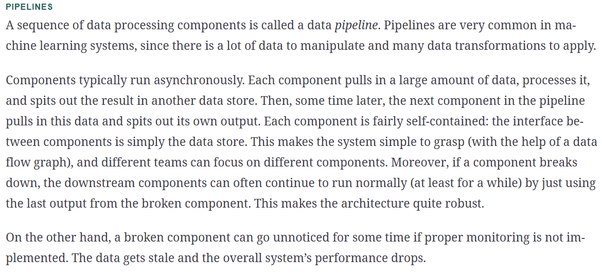

# Capítulo 2: Proyecto de ML completo

[← Índice](00-indice.md)

>**Resumen:** Un proyecto completo guiado de ML para entender las distintas fases.
> **Conceptos claves:** Ingeniería de datos, selección de modelo y ML. Lanzamiento a producción

## Contenido
. [Trabajando con datos reales](#trabajando-con-datos-reales)
- [Mira la visión general](#1-mira-la-visión-general): 
- [Obtén los datosL](#2-obtén-los-datos): 
- [Explora y visualiza los datos](#3-explora-y-visualiza-los-datos-para-comprenderlos): 
- [Prepara los datos](#4-prepara-los-datos-para-algoritmos-ml): 
- [Selecciona Modelo y entrénalo](#5-selecciona-un-modelo-y-entrénalo): 
- [Perfeccion tu modelo](#6-perfecciona-tu-modelo):
- [Presenta tu solución](#7-presenta-tu-solución):
- [Lanza, monitoriza y mantén tu sistema](#8-lanza-monitoriza-y-mantén-tu-sistema):

## Trabajando con datos reales

Cuando estudias y aprendes sobre ML, es mejor experimentar con conjuntos de datos del mundo real, no los artificiales. Por suerte,
hay múltiples fuentes para obtener datos:
- Repositorios populares de datos públicos
  - [OpenML.org](https://openml.org/)
  - [Kaggle.com](https://kaggle.com/datasets)
  - [PapersWithCode.com](https://paperswithcode.com/datasets)
  - [UC Irvine Machine Learning Repository](https://archive.ics.uci.edu/ml)
  - [Amazon’s AWS datasets](https://registry.opendata.aws/)
  - [TensorFlow datasets](https://tensorflow.org/datasets)
- Meta portals(listan repositorios de datos públicos)
  - [DataPortals.org](https://dataportals.org/)
  - [OpenDataMonitor.eu](https://opendatamonitor.eu/)
- Otras páginas listando repositorios de datos públicos populares:
  - [Wikipedia’s list of machine learning datasets](https://homl.info/9)
  - [Quora.com](https://homl.info/10)
  - [The datasets subreddit](https://reddit.com/r/datasets)

Usaremos el conjunto de datasets de "California Housing Prices" del repositorio StatLib. Este conjunto está basado en el censo de California
de 1990. No está actualizado a datos recientes, pero es bueno para aprender. 

## 1. Mira la visión general

> Lo primero es tener a mano la lista de objetivos de todo proyecto de ML. [Apprendix A](https://learning.oreilly.com/library/view/hands-on-machine-learning/9781098125967/app01.html#project_checklist_appendix)
> debería funcionar bien en general, y puedes adaptarla a tus necesidades.

### Determina el problema

Lo primero es determinar cuál es el objetivo. Crear un modelo probablemente no lo sea. ¿Cómo espera la compañia usar y beneficiarse del modelo?
**Determinar el objetivo** es importante, ya que determinará como enfocamos el problema, que algoritmos usarás, que medidas de rendimiento
elegirás para evaluar el modelo, y cuánto te esforzarás en perfeccionarlo.

P.e, en este caso, el jefe te indica que la salida(predicción de la mediana del precio de casa de un distrito) será usado en
otro sistema ML con otras señales para determinar si merece la pena invertir. Acertar es crítico, ya que afecta al negocio.

Lo próximo es mirar el **estado del arte**, es decir, como son las soluciones existentes si las hay. El *estado del arte* será
una buena *referencia de rendimiento*, además de indicarte cómo resolver el problema. 

En nuestro caso de ejemplo, los precios de un distrito son calculados manualmente por expertos usando datos actuales, cuando no 
pueden obtener la mediana, usando una estimación basada en reglas complejas. El problema es que suelen fallar, y sus predicciones 
se desvían un 30% del valor correcto. 

Con todo esto ya estás listo para hacerte preguntas en las siguientes cuestiones:
- Qué tipo de supervisión de entrenamiento necesita tu modelo. ¿Es supervisado, no supervisado, self-supervised, o aprendizaje por refuerzo?
- Qué tipo de tarea es. ¿Es clasificación, regresión, o algo más?
- ¿Deberías usar batch learning o online learning?

En el ejemplo que estamos usando, es una **tarea de entrenamiento supervisado**, ya que el modelo puede ser entrenando con las etiquetas(cada instancia
viene con su salida esperada, el precio mediano de las casas del distrito). Es una tarea de regresión, ya que tratamos de predecir un valor. Más específicamente,
es un problema de **regresión múltiple(multiple regression)**, ya que usaremos múltiples atributos para determinar la salida. También es **univariate regression**,
ya que solo queremos predecir un valor por distrito. Si quisiéramos predecir múltiples valores por distrito sería un problema de **multivariate regression**. Finalmente,
no hay un flujo de datos continuo, por lo que no es necesario adaptarse rápidamente, por lo que **batch-learning** rendirá bien.

> Si la cantidad de datos fuese demasiado grande, podrías dividir tu trabajo de batch-learning en múltiples servidores(usando la técnica MapReduce)o usar online learning.

### Selecciona una medida de rendimiento

El próximo paso es determinar una medida de rendimiento. Una medida típica para los problemas de regresión es **root mean squared error (RMSE)**. Esta medida
nos da una idea de cuánto falla en general, dando más peso a los errores grandes. La fórmula es: $$RMSE(X, h)=\sqrt{\frac{1}{m}\sum_{i=1}^{m}{(h(x^{(i)})-y^{(i)})^2}}$$

Donde:
- m es el número de instancias en el conjunto de datos tu esas usando para medir el RMSE.
- $x^{(i)}$ es el vector de atributos de la instancia $i$.
- $y^{(i)}$ es la etiqueta de la instacia $i$.
- X es la matriz completa incluyendo todas las instancias del conjunto(sin las etiquetas). Donde cada fila es $i$ es la traspuesta
del vector $x^{(i)}$.
- h es la función de predicción, también llamada hipótesis. Cuando se le pasa una instancia $x^{(i)}$, genera una salida predictiva.
- RMSE(X, h) es la **función de coste** medida en un conjunto de ejemplos usando la hipótesis h. 

Aunque RMSE es generalmente la medida preferida para tareas de regresión, en algunos casos tal vez prefieras otra, como la **mean absolute error (MAE)**.
$$MAE(X, h) = \frac{1}{m}\sum_{i=1}^{m}{|(h(x^{(i)})-y^{(i)})^2)|}$$

Ambas de estas métricas miden la distancia  entre dos vectores, el vector de predicciones y el vector de objetivos. Varias
medidas de distancia, o normas, son posibles:
- RMSE corresponde a la distancia Euclidea, la segunda norma.
- MAE es la distancia de Manhattan porque mide la distancia entre dos puntos en una ciudad si solo puedes ir en bloques ortogonales. Esta es la primera norma.
- La norma $ℓ_k$ de un vector v, contiene los n elementos definidos como $\|v\|_k= (|v_1|^k+|v_2|^k+...+|v_n|^k)^{1/k}$. La norma cero
da cuántos elementos no son cero en el vector, mientras que la norma infinitesimal nos da el valor máximo absoluto del vector.

Cuánto más alto la norma, más se centra en valores grandes e ignore los pequeños. Por eso RMSE es más sensible a outliers que MAE.
Pero cuando los outliers son exponencialmente raros(como en las campanas Gaussianas), RMSE rinde muy bien.

### Comprueba las asunciones

Por últimos, es recomendable listar y verificar las asunciones realizadas, esto te permita capturar errores graves de forma temprana. 

P.e, imagina el pipeline trabaja los precios como categorías como "barato", "medio" o "caro", en vez del valor preciso. Entonces el sistema
necesita obtener la categoría bien y no el precio. El problema debería haberse visto como uno de clasificación en vez de regresión.
Tras preguntar, confirmas que es de regresión ya que se necesitan los valores.

## 2. Obtén los datos

## 3. Explora y visualiza los datos para comprenderlos

## 4. Prepara los datos para algoritmos ML

## 5. Selecciona un modelo y entrénalo

## 6. Perfecciona tu modelo

## 7. Presenta tu solución

## 8. Lanza, monitoriza, y mantén tu sistema