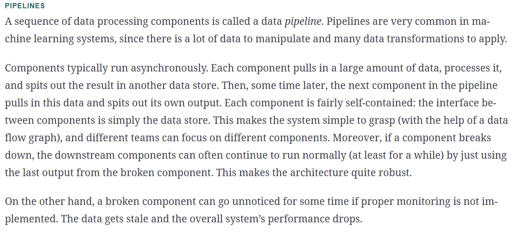
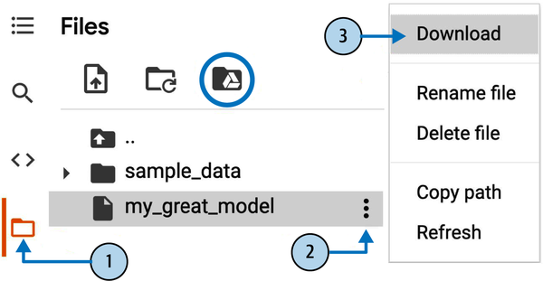
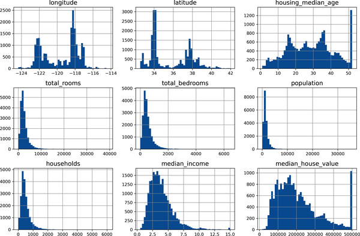
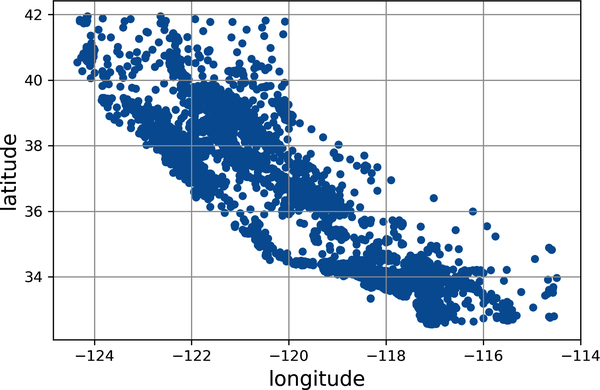
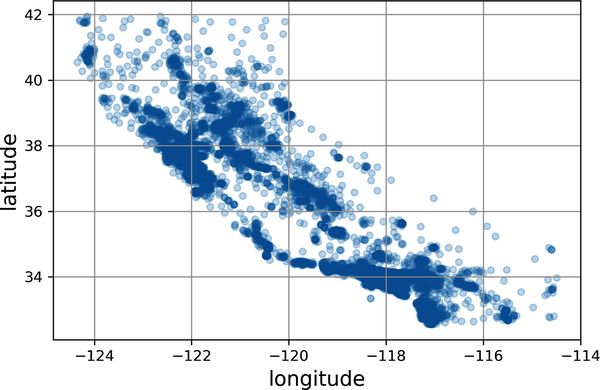
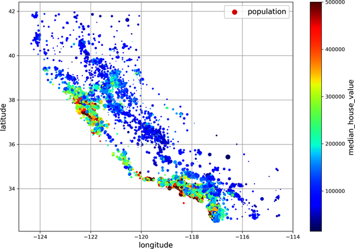
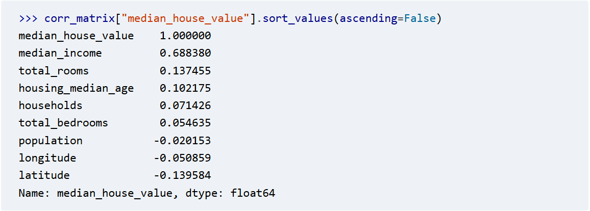
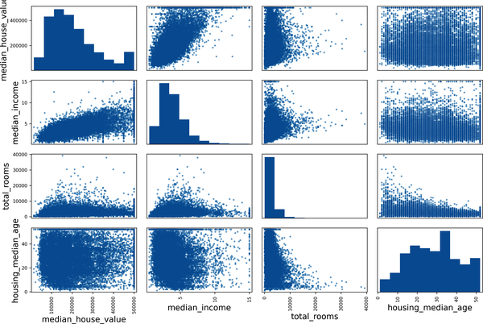
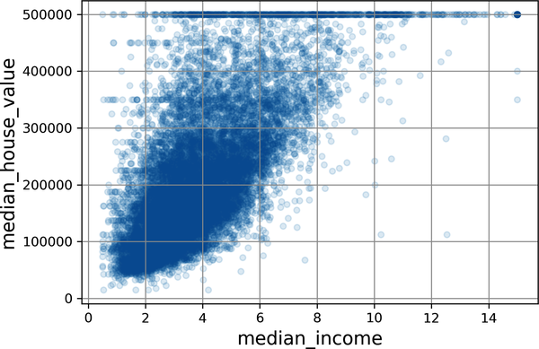
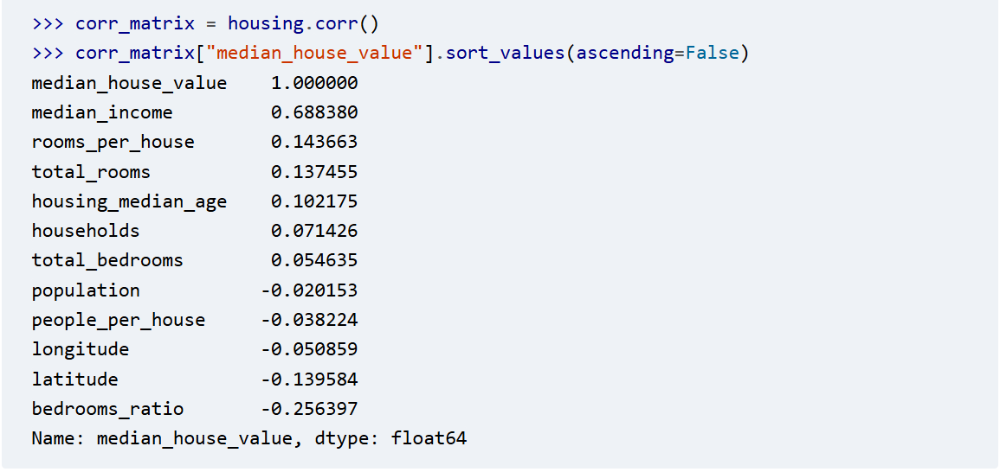

# Capítulo 2: Proyecto de ML completo

[← Índice](00-indice.md)

>**Resumen:** Un proyecto completo guiado de ML para entender las distintas fases.
> **Conceptos claves:** Ingeniería de datos, selección de modelo y ML. Lanzamiento a producción

## Contenido
. [Trabajando con datos reales](#trabajando-con-datos-reales)
- [Mira la visión general](#1-mira-la-visión-general): 
- [Obtén los datosL](#2-obtén-los-datos): 
- [Explora y visualiza los datos](#3-explora-y-visualiza-los-datos-para-comprenderlos): 
- [Prepara los datos](#4-prepara-los-datos-para-algoritmos-ml): 
- [Selecciona Modelo y entrénalo](#5-selecciona-un-modelo-y-entrénalo): 
- [Perfeccion tu modelo](#6-perfecciona-tu-modelo):
- [Presenta tu solución](#7-presenta-tu-solución):
- [Lanza, monitoriza y mantén tu sistema](#8-lanza-monitoriza-y-mantén-tu-sistema):

## Trabajando con datos reales

Cuando estudias y aprendes sobre ML, es mejor experimentar con conjuntos de datos del mundo real, no los artificiales. Por suerte,
hay múltiples fuentes para obtener datos:
- Repositorios populares de datos públicos
  - [OpenML.org](https://openml.org/)
  - [Kaggle.com](https://kaggle.com/datasets)
  - [PapersWithCode.com](https://paperswithcode.com/datasets)
  - [UC Irvine Machine Learning Repository](https://archive.ics.uci.edu/ml)
  - [Amazon’s AWS datasets](https://registry.opendata.aws/)
  - [TensorFlow datasets](https://tensorflow.org/datasets)
- Meta portals(listan repositorios de datos públicos)
  - [DataPortals.org](https://dataportals.org/)
  - [OpenDataMonitor.eu](https://opendatamonitor.eu/)
- Otras páginas listando repositorios de datos públicos populares:
  - [Wikipedia’s list of machine learning datasets](https://homl.info/9)
  - [Quora.com](https://homl.info/10)
  - [The datasets subreddit](https://reddit.com/r/datasets)

Usaremos el conjunto de datasets de "California Housing Prices" del repositorio StatLib. Este conjunto está basado en el censo de California
de 1990. No está actualizado a datos recientes, pero es bueno para aprender. 

## 1. Mira la visión general

> Lo primero es tener a mano la lista de objetivos de todo proyecto de ML. [Apprendix A](https://learning.oreilly.com/library/view/hands-on-machine-learning/9781098125967/app01.html#project_checklist_appendix)
> debería funcionar bien en general, y puedes adaptarla a tus necesidades.

### Determina el problema

Lo primero es determinar cuál es el objetivo. Crear un modelo probablemente no lo sea. ¿Cómo espera la compañia usar y beneficiarse del modelo?
**Determinar el objetivo** es importante, ya que determinará como enfocamos el problema, que algoritmos usarás, que medidas de rendimiento
elegirás para evaluar el modelo, y cuánto te esforzarás en perfeccionarlo.

P.e, en este caso, el jefe te indica que la salida(predicción de la mediana del precio de casa de un distrito) será usado en
otro sistema ML con otras señales para determinar si merece la pena invertir. Acertar es crítico, ya que afecta al negocio.

Lo próximo es mirar el **estado del arte**, es decir, como son las soluciones existentes si las hay. El *estado del arte* será
una buena *referencia de rendimiento*, además de indicarte cómo resolver el problema. 

En nuestro caso de ejemplo, los precios de un distrito son calculados manualmente por expertos usando datos actuales, cuando no 
pueden obtener la mediana, usando una estimación basada en reglas complejas. El problema es que suelen fallar, y sus predicciones 
se desvían un 30% del valor correcto. 



Con todo esto ya estás listo para hacerte preguntas en las siguientes cuestiones:
- Qué tipo de supervisión de entrenamiento necesita tu modelo. ¿Es supervisado, no supervisado, self-supervised, o aprendizaje por refuerzo?
- Qué tipo de tarea es. ¿Es clasificación, regresión, o algo más?
- ¿Deberías usar batch learning o online learning?

En el ejemplo que estamos usando, es una **tarea de entrenamiento supervisado**, ya que el modelo puede ser entrenando con las etiquetas(cada instancia
viene con su salida esperada, el precio mediano de las casas del distrito). Es una tarea de regresión, ya que tratamos de predecir un valor. Más específicamente,
es un problema de **regresión múltiple(multiple regression)**, ya que usaremos múltiples atributos para determinar la salida. También es **univariate regression**,
ya que solo queremos predecir un valor por distrito. Si quisiéramos predecir múltiples valores por distrito sería un problema de **multivariate regression**. Finalmente,
no hay un flujo de datos continuo, por lo que no es necesario adaptarse rápidamente, por lo que **batch-learning** rendirá bien.

> Si la cantidad de datos fuese demasiado grande, podrías dividir tu trabajo de batch-learning en múltiples servidores(usando la técnica MapReduce)o usar online learning.

### Selecciona una medida de rendimiento

El próximo paso es determinar una medida de rendimiento. Una medida típica para los problemas de regresión es **root mean squared error (RMSE)**. Esta medida
nos da una idea de cuánto falla en general, dando más peso a los errores grandes. La fórmula es: $$RMSE(X, h)=\sqrt{\frac{1}{m}\sum_{i=1}^{m}{(h(x^{(i)})-y^{(i)})^2}}$$

Donde:
- m es el número de instancias en el conjunto de datos tu esas usando para medir el RMSE.
- $x^{(i)}$ es el vector de atributos de la instancia $i$.
- $y^{(i)}$ es la etiqueta de la instacia $i$.
- X es la matriz completa incluyendo todas las instancias del conjunto(sin las etiquetas). Donde cada fila es $i$ es la traspuesta
del vector $x^{(i)}$.
- h es la función de predicción, también llamada hipótesis. Cuando se le pasa una instancia $x^{(i)}$, genera una salida predictiva.
- RMSE(X, h) es la **función de coste** medida en un conjunto de ejemplos usando la hipótesis h. 

Aunque RMSE es generalmente la medida preferida para tareas de regresión, en algunos casos tal vez prefieras otra, como la **mean absolute error (MAE)**.
$$MAE(X, h) = \frac{1}{m}\sum_{i=1}^{m}{|(h(x^{(i)})-y^{(i)})^2)|}$$

Ambas de estas métricas miden la distancia  entre dos vectores, el vector de predicciones y el vector de objetivos. Varias
medidas de distancia, o normas, son posibles:
- RMSE corresponde a la distancia Euclidea, la segunda norma.
- MAE es la distancia de Manhattan porque mide la distancia entre dos puntos en una ciudad si solo puedes ir en bloques ortogonales. Esta es la primera norma.
- La norma $ℓ_k$ de un vector v, contiene los n elementos definidos como $\|v\|_k= (|v_1|^k+|v_2|^k+...+|v_n|^k)^{1/k}$. La norma cero
da cuántos elementos no son cero en el vector, mientras que la norma infinitesimal nos da el valor máximo absoluto del vector.

Cuánto más alto la norma, más se centra en valores grandes e ignore los pequeños. Por eso RMSE es más sensible a outliers que MAE.
Pero cuando los outliers son exponencialmente raros(como en las campanas Gaussianas), RMSE rinde muy bien.

### Comprueba las asunciones

Por últimos, es recomendable listar y verificar las asunciones realizadas, esto te permita capturar errores graves de forma temprana. 

P.e, imagina el pipeline trabaja los precios como categorías como "barato", "medio" o "caro", en vez del valor preciso. Entonces el sistema
necesita obtener la categoría bien y no el precio. El problema debería haberse visto como uno de clasificación en vez de regresión.
Tras preguntar, confirmas que es de regresión ya que se necesitan los valores.

## 2. Obtén los datos

Todos los recursos de este libro están [online aquí](https://github.com/ageron/handson-ml3) como jupyter notebooks. Puedes ejecutarlos
en google collab, en kaggle o localmente siguiendo las instrucciones.

### Guardando los cambios en el código y tus datos 

Los cambios que hagas solo duran la sesión activa, cuando acabes desaparecerán, por ello es recomendable guardarlos. Para ello,
guardarás una copia en Google Drive seleccionando File → “Save a copy in Drive”. Otra opción es descargarlo en local, seleccionando
File → Download → “Download .ipynb”. Entonces más tarde lo puedes cargar de nuevo ya sea abriendo el archivo de drive o la copia local.

Si los notebooks generan datos que te interesan, asegúrate de descargarlos. Para ello haz lo siguiente:
1. Selecciona el icono de carpeta.
2. Da click en los tres puntos
3. Selecciona la opción de descargar

O alternativamente puedes hacer el mismo paso uno, pero montarlo en drive también, seleccionando la carpeta de drive(rodeado en la imagen).



Por defecto, se montará en /content/drive/MyDrive. Si lo quieres en otro directorio, haz una copia de /content/drive/MyDrive a 
tu otro directorio con el comando *!cp /content/my_great_model /content/drive/MyDrive* en una celda del notebook.

### Los peligros de la interactividad
Los notebooks son muy útiles para interactuar, pero hay que tener mucho cuidado con el orden en el que ejecutas las celdas,
pueden ocurrir errores en caso de orden incorrecto.

> En caso de un error extraño, haz selecting Runtime → “Restart runtime” para reiniciar la sesión. En caso de seguir fallando es
> que has modificado algo del notebook, revierte a una versión previa o carga de nuevo la inicial.

### Descargar los datos

En una situación típica, tus datos estarían en una base relacional u otra forma de almacenamiento de datos, y repartido en diferentes
tablas/documentos/archivos. Para acceder a ello, necesitarías las credenciales de acceso y familiarizarte con el esquema de datos.

A lo largo de este curso, esta parte es más sencilla. Descargaremos un archivo comprimido que contiene archivos CSV con todos
los datos.

En vez de descargar y descomprimir manualmente, es recomendable escribir una función que lo haga. Esto es realmente útil si los
datos cambian constantemente. Tú puedes crear un script que actualice los datos(o hacerlo automáticamente programando a una hora
determinada). Automatizar el proceso de carga de datos es muy útil si necesitas los datos en diferentes máquinas.

Aquí esta la función para ello:
```python
from pathlib import Path
import pandas as pd
import tarfile
import urllib.request

def load_housing_data():
    tarball_path = Path("datasets/housing.tgz")
    if not tarball_path.is_file():
        Path("datasets").mkdir(parents=True, exist_ok=True)
        url = "https://github.com/ageron/data/raw/main/housing.tgz"
        urllib.request.urlretrieve(url, tarball_path)
        with tarfile.open(tarball_path) as housing_tarball:
            housing_tarball.extractall(path="datasets")
    return pd.read_csv(Path("datasets/housing/housing.csv"))

housing = load_housing_data()
```

### Echa un vistazo rápido a la Estructura de Datos

Algunos métodos útiles de Pandas para ver información sobre tus datos son:
- **head()**: Permite ver las primeras cinco columnas. 
- **info()**: Te permite ver información general de la tabla como: el número de filas, el número de columnas y sus nombres, cuántos valores
no nulos hay en cada columna, y los tipos de datos de cada una.
- **value_counts**: Método útil para los atributos categóricos. Te permite ver los valores posibles y cuántas veces aparecen en tus datos.
- **describe()**: Muestra información estadística sobre los datos. Los percentiles indican cuánta proporción del total de datos
por debajo de un valor hay. P.e que el percentil 25% sea 110. Quiere decir que hasta 110 cubre el 25% de los datos.
- **hist()**: Representar la gráfica de histogramas de los atributos.



Al ver los histogramas notamos ciertas cosas:
- El ingreso mediano no parece estar expresado en dólares. Lo que ha pasado es que ha sido escalado y limitado a 15(en realidad 15.001) para 
ingresos medianos altos, y 0.5(en realidad 0.49999) para valores bajos. Esto representa 10.000 dolares, es decir, 3 significa
30.000 dólares. Los datos preprocesados son muy comunes en ML, es recomendable entender tus datos antes de seguir.
- La edad de casa mediana y el precio mediano de las casas también han sido capados. Este último es crítico, ya que es tu 
objetivo. Tu algoritmo de ML podría aprender erróneamente que los precios no se salen de esos límites. Debes hablarlo si esto
es un problema o no. Si te indican que necesitan predicciones precisas incluso fuera del rango que tienes, tienes dos opciones:
  - Recolectar datos de los distritos que fueron acotados y poner el valor real(900k en vez del valor acotado 500k)
  - Quitar los datos acotados tanto del entrenamiento como del conjunto de test.
- Los atributos tienen diferentes escalas.
- Por último, muchos histogramas tienen una cola larga hacia la derecha: los valores se concentran a la izquierda y se alargan mucho por encima de la mediana. 
Esto puede dificultar que algunos algoritmos de machine learning detecten patrones. Más adelante transformaremos estos atributos para que tengan
una distribución más simétrica, con forma de campana.. Formas de transformarlo para tratar este problena:
  - Aplicar transformación con la función logaritmo.
  - Aplicar transformación con la función raíz cuadrada.


### Crea un Test Set

#### Por qué apartarlo pronto
- Hay que separar el test set **antes** de explorar a fondo los datos. El cerebro detecta patrones con facilidad y es propenso al overfitting: si miras el test set, puedes elegir un modelo influido por patrones que has visto ahí.
- Consecuencia: la estimación del error de generalización será demasiado optimista. Esto se llama **data snooping bias**.
- Lo habitual es apartar un 20% de los datos (menos si el dataset es muy grande).

#### Split aleatorio simple
- Se barajan los índices y se separa el 20%. Problema: cada ejecución genera un test set distinto, así que con el tiempo el modelo (o tú) acabaría viendo todos los datos.
- Soluciones parciales:
  - Guardar el test set en la primera ejecución y cargarlo después.
  - Fijar la semilla (`np.random.seed(42)`). Falla si se actualiza el dataset.

#### Split estable con identificadores
- Se calcula un **hash del identificador** de cada instancia y va al test set si el hash es ≤ 20% del valor máximo. Así el test set se mantiene aunque se actualicen los datos, y las instancias nuevas nunca contaminan lo que ya estaba en train.
- Requiere identificadores **únicos e inmutables**.
- Si no hay columna ID:
  - Usar el índice de fila (los datos nuevos deben añadirse al final y no borrar filas nunca).
  - O combinar atributos estables (p. ej., longitud y latitud).

#### Scikit-Learn: `train_test_split()`
- Hace lo mismo que la función manual, con extras:
  - `random_state` para fijar la semilla.
  - Puede dividir varios datasets con el mismo número de filas por los mismos índices (útil si las etiquetas están en un DataFrame aparte).

#### Muestreo estratificado
- El muestreo puramente aleatorio es válido si el dataset es grande, pero si no, introduce **sampling bias** (el test set puede no ser representativo).
- **Estratificado:** se divide la población en subgrupos homogéneos (**estratos**) y se muestrea el número adecuado de cada uno para que el test set sea representativo.
- Ejemplo del libro: `median_income` (importante según los expertos) es continua, así que se crea una categoría `income_cat` con `pd.cut()` y 5 categorías.
- Cuidado: no usar demasiados estratos, y cada uno debe tener suficientes instancias.
- En Scikit-Learn:
  - `StratifiedShuffleSplit` (varios splits, útil para validación cruzada).
  - Forma corta: `train_test_split(..., stratify=housing["income_cat"])`.
- Resultado: las proporciones del test set estratificado son casi idénticas a las del dataset completo; con muestreo aleatorio puro quedan sesgadas.
- Después se elimina `income_cat`, ya que solo servía para estratificar.

#### Idea clave
- Generar bien el test set es una parte crítica y a menudo descuidada de un proyecto de ML. Estas ideas se reutilizan en la validación cruzada.

## 3. Explora y visualiza los datos para comprenderlos
- Aparta el training set y usa solo el training set para explorar.
- Si el training set es muy grande, tal vez te interese coger una pequeña parte como exploration set.
- Crea copias si manipulas los conjuntos para tener una copia intacta quer recuperar.

```python
housing = strat_train_set.copy()
```

### Visualiza los datos geográficos
- Ya que tenemos **datos geográficos**, es buena idea **representar una gráfica de puntos de dispersión(scatterplot)**.
```python
housing.plot(kind="scatter", x="longitude", y="latitude", grid=True)
plt.show()
```



- Se puede ver un patrón, pero no nos permite ver la densidad real de casas a lo largo de la gráfica. Alterar el factor de
transparencia alpha a 0.2 nos permitirá verlo mejor.
```python
housing.plot(kind="scatter", x="longitude", y="latitude", grid=True, alpha=0.2)
plt.show()
```


Ahora se aprecia mejor el patrón de densidad por cada lugar.

Después de mirar la posición de nuestros datos, nos interesa mirar la población y nuestro objetivo, el precio mediano de las casas.
- El radio de cada círculo(opción s) representa la población
- El color representa el precio(opción c). 
- Mapeamos el rango de precios a colores, con cmap = "jet"(azul valores más bajos, rojos más altos)

```python
housing.plot(kind="scatter", x="longitude", y="latitude", grid=True,
             s=housing["population"] / 100, label="population",
             c="median_house_value", cmap="jet", colorbar=True,
             legend=True, sharex=False, figsize=(10, 7))
plt.show()
```


- Podemos apreciar que las casas más caras están más próximas a la costa
- Los núcleos más densos de población y pisos más baratos están en el interior, alejados de la costa.
- Un algoritmo de clustering parece adecuado para nuestro problema, detectando el cluster principal.

### Busca las correlaciones

- Es recomendable ver la correlación de cada atributo con la etiqueta. 
- La primera línea calcula la correlación(standard correlation coefficient) de todos los atributos con todos, es decir, una matriz de correlaciones.
- La segunda seleccionamos la fila del atributo etiqueta.
- El valor de cada celda de correlación va de -1 a 1.
- Cuando es próximo a -1, quiere decir que hay una fuerte correlación negativa(un valor baja, el otro sube).
- Cuando es próximo a 1, quiere decir que hay una fuerte correlación positiva.
- Cuando es próximo a 0, indica que no hay correlación linear(pero puede haber otro tipo de correlación)
```python
corr_matrix = housing.corr() 
corr_matrix["median_house_value"].sort_values(ascending=False)
```


- Otra manera de comprobar la correlación entre atributos es con la función *scatter_matrix* de Pandas. Que representa una gráfica
de puntos enfrentando dos atributos.
- Es recomendable filtrar, ya que si pasamos todos tendríamos $n^2 $ gráficos, donde n es el número de atributos dinámicos. Por ello,
cogemos los atributos que nos daban mejor correlación lineal antes.
- En donde coinciden los atributos, se representa un histograma. Se puede elegir otra gráfica configurando el argumento *diagonal*:
  - diagonal = "hist": Histograma, por defecto es esta.
  - diagonal = "kte": Kernel Density Estimation
```python
from pandas.plotting import scatter_matrix

attributes = ["median_house_value", "median_income", "total_rooms",
              "housing_median_age"]
scatter_matrix(housing[attributes], figsize=(12, 8))
plt.show()
```


- Podemos apreciar que median_income es el atributo más prometedor entre todos. Por lo que decidimos estudiarlo en más profundidad.



- Se aprecía el acotamiento superior en 500.000 como línea horizontal.
- Hay otras líneas horizontales, en 450K, alrededor de 350K, tal vez cerca de 280K.
- El segundo tipo de líneas horizontales son debidos a datos outliers, por lo que es recomendable quitarlos del training set.

### Experimenta con la combinación de atributos
- Otra alternativa es **combinar atributos**.
  - P.e, no nos interesa el total de habitaciones en los distritos, sino el número de habitaciones por hogar.
  - También puedes probar con el número de dormitorios por hogar en vez del total de dormitorios del distrito.
  - Otro atributo podría ser la cantidad de personas por hogar en vez de la población del distrito.

```python
housing["rooms_per_house"] = housing["total_rooms"] / housing["households"]
housing["bedrooms_ratio"] = housing["total_bedrooms"] / housing["total_rooms"]
housing["people_per_house"] = housing["population"] / housing["households"]
```


- Hemos mejorado porque ahora bedrooms_ratio nos da una correlación algo fuerte negativa. Por lo que casas con un ratio menor de dormitorios frente a habitaciones suelen ser más caras.
  - Lo mismo pasa con rooms_per_house que está más correlacionado positivamente que simplemente total_rooms.

- La exploración no necesita ser completa del todo desde el principio, sino que sirve para afrontar por primera vez el problema.
- Después de tener un prototipo ejecutable, puedes usar el nuevo conocimiento adquirido para explorar más.

## 4. Prepara los datos para algoritmos ML

Crea funciones para automatizar este proceso, por las siguientes razones:
- Te facilitará reutilizar las transformaciones en cualquier dataset(p.e para el dataset actualizado con datos frescos).
- Te permitirá construir una librería de transformaciones que reusarás en proyectos futuros.
- Te permite automatizar la transformación de los datos nuevos que llegan en vivo antes de dárselo al algoritmo.
- Te facilitará poder experimentar con distintas transformaciones y ver que combinación de ellas rinde mejor.

Es recomendable separar las etiquetas del conjunto para los siguientes pasos:
- Ten en cuenta que drop devuelve una copia y no afecta al conjunto.
- Con el argumento "inplace"= True puedes hacer el cambio y no sea necesario una copia.
- axis = 1 indica que se quita la columna. axis=0 indica que se quita la fila.
- drop(column_name,axis = 1), quita la columna con nombre column_name.
- drop(5,axis=0) Quita la fila con índice 5.
```python
housing = strat_train_set.drop("median_house_value", axis=1)
housing_labels = strat_train_set["median_house_value"].copy()
```

### Limpia los datos

La mayoría de algoritmos no pueden trabajar con dataset con celdas vacías o faltantes. Para ello:
- Quita la fila con el dato faltante.
- Quita el atributo del dato faltante.
- Imputa el valor faltante.

En pandas, esto se resuelve con tres métodos:
- **dropna()**
- **drop()**
- **fillna()**

```python
housing.dropna(subset=["total_bedrooms"], inplace=True)  # option 1 Quitamos las fila con valores de total_bedrooms faltantes.

housing.drop("total_bedrooms", axis=1)  # option 2 Quitamos el atributo total_bedrooms

median = housing["total_bedrooms"].median()  # option 3 
housing["total_bedrooms"].fillna(median, inplace=True) # Imputamos los valores usando la mediana para las celdas faltantes.
```

La tercera opción es la menos destructiva, pero usaremos una clase de Sklearn para ello: **SimpleImputer**.
- Imputa todos los atributos.
- Permite la reutilización, facilitando la aplicación en otros conjuntos(p.e test set).
- Sólo sirve con valores numéricos. **¡CUIDADO! Selecciona solo los atributos numéricos.**
- La estrategia de imputación se determina con el parámetro strategy(p.e strategy = mean, strategy="most_frequent",etc.)

```python
from sklearn.impute import SimpleImputer

imputer = SimpleImputer(strategy="median") #Creación del objeto SimpleImputer
housing_num = housing.select_dtypes(include=[np.number]) # Selección de atributos numéricos
imputer.fit(housing_num) # Aprendizaje de los valores a imputar
print(imputer.statistics_) # Variable de instancia donde se guardar los valores aprendidos a imputar
X = imputer.transform(housing_num) # Transformamos el conjunto original al conjunto Imputado
```

Otras alternativas de *Imputer* de valores numéricos son:
- *KNNImputer*: Usa le media de los k-vecinos para el atributo. La distancia está basada en los atributos disponibles.
- *IterativeImputer*: Entrena un modelo de regresión por características para predecir los valores faltantes. Itera múltiples veces para aprender mejores valores.

Un dato que puede ser útil para entender Sklearn son [sus principales principios de diseño](https://homl.info/11):
- **Consistencia**: Todos los objetos comparten una interfaz simple y consistente.
  - *Estimators*: Cualquier objeto que pueda estimar algún parámetro basado en un dataset.
    - Ocurre en el método fit().
    - Recibe uno(dataset completo) o dos parámetros en caso de entrenamiento supervisado(dataset y etiquetas).
    - Cualquier otro parámetro usado para configurarlo son hiperparámetros(p.e strategy) y se configura a través de una variable de instancia(generalmente pasado por el constructor).
  - *Transformers*: Estimators que pueden transformar los dataset.
    - Realizado por el método transform(). 
    - Recibe el dataset a transformar.
    - Devuelve el dataset transformado.
    - Hay un método que combina fit() y transform(), fit_transform(), que algunas veces es más rápido y está más optimizado.
  - *Predictors*: Estimadores, que recibidos un dataset, hacen predicciones. P.e, el modelo de LinearRegression que predecía la satisfación de un país en función del GDP.
    - Se realiza con el método predict().
    - Entrada: Dataset de datos nuevos que se quieren predecir.
    - Salida: Predicciones.
    - También tiene un método score() para evaluar como de buenas han sido las predicciones dado un test(o unas etiquetas en entrenamiento supervisado).
- **Inspección**: 
  - Se puede ver la configuración de hiperparámetros con las variables de instancia(p.e strategy).
  - Se puede ver todos los parámetros aprendidos en los estimators con variables de instacia con sufijos barrabaja(p.e statistics_).
- **Reutilización de clases existentes(Nonproliferation of classes)**:
  - Los datasets son representados como NumPy Arrays o matrices de dispersión SciPy, en vez de clases propias.
  - Hiperparámetros son Python string o números.
- **Composición**: Se reusan los bloques existentes tanto cómo se puedan. P.e es más fácil crear un estimador Pipeline como una secuencia de transformadores con un estimador final.
- **Valores por defecto(Sensible defaults)**: Sklearn ofrece valores por defecto para la mayoría de parámetros, facilitando la creación de una versión inicial rápidamente de nuestro sistema.

Los SKlearn Transformers producen como salida siempre NumpyArrays(o SciPy sparce matrix algunas veces) incluso cuando la entrada es un objeto PandasDataframe. Por ello:
- El objeto Numpy no tiene nombres de columna.
- No tiene índices de fila tampoco.
- Es trivial añadirlos.

```python
housing_tr = pd.DataFrame(X, columns=housing_num.columns,index=housing_num.index)
```
### Manejando Atributos textuales y categóricos

- Los atributos categóricos suelen ser cadenas que pueden tomar un valor de un conjunto determinado de posibles valores.
- Los algoritmos de ML prefieren trabajar con valores numéricos --> Hay que transformarlos.
- Para tratar los atributos categóricos tenemos las siguientes alternativas:
  - Usar un encoder.
  - Quitar el atributo categórico.
  - Transformar el atributo categórico en uno numérico equivalente.
- Para los encoder sklearn nos ofrece distintas alternativas:
  - **OrdinalEncoder**: Útil cuando el conjunto de valores sigue un orden en el dominio. Se transforma en números enteros.
    - La variable de instancia categories_ es una lista de listas con todos los atributos numéricos.
    - La traducción elemento de una sublista e índice en la lista nos da el número que lo representa.
  - **OneHotEncoder**: Codifica cada valor del atributo como binario(one-hot vectors). 
    - Se representa con una matriz de dispersión, que indica la posición del 1 en vez del número completo con muchos ceros.
    - Esta forma es eficiente en los casos que el dominio de los atributos categóricos es grande.
    - Método toarray() para transformar la matriz dispersa en densa(lista de listas).
    - En el constructor puedes establecer el argumento sparse_ouput= False para que use densa por defecto.
    - También tiene la variable de instancia categories_.
    - No recomendado cuando hay muchos valores, ya que ralentiza el entrenamiento.
  - Método de Pandas get_dummies() para obtener una representación onehot.
    - Negativo: No recuerda las categorías del entrenamiento como OneHotEncoder, por lo que no sirve en producción. Debe haber consistencia 
    de características entrenamiento-producción.

Más sobre los encoders:
- Almacenan el nombre de las columnas pasadas en feature_names_in_
- Las nuevas columnas generadas por los encoder se pueden obtener con get_feature_names_out()
```python
from sklearn.preprocessing import OrdinalEncoder
from sklearn.preprocessing import OneHotEncoder

ordinal_encoder = OrdinalEncoder()
housing_cat_encoded = ordinal_encoder.fit_transform(housing_cat)

cat_encoder = OneHotEncoder()
housing_cat_1hot = cat_encoder.fit_transform(housing_cat)
housing_cat_1hot.toarray()

cat_encoder = OneHotEncoder(sparse_output=False)
housing_cat_1hot = cat_encoder.fit_transform(housing_cat)  # now a dense array
```

### Escalado y Transformación de Atributos

- Los algoritmos de ML no rinden bien cuando los valores de los distintos atributos son muy distintos en cuanto a dominio, es decir, tenemos distintas escalas.
  - A este tipo de transformaciones se las denomina **Escalado de Atributos(feature scaling)**.
- Hay dos formas de realizarla:
  - *Min-max Scaling*
    - Transformamos los valores para que queden en el rango [0,1]
    - Clase *MinMaxScaler en Sklearn*. Puedes modificar el rango con el argumento del constructor *feature_range*
    - Se calcula restando el valor con el mínimo y luego diviendo por la resta de máximo y mínimo. 
    - 
  - *Standardization*
    - No limita los valores a un rango cerrado.
    - Está menos afecto por los outliers.
    - Primero resta la media(así los valores estandarizados tienen media cero), y divide el resultado por la desviación estándar(así los valores
    estandarizados tienen desviación típica 1.)
    - La clase *StandardScaler* sirve para esto.
    - Si quieres escalar una matriz dispersa sin convertirla en densa, usa la clase StandarScaler con el hiperparámetro *with_mean* a False.
- Solo usa fit() o fit_transform() con el training set, ya que este es el conjunto de ajuste.
- Los otros conjuntos usan solo transform(). Para evitar los errores de escalado por los outliers, establece *clip="True""*.
- Cuando la distribución de una característica presente "heavy tail", hay que transformar el atributo antes de aplicar feature scaling.
  - Nuestro objetivo es conseguir una distribución simétrica.
  - Algunas formas son aplicando la raíz cuadrado o elevando a un número entre 0 y 1.
  - Si se parece a la distribución Power Law(Gráficas exponenciales negativas) lo mejor es aplicar el logaritmo.
  - Otra forma es bucketizing el atributo, es decir:
    - Dividimos la distribución en intervalos de igual tamaño.
    - Transformamos el atributo con el índide del intervalo al que pertenece el dato.
    - P.e, podemos usar los percentiles.
- Para distribuciones multimodales
  - Bucketizing funciona también solo que en vez de tratar el atributo transformado del índice
  como número lo tratamos como un nuevo atributo categórico, por lo que hay que aplicar encoders.
  - Añadir una característica por moda que las discrimine. La medida de discriminación suele ser *radial basis function (RBF)*.

  
```python
from sklearn.preprocessing import MinMaxScaler
from sklearn.preprocessing import StandardScaler

min_max_scaler = MinMaxScaler(feature_range=(-1, 1))
housing_num_min_max_scaled = min_max_scaler.fit_transform(housing_num)

std_scaler = StandardScaler()
housing_num_std_scaled = std_scaler.fit_transform(housing_num)
```

- No solo tenemos que transformar los datos de entrada, si hemos transformado el objetivo, la salida de las etiquetas predichas estarán transformadas.
  - Solución: El método inverse_transform() nos permite deshacer las transformaciones, así obtenemos las etiquetas finales.
- El método to_frame() es necesario ya que StandardScaler espera DataFrame no objetos Pandas Series.
- Otra alternativa más sencilla es usar **TransformedTargetRegressor**
  - Le pasamos el *modelo de regresión* y el *transformador de etiquetas*.
  - Transformará internamente las etiquetas automáticamente.
  - Entrenas el modelo con fit() pasándole las etiquetas sin transformar.
  - Para hacer predicciones llamamos a predict, y este internamente hará el inverse_transform().

```python
from sklearn.linear_model import LinearRegression

target_scaler = StandardScaler()
scaled_labels = target_scaler.fit_transform(housing_labels.to_frame())

model = LinearRegression()
model.fit(housing[["median_income"]], scaled_labels)
some_new_data = housing[["median_income"]].iloc[:5]  # pretend this is new data

scaled_predictions = model.predict(some_new_data)
predictions = target_scaler.inverse_transform(scaled_predictions)
```

```python
from sklearn.compose import TransformedTargetRegressor

model = TransformedTargetRegressor(LinearRegression(),
                                   transformer=StandardScaler())
model.fit(housing[["median_income"]], housing_labels)
predictions = model.predict(some_new_data)
```
### Transformadores Custom

> Notas del capítulo 2 de *Hands-On Machine Learning* (Géron), sección "Custom Transformers".

#### Idea principal

Scikit-Learn trae muchos transformadores, pero a menudo hay que escribir los propios para:

- Transformaciones personalizadas
- Tareas de limpieza
- Combinar atributos concretos

Hay **dos niveles** según si la transformación necesita aprender algo de los datos:

| Caso | Herramienta |
|---|---|
| No necesita entrenamiento | `FunctionTransformer` |
| Necesita aprender parámetros en `fit()` | Clase personalizada |

---

#### 1. Transformadores sin entrenamiento: `FunctionTransformer`

Se envuelve una función que recibe un array de NumPy y devuelve el array transformado.

##### Ejemplo: transformación logarítmica

Útil para features con **cola larga a la derecha** (siempre que sean positivas).

```python
from sklearn.preprocessing import FunctionTransformer

log_transformer = FunctionTransformer(np.log, inverse_func=np.exp)
log_pop = log_transformer.transform(housing[["population"]])
```

- `inverse_func` es **opcional**. Se usa, por ejemplo, con `TransformedTargetRegressor`.

##### Ejemplo: con hiperparámetros (`kw_args`)

La función puede recibir argumentos adicionales. Ejemplo con similitud RBF gaussiana:

```python
rbf_transformer = FunctionTransformer(rbf_kernel,
                                      kw_args=dict(Y=[[35.]], gamma=0.1))
age_simil_35 = rbf_transformer.transform(housing[["housing_median_age"]])
```

- El kernel RBF **no tiene función inversa**: hay siempre dos valores a la misma distancia de un punto fijo (salvo a distancia 0).
- `rbf_kernel()` **no trata las features por separado**: si le pasas 2 features, calcula la distancia euclídea 2D.

##### Ejemplo: similitud geográfica con San Francisco

```python
sf_coords = 37.7749, -122.41
sf_transformer = FunctionTransformer(rbf_kernel,
                                     kw_args=dict(Y=[sf_coords], gamma=0.1))
sf_simil = sf_transformer.transform(housing[["latitude", "longitude"]])
```

##### Ejemplo: combinar features (ratio)

```python
ratio_transformer = FunctionTransformer(lambda X: X[:, [0]] / X[:, [1]])
ratio_transformer.transform(np.array([[1., 2.], [3., 4.]]))
# array([[0.5 ], [0.75]])
```

---

#### 2. Transformadores entrenables: clase personalizada

Scikit-Learn usa **duck typing**: no hace falta heredar de ninguna clase base. Solo se necesitan tres métodos:

1. `fit()` → **debe devolver `self`**
2. `transform()`
3. `fit_transform()`

##### Atajos con clases base (mixins)

- **`TransformerMixin`** → te da `fit_transform()` gratis (llama a `fit()` y luego `transform()`).
- **`BaseEstimator`** → te da `get_params()` y `set_params()`, útiles para el ajuste automático de hiperparámetros.
  - Condición: **no usar `*args` ni `**kwargs`** en el constructor.

##### Ejemplo: clon de `StandardScaler`

```python
from sklearn.base import BaseEstimator, TransformerMixin
from sklearn.utils.validation import check_array, check_is_fitted

class StandardScalerClone(BaseEstimator, TransformerMixin):
    def __init__(self, with_mean=True):  # sin *args ni **kwargs
        self.with_mean = with_mean

    def fit(self, X, y=None):  # y es obligatorio aunque no se use
        X = check_array(X)
        self.mean_ = X.mean(axis=0)
        self.scale_ = X.std(axis=0)
        self.n_features_in_ = X.shape[1]
        return self  # ¡siempre devolver self!

    def transform(self, X):
        check_is_fitted(self)
        X = check_array(X)
        assert self.n_features_in_ == X.shape[1]
        if self.with_mean:
            X = X - self.mean_
        return X / self.scale_
```

##### Puntos clave a recordar

- **`sklearn.utils.validation`** contiene funciones para validar entradas. El libro las omite por simplicidad, pero el **código de producción debería incluirlas**.
- Los **pipelines** exigen que `fit()` tenga los argumentos `X` e `y` → de ahí `y=None`.
- Todos los estimadores fijan **`n_features_in_`** en `fit()` y comprueban que `transform()`/`predict()` reciben ese mismo número de features.
- `fit()` **siempre devuelve `self`**.
- Los atributos aprendidos terminan en **guion bajo** (`mean_`, `scale_`...). `check_is_fitted` los busca.

##### Lo que le falta a esta implementación

- Debería fijar `feature_names_in_` en `fit()` cuando recibe un DataFrame.
- Todo transformador debería ofrecer `get_feature_names_out()`.
- Y también `inverse_transform()` cuando la transformación sea reversible.

(El libro lo deja como ejercicio al final del capítulo.)

---

#### 3. Un transformador puede usar otros estimadores: `ClusterSimilarity`

Un custom transformer puede apoyarse en otros estimadores. Este usa **KMeans** en `fit()` para encontrar los clusters principales 
y **`rbf_kernel`** en `transform()` para medir la similitud de cada muestra con cada centro.

```python
from sklearn.cluster import KMeans

class ClusterSimilarity(BaseEstimator, TransformerMixin):
    def __init__(self, n_clusters=10, gamma=1.0, random_state=None):
        self.n_clusters = n_clusters
        self.gamma = gamma
        self.random_state = random_state

    def fit(self, X, y=None, sample_weight=None):
        self.kmeans_ = KMeans(self.n_clusters, random_state=self.random_state)
        self.kmeans_.fit(X, sample_weight=sample_weight)
        return self

    def transform(self, X):
        return rbf_kernel(X, self.kmeans_.cluster_centers_, gamma=self.gamma)

    def get_feature_names_out(self, names=None):
        return [f"Cluster {i} similarity" for i in range(self.n_clusters)]
```

##### Conceptos de KMeans mencionados

- `n_clusters` → cuántos clusters busca.
- `cluster_centers_` → centros disponibles tras entrenar.
- `sample_weight` (opcional en `fit()`) → pesos relativos de las muestras. Idea del libro: ponderar cada distrito por su ingreso mediano y ver cómo cambian los clusters.
- Es un algoritmo **estocástico** → hay que fijar `random_state` para obtener resultados **reproducibles**. (Se verá en el capítulo 9.)

##### Uso

```python
cluster_simil = ClusterSimilarity(n_clusters=10, gamma=1., random_state=42)
similarities = cluster_simil.fit_transform(housing[["latitude", "longitude"]])
```

- Resultado: matriz con **una fila por distrito** y **una columna por cluster** (10 columnas).
- Cada valor es la similitud RBF gaussiana entre el distrito y ese centro.
- Según la Figura 2-19 del libro, la mayoría de los clusters caen en **zonas muy pobladas**.

##### Tip

Puedes comprobar que tu estimador respeta la API de Scikit-Learn con **`check_estimator()`** (de `sklearn.utils.estimator_checks`).
Documentación completa de la API: <https://scikit-learn.org/stable/developers>

---

#### Resumen rápido

- **Sin aprender nada** → `FunctionTransformer` (con `kw_args` para hiperparámetros, `inverse_func` opcional).
- **Aprendiendo algo en `fit()`** → clase propia con `fit()` (devuelve `self`), `transform()` y `fit_transform()`.
- `TransformerMixin` → `fit_transform()` gratis. `BaseEstimator` → `get_params()`/`set_params()` (sin `*args`/`**kwargs`).
- `y=None` en `fit()` para ser compatible con pipelines.
- Guardar `n_features_in_` y atributos aprendidos con `_` final.
- Un transformador puede contener otros estimadores (ej. KMeans + RBF).
- Para producción: validar entradas, `feature_names_in_`, `get_feature_names_out()` e `inverse_transform()`.

### Pipelines de Transformación

- La clase **Pipeline** nos permite definir un flujo de transformaciones, así no nos equivocamos en el orden de ejecución.
- El constructor de Pipeline recibe **una lista de pares nombre/estimator(2-tuples)**.
  - El nombre puede ser cualquiera mientras no contenga dobles barra abajo(__).
  - Los stimators deben ser todos transformadores, excepto el ultimo, que puede ser cualquier cosa.
- La función **make_pipeline()** nos permite crear una Pipeline sin necesidad de pasarle nombres.
  - Le asigna como nombre la clase del transformador en minúscula, y si hay varios de la misma clase un indice, p.e simpleimputer-1.
- Al ejecutar fit(), llama de forma secuencial al método fit_transform() de los distintos transformadores, pasando el resultado de uno al siguiente.
Así hasta el último, que llama al método fit().
- Los métodos accesibles de un pipeline son los mismos que los métodos de la última clase, es decir, se comporta como la última clase.
  - P.e si el último es un StandartScaler, que es un transformador, el pipeline actuará como fun transformador, pudiendo llamar a transform().
  - Por otro caso, si es un predictor, podrás llamar a predict(), para realizar todas las transformaciones previas y predecir con los datos transformados.
- Se puede acceder a los distintos transformadores del pipeline, ya sea con indica o con el nombre del transformador(pipeline[1] o pipeline["simpleimputer"]).

```python
from sklearn.pipeline import Pipeline
from sklearn.pipeline import make_pipeline

# Diferentes declaraciones de Pipelines
num_pipeline = Pipeline([
    ("impute", SimpleImputer(strategy="median")),
    ("standardize", StandardScaler()),
])
num_pipeline_2 = make_pipeline(SimpleImputer(strategy="median"), StandardScaler())

# Ejecutamos el pipeline y creamos un Dataframe a partir del NumPy Array
housing_num_prepared = num_pipeline.fit_transform(housing_num)
df_housing_num_prepared = pd.DataFrame(
    housing_num_prepared, columns=num_pipeline.get_feature_names_out(),
    index=housing_num.index)
```

> Tip: En el jupyter notebook,si haces ```import sklearn``` y ejecutas ```sklearn.​set_config(display="diagram")```, todos 
> los stimators de Scikit-learn serán renderizados como diagramas interactivos. Es muy útil para visualizar pipelines. Para visualizar
> num_pipeline, ejecuta en la última línea de una celda ```num_pipeline```. 

- **ColumnTransformer**
  - Nos permite aplicar todas las transformaciones a todas las columnas, en vez de separarlas por numéricos y categóricos.
  - Aplicamos la transformación adecuada a cada columna.
  - Se le pasan listas de 3-tuplas
    - Un nombre único sin doble barra baja(__).
    - El transformador a aplicar
    - Una lista de nombres o índices de las columnas a las que se aplica el transformador.
  - En vez del transformador puedes ponder "drop" si quieres quitar las columnas o "passthrough" si quieres mantenerlas.
  - Las columnas no listadas en ningun transformador serán dropeadas por defecto. Configurar el parámetro ```remainder``` en el transformador para mantenerlas.
- **make_column_selector**
  - Clase que nos permite seleccionar todas las columnas de un tipo.
  - Muy conveniente para no tener que listar a mano todos los atributos de un tipo.
  - Se puede pasar a Column_Transformer en vez del listado de columnas o índices.
- **make_column_transformer()**
  - Es como make_pipeline solo que con la clase ColumnTransformer.
- El resultado de los transformadores de columnas son la concatenación de las columnas transformadas.
- Nunca se añaden más filas.
- Devuelve un *NumPy Array*, pero puedes envolverlo en un Dataframe restaurando los nombres de columnas con ```preprocessing.get_feature_names_out()```.
- El ```OneHotEncoder``` devuelve una matriz dispersa, mientras que ```numPipeline``` devuelve una matriz densa. El ```ColumnTransformer``` estima el ratio
de celdas no-cero. Si es menor de un límite pasado(```sparse_threshold=0.3```) devuelve una matriz dispersa.

```python
from sklearn.compose import ColumnTransformer
from sklearn.compose import make_column_selector, make_column_transformer

# Dos formas de definir el mismo Transformador de Columnas
num_attribs = ["longitude", "latitude", "housing_median_age", "total_rooms",
               "total_bedrooms", "population", "households", "median_income"]
cat_attribs = ["ocean_proximity"]

cat_pipeline = make_pipeline(
    SimpleImputer(strategy="most_frequent"),
    OneHotEncoder(handle_unknown="ignore"))

# Primera forma con ColumnTransformer
preprocessing = ColumnTransformer([
    ("num", num_pipeline, num_attribs),
    ("cat", cat_pipeline, cat_attribs),
])

# Segunda Forma con make_column_transformer
preprocessing = make_column_transformer(
    (num_pipeline, make_column_selector(dtype_include=np.number)), # Pasamos la clase make_column_selector para simplificar el listado de columnas de numeros.
    (cat_pipeline, make_column_selector(dtype_include=object)),
)

housing_prepared = preprocessing.fit_transform(housing)
```
Por tanto, en este proyecto hemos hecho:
- Imputar los valores faltantes con la mediana para valores numéricos y con el más frequente con los categóricos.
- El atributo categórico será one-hot encoded.
- Ingeniería de atributos mezclando algunas para obtener mejor correlación con la etiqueta.
- Añadir similitud de atributos por cluster(cluster similarity features), ya que es más útil que la latitud y longitud.
- Atributos con cola larga se aplica el algoritmo, ya que los modelos prefieren distribuciones uniformes o gaussianas.
- Se reescalarán todos los atributos.

```python
def column_ratio(X):
    return X[:, [0]] / X[:, [1]]

def ratio_name(function_transformer, feature_names_in):
    return ["ratio"]  # feature names out

def ratio_pipeline():
    return make_pipeline(
        SimpleImputer(strategy="median"),
        FunctionTransformer(column_ratio, feature_names_out=ratio_name),
        StandardScaler())

log_pipeline = make_pipeline(
    SimpleImputer(strategy="median"),
    FunctionTransformer(np.log, feature_names_out="one-to-one"),
    StandardScaler())
cluster_simil = ClusterSimilarity(n_clusters=10, gamma=1., random_state=42)
default_num_pipeline = make_pipeline(SimpleImputer(strategy="median"),
                                     StandardScaler())
preprocessing = ColumnTransformer([
        ("bedrooms", ratio_pipeline(), ["total_bedrooms", "total_rooms"]),
        ("rooms_per_house", ratio_pipeline(), ["total_rooms", "households"]),
        ("people_per_house", ratio_pipeline(), ["population", "households"]),
        ("log", log_pipeline, ["total_bedrooms", "total_rooms", "population",
                               "households", "median_income"]),
        ("geo", cluster_simil, ["latitude", "longitude"]),
        ("cat", cat_pipeline, make_column_selector(dtype_include=object)),
    ],
    remainder=default_num_pipeline)  # one column remaining: housing_median_age
```
- Como salida tenemos 24 atributos en un NumPy Array.
  - Salida de shape: (16512, 24)
  - Salida de get_feature_names_out: array(['bedrooms__ratio', 'rooms_per_house__ratio',
       'people_per_house__ratio', 'log__total_bedrooms',
       'log__total_rooms', 'log__population', 'log__households',
       'log__median_income', 'geo__Cluster 0 similarity', [...],
       'geo__Cluster 9 similarity', 'cat__ocean_proximity_<1H OCEAN',
       'cat__ocean_proximity_INLAND', 'cat__ocean_proximity_ISLAND',
       'cat__ocean_proximity_NEAR BAY', 'cat__ocean_proximity_NEAR OCEAN',
       'remainder__housing_median_age'], dtype=object)
```python
housing_prepared = preprocessing.fit_transform(housing)
housing_prepared.shape

preprocessing.get_feature_names_out()
```
## 5. Selecciona un modelo y entrénalo

### Entrena y Evalua con el Training Set

- El problema de **underfitting** al conjunto de entrenamiento
  - Ocurre cuando el error en el conjunto de testeo es muy grande después del entrenamiento. 
  - Causas
    - Los atributos no ofrecen suficiente información para hacer buenas predicciones
    - El modelo no es lo suficientemente potente.
    - Soluciones
      - Elegir un modelo más potente
      - Pasar mejores atributos al modelo.
      - Reducir las restricciones en el modelo.
- El problema del **overfitting**
  - Ocurre cuando la puntuación de testeo es demasiado buena.
  - ¿Cómo comprobarlo? Usando parte de los datos de entrenamiento en un conjunto de validación.

```python
from sklearn.linear_model import LinearRegression
from sklearn.metrics import root_mean_squared_error
from sklearn.tree import DecisionTreeRegressor

# Preprocesamiento y entrenamiento
lin_reg = make_pipeline(preprocessing, LinearRegression())
lin_reg.fit(housing, housing_labels)

# Aplicación de regresión con predicciones
housing_predictions = lin_reg.predict(housing)

# Calculo del error por RMSE
lin_rmse = root_mean_squared_error(housing_labels, housing_predictions)
print(lin_rmse)
# 68687.89176589991 Un error muy grande, la mayoria va de 120K a 265K Caso de underfitting

# Uso de un modelo más potente
tree_reg = make_pipeline(preprocessing, DecisionTreeRegressor(random_state=42))
tree_reg.fit(housing, housing_labels)

housing_predictions = tree_reg.predict(housing)

tree_rmse = root_mean_squared_error(housing_labels, housing_predictions)
tree_rmse
# 0.0 Demasiado bueno la puntuación. Sintoma de Overfitting
```

### Mejor Evaluación usando Validación Cruzada

- **Cross-Validation**
  - Técnica que permite evaluar reusando el training set. Creando K experimentos diferentes.
  - Divide el training set en K conjuntos disjuntos. 
  - En cada experimento 1 se convierte en el Evaluation Set y el resto se usa para entrenar el modelo.
  - Se recogen K medidas de rendimiento.
  - En SKLearn esperan una función de utilidad(más grande es mejor) en vez de una función de coste(menor es mejor), 
  por lo que la función scoring es lo opuesto de RMSE. Por eso ponemos un menos en el ejemplo.
  - Nos indica una *estimación de rendimiento* del modelo.
  - También nos da una *medida de como de precisa esta estimación es(con la desviación estándar)*.
  - **Inconveniente: Se necesita entrenar y evaluar múltiples veces, costo de tiempo y recursos.**
- **cross_val_score()**
  - El primer argumento es el modelo base creado.
  - El segundo el conjunto de datos de entrenamiento sin etiquetas, el tercero las etiquetas.
  - El parámetro *scoring* determina la métrica de rendimiento
  - *cv* define el número de experimentos o divisiones, es decir, la K.

```python
from sklearn.model_selection import cross_val_score

tree_rmses = -cross_val_score(tree_reg, housing, housing_labels,
                              scoring="neg_root_mean_squared_error", cv=10)

pd.Series(tree_rmses).describe()
```
``` 
count       10.000000
mean     66868.027288
std       2060.966425
min      63649.536493
25%      65338.078316
50%      66801.953094
75%      68229.934454
max      70094.778246
dtype: float64
```

- Nos ha permitido detectar el Overfitting:
  - Error bajo en training set
  - Error alto en evaluation set

> En este paso, entrena y evalúa diferentes modelos de distintas categorías de algoritmos de ML. Sin optimizar los hiperparámetros. La idea
> es tener unos cuántos(2-5) buenos candidatos base para la siguiente etapa.

## 6. Perfecciona tu modelo

### Grid Search
Formas de configurar los hiperparámetros:
- Cambiarlos manualmente hasta que encuentres una buena combinación
  - Ineficaz, tedioso y consume demasiado tiempo.
- Usar herramientas que te facilitan la experimentación y configuración de hiperparámetros.

- **GridSearchCV**
  - Le pasas los hiperparámetros y los valores a probar
  - Usará cross-validation para probar y evaluar todas las configuraciones
  - Como se aprecia, param_grid es una lista de diccionarios con dos búsquedas diferentes.
  - Puedes referenciar a cualquier hiperparámetro en cualquier estimator en una pipeline.
  - Para ver la mejor configuración resultante, consulta el atributo **best_params_**
  - Configura ```refit=True``` para reentrenar el mejor resultado con todo el traning set.
  - Los resultados de las distintas ejecuciones están en el diccionario grid_search.cv_results_
  - Preferible con un espacio de búsqueda de hiperparámetros pequeño.
- **param_grid**
  - Se divide el string por el doble barra baja(por eso los nombres no pueden incluirlos). 
  - ```preprocessing__geo__n_clusters``` quiere decir:
    - Mira por un estimator llamado ```preprocessing``` en la pipeline y encuentra el ```ColumnTransformer```.
    - Mira por un transformer llamado ```geo``` en ese ColumnTransformer, y encuentra el transformer ```ClusterSimilarity```.
    - Luego mira por el hiperparametro ```n_clusters``` en ese transformer.
  - ```random_forest__max_feature```
    - Igual, se refiere al hiperparametro ```max_feature``` de un estimator llamado ```random_forest```, que es nuestro modelo ```RandomForestRegressor```.
-  En este ejemplo tenemos $(3 \times 3) + (3 \times 3)$ combinaciones totales, como es 3-cross-validation, en total tenemos $15\times 3 $,45.

> Si ves que uno de los hiperparametros del mejor resultado es uno de los extremos, prueba de nuevo cambiando el rango. Nos indica que puede mejorar el rendimiento.
```python
from sklearn.model_selection import GridSearchCV

full_pipeline = Pipeline([
    ("preprocessing", preprocessing),
    ("random_forest", RandomForestRegressor(random_state=42)),
])
param_grid = [
    {'preprocessing__geo__n_clusters': [5, 8, 10],
     'random_forest__max_features': [4, 6, 8]},
    {'preprocessing__geo__n_clusters': [10, 15],
     'random_forest__max_features': [6, 8, 10]},
]
grid_search = GridSearchCV(full_pipeline, param_grid, cv=3,
                           scoring='neg_root_mean_squared_error')
grid_search.fit(housing, housing_labels)

grid_search.best_params_ # Vemos la mejor configuración obtenida 
# {'preprocessing__geo__n_clusters': 15, 'random_forest__max_features': 6}

cv_res = pd.DataFrame(grid_search.cv_results_) # Transformamos el diccionario de resultados en un DataFrame
cv_res.sort_values(by="mean_test_score", ascending=False, inplace=True) # Lo ordenamos de menor a mayor puntuación
cv_res.head()  # note: the 1st column is the row ID
```

```
   n_clusters max_features  split0  split1  split2  mean_test_rmse
12         15            6   43460   43919   44748           44042
13         15            8   44132   44075   45010           44406
14         15           10   44374   44286   45316           44659
7          10            6   44683   44655   45657           44999
9          10            6   44683   44655   45657           44999
```

### Randomized Search

- **RandomizedSearchCV**
  - Preferible cuando el espacio de búsqueda de hiperparámetros es grande.
  - En vez de intentar todas las combinaciones evalúa un número determinado de veces escogiendo configuraciones aleatorias de hiperparámetros de los valores posibles.
  - Ventajas:
    - Te permite trabajar con rangos continuos o discretos, a diferencia de Grid Search que especificabas los posibles valores.
    - Es más eficiente si un hiperparámetro no ofrece mucho cambio con sus valores, ya que es aleatorio en vez de probar con todos.
    - Límita el número de ejecuciones. P.e 6 hiperparámetros con 10 valores cada uno son un millón de ejecuciones con Grid Search. Con esta técnica puedes parar mucho antes.
  - Para cada hiperparámetro debes proporcionar una lista de posibles valores o una distribución probabilística
  - En el ejemplo del codigo, ```randint``` es una clase que implementa distribuciones uniformes.

```python
from sklearn.model_selection import RandomizedSearchCV
from scipy.stats import randint

param_distribs = {'preprocessing__geo__n_clusters': randint(low=3, high=50),
                  'random_forest__max_features': randint(low=2, high=20)}

rnd_search = RandomizedSearchCV(
    full_pipeline, param_distributions=param_distribs, n_iter=10, cv=3,
    scoring='neg_root_mean_squared_error', random_state=42)

rnd_search.fit(housing, housing_labels)
```
- **HalvingRandomSearchCV y HalvingGridSearchCV**
  - El objetivo es realizar lo mismo que las clases anteriores pero más eficientes computacionalmente, entrenando más rápido o en la exploración del espacio de búsqueda.
  - Funcionan de la siguiente manera:
    - En la primera ronda, muchas combinaciones de hiperparámetros(los candidatos) son generados usando Grid o Random Search.
    - Los candidatos son entrenados y evaluados mediante cross-validation. En la primera ronda se entrenan usando recursos limitados(una pequeña parte del training set).
    - Tras la evaluación el mejor pasa a la siguiente ronda, donde se permiten usar más recursos.
    - Después de múltiples rondas, los candidatos finales pueden usar los recursos completos.
  - Puede ahorrar algo de tiempo en el ajuste de hiperparámetros.

### Método Ensemble

Básicamente se trata de combinar los modelos que mejor rinden para mejorar el sistema. El grupo("ensemble") ofrecerá mejor
rendimiento que el modelo individual en general.Se explora más en el capítulo 7.

P.e podrías crear un modelo basado en K vecinos cercanos, luego lo agrupas con un modelo ensemble que predice la media 
de las predicciones de un Random Forest y del K-vecinos más cercanos.

### Analizando el mejor modelo y sus errores

- Puedes obtener información del mejor modelo entrenado sobre el problema. P.e, el modelo te puede informar del peso de cada
atributo respecto al problema.
- También deberías fijarte en los errores e intentar comprender la causa y como resolverlos(P.e añadir más atributos o quitar los irrelevantes, quitar outliers, etc).
- Tras ver que funciona bien en general, hay que explorar como rinde en los distintos valores categóricos. P.e con las casas, ver como predice las casas en pueblos vs. ciudades,
en zonas ricas vs. pobres. Para ello debes crear subconjuntos respecto a tu validation set para cada categoría.
  - Ignorar esto podría provocar el despliegue de un modelo ineficaz en producción en ciertos escenarios.

```python
final_model = rnd_search.best_estimator_  # includes preprocessing
feature_importances = final_model["random_forest"].feature_importances_
feature_importances.round(2)
# array([0.07, 0.05, 0.05, 0.01, 0.01, 0.01, 0.01, 0.19, [...], 0.01])

sorted(zip(feature_importances,final_model["preprocessing"].get_feature_names_out()), reverse=True)
```

``` 
[(0.18694559869103852, 'log__median_income'),
 (0.0748194905715524, 'cat__ocean_proximity_INLAND'),
 (0.06926417748515576, 'bedrooms__ratio'),
 (0.05446998753775219, 'rooms_per_house__ratio'),
 (0.05262301809680712, 'people_per_house__ratio'),
 (0.03819415873915732, 'geo__Cluster 0 similarity'),
 [...]
 (0.00015061247730531558, 'cat__ocean_proximity_NEAR BAY'),
 (7.301686597099842e-05, 'cat__ocean_proximity_ISLAND')]
```
> El transfomer ```sklearn.feature_selection.SelectFromModel``` puede quitar los atributos menos útiles automáticamente.
> Cuando haces fit, entrena un modelo(random forest en general), mira a su atributo ```feature_importances_```, y selecciona 
> los atributos más útiles. Y cuando llamas a transform(), quita los otros.
### Evalua tu sistema en el Test Set
## 7. Presenta tu solución

## 8. Lanza, monitoriza, y mantén tu sistema

## Extra: Resumen Propio