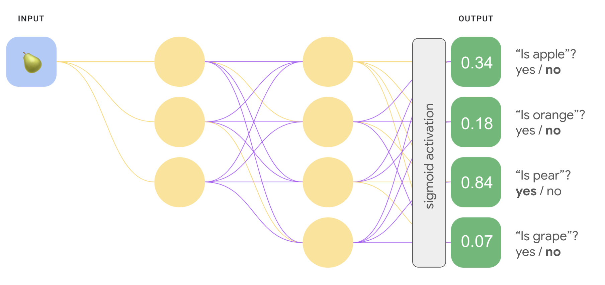
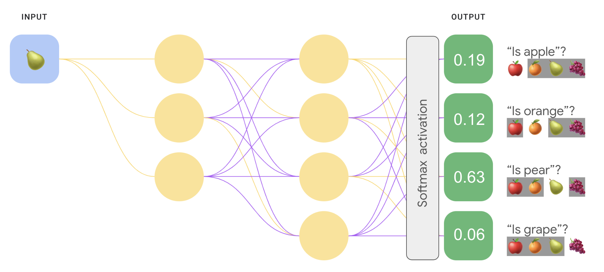

# Redes Neuronales
## Introducción

Es posible que recuerdes de los ejercicios de combinación de atributos en el módulo de datos categóricos que el siguiente 
problema de clasificación no es lineal:

"No lineal" significa que no se puede predecir con exactitud una etiqueta con una con el formato $b+w_1x_1+w_2x_2$. En 
otras palabras, la "superficie de decisión" no es una línea.

Sin embargo, si hacemos una combinación de atributos en los atributos $x_1$ y $x_2$, podemos luego representar la relación 
no lineal entre los dos atributos con un modelo lineal: $b+w_1x_1+w_2x_2+w_3x_3$, donde x_3 es la combinación de atributos  
$x_1$ y $x_2$.

Ahora, considera el siguiente conjunto de datos:

Es posible que también lo recuerdes de los ejercicios de combinación de atributos. que determinar las combinaciones de 
atributos correctas para ajustar un modelo lineal a estos datos requería un poco más de esfuerzo y experimentación.

Pero ¿qué pasaría si no tuvieras que hacer toda esa experimentación por tu cuenta? Las redes neuronales son un conjunto 
de arquitecturas de modelos diseñadas para encontrar patrones no lineales en los datos. Durante el entrenamiento de una red neuronal,
el modelo aprende automáticamente las combinaciones de atributos óptimas que se deben realizar en los datos de entrada para minimizar 
la pérdida.

## Nodos y capas ocultas

Para construir una red neuronal que aprenda no linealidades , comience con la siguiente estructura de modelo familiar: 
un modelo lineal de la forma $y' = b+w_1x_1+w_2x_2+w_3x_3$

### Añadiendo capas a la red

Tenga en cuenta que al ajustar los valores de ponderación y sesgo de la red en el Ejercicio 1 , no se modificó la relación matemática
general entre la entrada y la salida. Nuestro modelo sigue siendo lineal.

Pero ¿qué pasa si añadimos otra capa a la red, entre la capa de entrada y la de salida? En la terminología de las redes neuronales, las 
capas adicionales entre la capa de entrada y la de salida se denominan capas ocultas , y los nodos de estas capas se denominan neuronas.

El valor de cada neurona en la capa oculta se calcula de la misma manera que la salida de un modelo lineal: se toma la suma 
del producto de cada una de sus entradas (las neuronas de la capa de red anterior) y un parámetro de ponderación único, más el sesgo. 
De forma similar, las neuronas de la siguiente capa (en este caso, la capa de salida) se calculan utilizando los valores de las neuronas
de la capa oculta como entradas.

Esta nueva capa oculta permite a nuestro modelo recombinar los datos de entrada utilizando otro conjunto de parámetros.
¿Puede esto ayudar a nuestro modelo a aprender relaciones no lineales?
No, ya que los cálculos lineales realizados sobre la salida de cálculos lineales también lo son.

## Funciones de activación

Agregar capas ocultas a nuestra red no era suficiente para representar no linealidades. Las operaciones lineales realizadas 
 sobre operaciones lineales siguen siendo lineales.

¿Cómo se puede configurar una red neuronal para aprender relaciones no lineales entre valores? Necesitamos una forma de insertar
operaciones matemáticas no lineales en un modelo.

Ya hemos aplicado esta táctica anteriormente con la regresión logística. Donde hemos aplicado operaciones matemáticas no lineales 
al resultado de un modelo lineal. Convirtiendo la salida lineal en un valor continuo de 0 a 1 con la función sigmoideo. 
Podemos aplicar el mismo principio a nuestra red neuronal.

Aquí, la sigmoide sirve como una función de activación para la red neuronal, una transformación no lineal del valor de salida 
de una neurona antes de que el valor pase como entrada a los cálculos de la siguiente capa de la red neuronal.

Ahora que hemos añadido una función de activación, añadir capas tiene un mayor impacto. Apilar no linealidades sobre no linealidades
nos permite modelar relaciones muy complejas entre las entradas y las salidas previstas. En resumen, cada capa aprende efectivamente 
una función más compleja y de mayor nivel sobre las entradas sin procesar. 

Si desea comprender mejor cómo funciona esto, consulte [la excelente entrada del blog de Chris Olah](https://colah.github.io/posts/2014-03-NN-Manifolds-Topology/) .

### Funciones de activación comunes

Tres funciones matemáticas que se utilizan comúnmente como funciones de activación son:
- sigmoide
- tanh
- ReLU

#### Sigmoideo
La función sigmoidea (discutida anteriormente) realiza la siguiente transformación en la entrada $x$, produciendo un valor 
de salida entre 0 y 1: $$F(x)=\frac{1}{1+e^{-x}}$$

>[!NOTE]
> El término sigmoide se utiliza a menudo de forma más general para referirse a cualquier función con forma de S. 
> Un término técnicamente más preciso para la función específica $$F(x)=\frac{1}{1+e^{-x}}$$ es función logística.

#### Tanh
La función tanh (abreviatura de "tangente hiperbólica") transforma la entrada $x$ para producir un valor de salida entre –1 y 1:
$$F(x)=tanh(x)$$

> Tenga en cuenta que el rango de la función sigmoidea es de 0 a 1, y el rango de la función tanh es de –1 a 1.

#### ReLU

La función de activación de la unidad lineal rectificada (o ReLU, por sus siglas en inglés) transforma la salida utilizando 
el siguiente algoritmo:
- Si el valor de entrada $x$ es menor que 0, devuelve 0.
- Si el valor de entrada $x$ es mayor o igual a 0, devuelve el valor de entrada.

ReLU se puede representar matemáticamente utilizando la función max(): $$F(x) = max(0,x)$$

ReLU suele funcionar mejor como función de activación que una función suave como la sigmoidea o la tangente, ya que es menos 
susceptible al problema del gradiente de desaparición durante el entrenamiento de redes neuronales. ReLU también es mucho más 
fácil de calcular que estas funciones.

Con esta función, nuestro modelo puede aprender la relación no lineal entre las características y las etiquetas. Solo tendríamos
que explorar cuál es la configuración adecuada de capas, nodos y activaciones en nuestra red neuronal.

### Otras funciones de activación

En la práctica, cualquier función matemática puede servir como función de activación. Supongamos que $\sigma$ Representa nuestra
función de activación. El valor de un nodo en la red se obtiene mediante la siguiente fórmula: $$\sigma(w*x+b)$$

Keras ofrece compatibilidad inmediata con muchas funciones de activación . Aun así, recomendamos empezar con ReLU.

### Resumen 

Ahora nuestro modelo tiene todos los componentes estándar de lo que la gente suele querer decir cuando se refiere a una red neuronal:
- Un conjunto de nodos, análogos a las neuronas, organizados en capas. 
- Un conjunto de pesos y sesgos aprendidos que representan las conexiones entre cada capa de la red neuronal y la capa inferior. Esta capa puede ser otra capa de la red neuronal o algún otro tipo de capa. 
- Una función de activación que transforma la salida de cada nodo de una capa. Cada capa puede tener distintas funciones de activación.

> Una advertencia: las redes neuronales no son necesariamente siempre mejores que los cruces de características, pero ofrecen 
> una alternativa flexible que funciona bien en muchos casos.

## Entrenamiento con propagación inversa

La propagación inversa es el algoritmo de entrenamiento más común para las redes neuronales. Hace que el descenso del gradiente
sea factible para las redes neuronales de varias capas. Muchas bibliotecas de código de aprendizaje automático (como Keras) controlan
la retropropagación automáticamente, por lo que no necesitas realizar ninguno de los cálculos subyacentes por tu cuenta. 

### Prácticas recomendadas para el entrenamiento de redes neuronales

> NOTA: El algoritmo de entrenamiento de propagación inversa usa el concepto de cálculo de un gradiente para ajustar los pesos 
> del modelo y minimizar la pérdida. Por lo general, comprender y depurar los problemas que se indican a continuación requiere 
> algunos conocimientos básicos de cálculo.

#### Desaparición de gradientes

Los gradientes de las capas inferiores de la red neuronal (las más cercanas a la capa de entrada) pueden volverse muy pequeños. 
En las redes profundas (redes con más de una capa oculta), el cálculo de estos gradientes puede implicar la multiplicación de muchos 
términos pequeños.

Cuando los valores del gradiente se acercan a 0 para las capas inferiores, se dice que los gradientes "se desvanecen". Las capas 
con gradientes que desaparecen se entrenan muy lentamente o no se entrenan en absoluto.

La función de activación ReLU puede ayudar a evitar la desaparición de gradientes.

#### Gradientes que crecen demasiado

Si los pesos de una red son muy grandes, los gradientes de las capas más bajas implican productos de muchos términos grandes. En 
este caso, puedes tener gradientes que explotan, es decir, gradientes que se vuelven demasiado grandes para converger.

La normalización por lotes puede ayudar a evitar el crecimiento excesivo de gradientes, al igual que la reducción de la tasa 
de aprendizaje.

#### Unidades ReLU inactivas

Una vez que la suma ponderada de una unidad ReLU cae por debajo de 0, la unidad ReLU puede quedar atascada. Genera 0, por lo 
que no contribuye al resultado de la red, y los gradientes ya no pueden fluir a través de ella durante la retropropagación. Con una 
fuente de gradientes limitada, es posible que la entrada de ReLU nunca cambie lo suficiente como para volver a establecer la suma 
ponderada por encima de 0.

Reducir la tasa de aprendizaje puede ayudar a evitar que las unidades ReLU dejen de funcionar.

> También existen muchas variantes de ReLU diseñadas para abordar este problema específico, como LeakyReLU, que puedes considerar 
> usar como función de activación para evitar unidades ReLU inactivas.

#### Regularización de retirados

Otra forma de regularización, llamada regularización por retirados, es útil para las redes neuronales. Funciona omitiendo 
unidades de activación de forma aleatoria en una red para un solo paso del gradiente. Mientras más retires, mejor será la 
regularización:
- 0.0 = No se usa la regularización de retirados.
- 1.0 = Se descartan todos los nodos. El modelo no aprende nada.
- Los valores entre 0.0 y 1.0 son más útiles.

## Clasificación Multiclase

Algunos problemas de clases múltiples del mundo real implican elegir entre millones de clases separadas. Por ejemplo, considera
una clasificación de clases múltiples que puede identificar la imagen de casi cualquier cosa.

Hay dos variantes principales de la clasificación de clases múltiples:
- uno frente a todos.
- one-vs.-one, que generalmente se conoce como softmax

### Uno frente a todos
Uno frente a todos proporciona una forma de usar la clasificación binaria. para una serie de predicciones sí o no en múltiples
etiquetas posibles.

Dado un problema de clasificación con n soluciones posibles, la fórmula uno frente a todos contiene N clasificadores binarios independientes, un objeto 
binario de clasificación para cada resultado posible. Durante el entrenamiento, el modelo se ejecuta a través de una secuencia de
clasificadores binarios, el entrenamiento de cada uno para que responda de clasificación.

Por ejemplo, en el caso de la imagen de un trozo de fruta, cuatro se podrían entrenar diferentes reconocedores, cada uno 
para responder un sí/no diferente pregunta:
1. ¿Esta imagen es de una manzana?
2. ¿Esta imagen es de color naranja?
3. ¿Esta imagen es de una banana?
4. ¿Esta imagen es una uva?

Este enfoque es bastante razonable cuando la cantidad total de clases es pequeña, pero se vuelve cada vez más ineficiente a medida 
que la cantidad de clases aumenta.

Podemos crear un modelo más eficiente de uno vs todos con las redes neuronales, en vez de clasificadores binarios. En cuya cada nodo
salida representa una clase diferente. La siguiente imagen representa un caso:

### Uno frente a uno (softmax)
En la imagen anterior, las probabilidades conjuntas no suman 1. En una estrategia de uno frente a todos enfoque, se determina 
la probabilidad de cada conjunto binario de resultados independientemente de todos los demás conjuntos. Es decir, estamos determinando
la probabilidad de “manzana” en comparación con "no es una manzana" sin considerar la probabilidad de que nuestros otras opciones de 
frutas: “naranja”, “pera” o “uva”.

Pero ¿qué sucede si queremos predecir las probabilidades de cada fruta en relación con los demás? En este caso, en lugar de predecir 
“manzana” en comparación con "no manzana", queremos predecir "manzana" contra "naranja" versus "pera" en comparación con "uva". Este 
tipo de clasificación de clases múltiples se denomina clasificación de uno frente a uno.

Podemos implementar una clasificación de uno frente a uno con el mismo tipo de arquitectura de red utilizada para la clasificación
de uno frente a todos, con un cambio clave. Debemos aplicar una transformación diferente a la capa de salida.

Para uno frente a todos, aplicamos la función de activación sigmoidea a cada salida independiente, lo que da como resultado un 
valor de salida entre 0 y 1 para cada nodo, pero no garantizó que estos valores sumaran exactamente 1.

Para uno frente a uno, en cambio, podemos aplicar una función denominada softmax, que asigna probabilidades decimales a cada 
clase en un problema de clases múltiples, todas las probabilidades suman 1.0. Esta restricción adicional ayuda a que el entrenamiento
converja más rápido de lo que lo haría de otro modo.

La siguiente imagen vuelve a implementar nuestra clasificación de clases múltiples de uno frente a todos tarea como una tarea 
de uno frente a uno. Ten en cuenta que para ejecutar softmax, la función directamente que precede a la capa de salida (llamada 
capa softmax), debe tener la misma cantidad de nodos que la capa de salida.

#### Opciones de softmax
Considera las siguientes variantes de softmax:
- **Softmax completo** es el softmax del que estuvimos hablando. es decir, softmax calcula una probabilidad para cada clase posible.
- **Muestreo de candidatos** significa que softmax calcula una probabilidad para todas las etiquetas positivas, pero solo 
para una muestra aleatoria de con etiquetas negativas. Por ejemplo, si nos interesa determinar ya sea un beagle o un sabueso,
no tenemos que proporcionar probabilidades para cada ejemplo que no sea un perro.

Softmax completo es bastante económico cuando la cantidad de clases es pequeña. pero se vuelve demasiado costoso cuando aumenta 
la cantidad de clases. El muestreo de candidatos puede mejorar la eficiencia en los problemas que tienen una gran cantidad de clases.

#### Una etiqueta frente a muchas

Softmax supone que cada ejemplo es miembro de exactamente una clase. Sin embargo, algunos ejemplos pueden ser miembros de varias
clases de manera simultánea. Para tales ejemplos:
- No puedes usar softmax.
- Debes usar regresiones logísticas múltiples.

Por ejemplo, el modelo de uno frente a uno en la figura 9 de arriba supone que cada entrada mostrará exactamente un tipo de fruta: 
una manzana, una naranja, una pera o una uva. Sin embargo, si una imagen de entrada puede contener varios tipos de frutas, 
tazón de manzanas y naranjas, tendrás que usar varias regresiones.