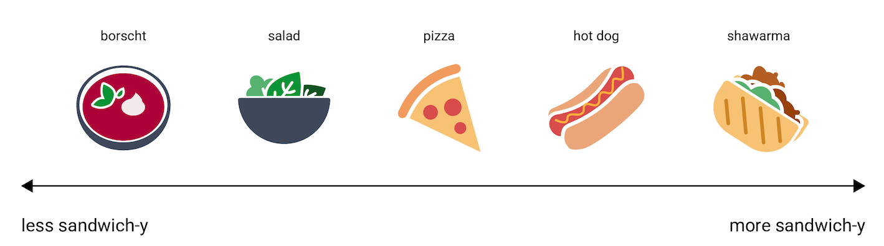
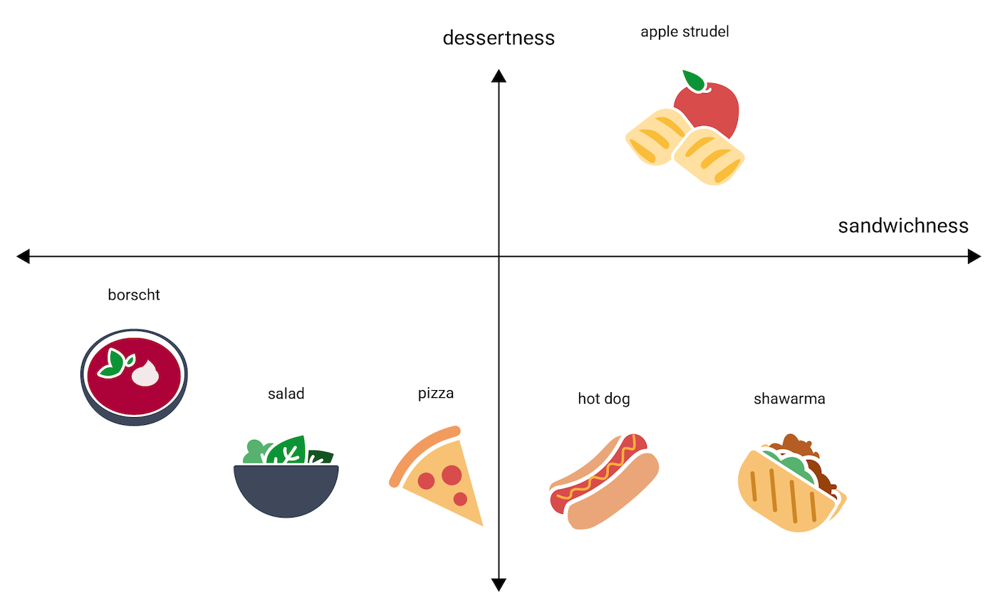
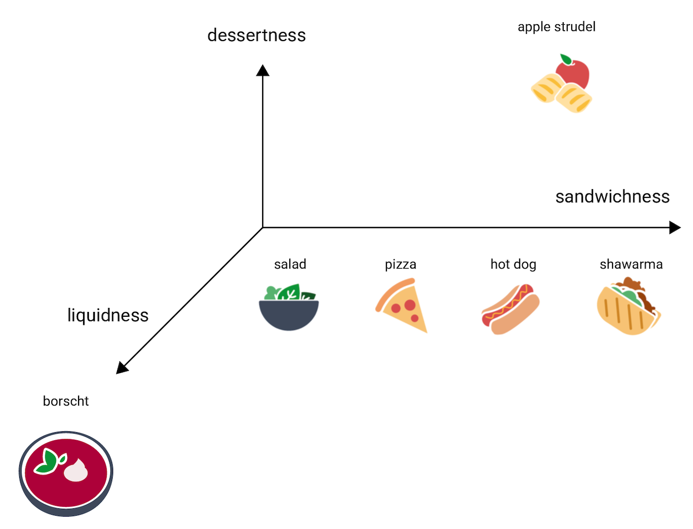
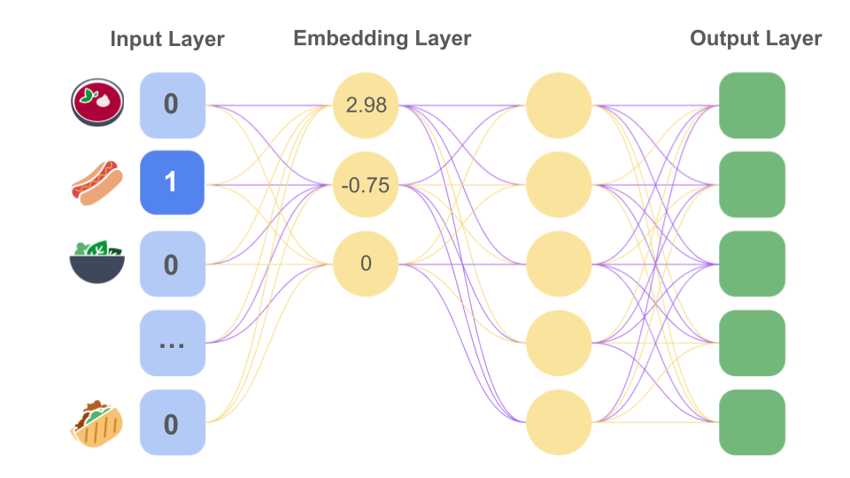

# Incorporaciones
## Introducción

Imagina que estás desarrollando una aplicación que recomienda comidas. Un usuario ingresa sus comidas favoritas y la app le 
sugiere opciones similares que podrían gustarle. Quieres desarrollar un modelo de aprendizaje automático (AA) que pueda predecir 
comidas similares, de modo que tu app pueda brindar recomendaciones de alta calidad ("Como te gustan los panqueques, te recomendamos 
los crepes").

Para entrenar tu modelo, seleccionas un conjunto de datos de 5,000 comidas populares, incluidas borscht, perro caliente, ensalada,
pizza y shawarma.

Crea una función meal que contenga una representación de codificación one-hot de cada una de las comidas del conjunto de datos. 
La codificación hace referencia al proceso de elegir una representación numérica inicial de datos para entrenar el modelo.

### Dificultades de las representaciones de datos dispersas

Si revisas estas codificaciones one-hot, observarás que la representación de los datos presenta varios problemas.
- **Cantidad de pesos**. Los vectores de entradas grandes representan una gran cantidad de pesos para una red neuronal. Con 
M entradas en tu codificación one-hot y N nodos en la primera capa de la red después de la entrada, el modelo tiene que entrenar
MxN pesos para esa capa.
- **Cantidad de datos**. Cuantos más pesos tenga tu modelo, más datos se necesitarán para entrenarlo de manera eficaz.
- **Cantidad de procesamiento**. Cuantos más pesos, más procesamiento se necesita para entrenar y usar el modelo. Esto puede hacer que 
se supere fácilmente la capacidad del hardware.
- **Cantidad de memoria**. Cuantos más pesos tenga tu modelo, más memoria se necesitará en los aceleradores para entrenarlo y ponerlo
en producción. Escalar esto de manera eficiente es muy difícil.
- **Dificultad para admitir aprendizaje automático en el dispositivo (ODML)**. Si esperas ejecutar tu modelo de AA en dispositivos 
locales (en lugar de publicarlo), deberás reducir la cantidad de pesos del modelo.

Por ello, crearemos embeddings, que son representaciones de menos dimensiones de datos dispersos que resuelven esos problemas.

## Espacio de embedding y embeddings estáticos

Un embedding es una representación vectorial de datos en un espacio de embedding. En general, un modelo encuentra posibles embeddings
proyectando el espacio de alta dimensión vectorial de datos iniciales en un espacio de menor dimensión.

Los embeddings facilitan el aprendizaje automático con vectores de atributos grandes. A veces, las posiciones relativas de los 
elementos en el espacio de embedding tienen una posible relación semántica, pero a menudo el proceso de encontrar un espacio de 
menor dimensión, y las posiciones relativas en ese espacio, no es interpretable para los humanos, y los embeddings resultantes son 
difíciles de entender.

Aun así, en aras de la comprensión humana, para dar una idea de cómo los vectores de embedding representan información, ten en 
cuenta la siguiente representación de unidimensional de los platos perro caliente, pizza, ensalada, shawarma y borscht, en una escala de 
"lo menos parecido a un sándwich" a "lo más parecido a un sándwich". La única dimensión es una medida imaginaria de "sandwicheidad".

En esta línea, ¿dónde quedaría un strudel de manzana? Es discutible, pero podría colocarse entre hot dog y shawarma. Sin embargo, el strudel 
de manzana también parece tener una dimensión adicional de dulzor o postreidad que lo diferencia mucho de las otras opciones. La siguiente
figura muestra este caso agregando una dimensión de "postreidad":

Un embedding representa cada elemento en un espacio de n dimensiones con n números de puntos flotantes (en general, entre –1 y 1, o 0 y 1).
En la primera imagen representa cada comida en un espacio de una dimensión con una única coordenada, mientras que en la segunda imagen representa 
cada comida en un espacio de dos dimensiones con dos coordenadas. En la segunda imagen, "strudel de manzana" está en el cuadrante superior 
derecho del gráfico y se podría asignar al punto (0.5, 0.3), mientras que "perro caliente" está en el cuadrante inferior derecho del 
gráfico y se podría asignar al punto (0.2, –0.5).

En un embedding, la distancia entre dos elementos cualquiera se puede calcular matemáticamente y se puede interpretar como una
medida de similitud relativa entre esos dos elementos. Dos elementos que están cerca entre ellos, como shawarma y hot dog en la segunda
imagen, están más relacionados en la representación del modelo de datos que dos elementos más distantes entre ellos, como apple strudel 
y borscht.

Ahora considera el borscht, que es mucho más líquido que los otros elementos. Esto sugiere una tercera dimensión, liquiditud o qué 
tan líquido puede ser una comida. Al agregar esa dimensión, los elementos podrían visualizarse en 3 dimensiones de la siguiente forma:

Observa cuánta información se expresa en estas tres dimensiones. Podrías imaginar agregar dimensiones adicionales, como cuánto horneado o cuánta carne podría tener una comida, 
aunque los espacios de 4, 5 o más dimensiones son difíciles de visualizar.

### Espacios de embedding reales
En el mundo real, los espacios de embedding tienen **d dimensiones**, en donde **d** es mucho más que 3, aunque **menos que la dimensionalidad 
de los datos**, y las relaciones entre los datos no son necesariamente tan intuitivas como en la ilustración artificial de arriba 
(en el caso de embeddings de palabras, d suele ser 256, 512 o 10241).

En la práctica, el profesional de AA suele configurar la tarea específica y la cantidad de dimensiones de embedding. Posteriormente, 
el modelo intenta organizar los ejemplos de entrenamiento para que estén cerca en un espacio de embedding con una cantidad especificada
de dimensiones, o ajustes para la cantidad de dimensiones, si d no es fijo. Las dimensiones individuales casi nunca son entendibles 
como "postreidad" o "liquiditud". En ocasiones, lo que "significan" se puede inferir, pero no siempre sucede.

Los embeddings, en general, serán específicos de la tarea y diferirán entre ellas cuando difiera la tarea. Por ejemplo, los embeddings 
generados por un modelo de clasificación vegetariano en comparación con uno no vegetariano serán diferentes a los embeddings generados 
por un modelo que sugiera platos basados en el momento del día o la estación del año. Por ejemplo, es probable que "cereal" y "salchicha
de desayuno" estén cerca en el espacio de embedding de un modelo de momento del día, pero lejos en el espacio de embedding de un
modelo vegetariano en comparación con un modelo no vegetariano.

### Embeddings estáticos

Si bien los embeddings difieren según la tarea, una tarea tiene una aplicabilidad general: predecir el contexto de una palabra. 
Los modelos entrenados para predecir el contexto de una palabra asumen que las palabras que aparecen en contextos similares 
están relacionadas semánticamente. Por ejemplo, los datos de entrenamiento que incluyen las oraciones "Anduvieron en burro por 
el Gran Cañón" y "Anduvieron a caballo por el cañón" sugieren que "caballo" aparece en un contexto similar a "burro". Resulta que 
los embeddings basados en la similitud semántica funcionan bien para muchas tareas de idiomas generales.

Aunque es un ejemplo más antiguo y fue sustituido en gran parte por otros modelos, el modelo word2vec sigue siendo útil a modo 
de ilustración. word2vec se entrena con un corpus de documentos para obtener un único embedding global por palabra. Cuando cada
palabra o dato tiene un único vector de embedding, se denomina embedding estático. 

> Nota: word2vec puede referirse tanto a un algoritmo para obtener embeddings de palabras estáticas como a un conjunto de 
> vectores de palabras que se entrenaron previamente con ese algoritmo. En este módulo, se usa en ambos sentidos.

La red neuronal word2vec aprende a representar palabras como vectores de alta dimensionalidad. Con las siguientes partes:
- Capa de entrada: Nodos de entrada, tenemos uno por cada palabra de nuestro vocabulario.
- Capa oculta 1: Tenemos d nodos intermedios, donde d son las dimensiones de nuestra incorporación deseada. Se la denomina capa de
proyección o embedding. No es necesario una función de activación en esta capa.
- Capa oculta 2: Sigue a la capa 1, esta sí presenta función de activación para procesar aún más los datos. Tenemos d nodos.
- Capa de salida: Tras la capa 2, tenemos la capa de salida. Que será igual que la de entrada, 1 nodo por palabra de nuestro vocabulario.
- Función softmax: Sigue a la capa de salida para normalizar.

**¿Cómo se entrena?** Tomaremos textos y crearemos pares de (entrada, salida). La entrada es una palabra que aparece en el texto, 
y la salida(el valor que intentamos predecir) será una palabra próxima(múltiples pares si cogemos varias palabras próximas). 
A estos pares, se les denomina **skip-grams**. Cuántos más tengamos mejor, aunque más tardará en entrenarse.

Tras entrenar, los pesos entre la primera y segunda capa oculta serán nuestra matriz de incorporación. Es decir, para encontrar la
incorporación de una palabra apila todos los pesos de esa palabra en un vector. Estos vectores tendrán menos dimensiones que nuestra
representación one-hot y codificarán información sobre el significado de las palabras.

Al final, las palabras que presenten más relación entre sí, estarán más próximas entre sí en el espacio vectorial. Aunque esta
implementación no es eficiente ni en tiempo ni en memoria.

Las investigaciones sugieren que estos embeddings estáticos, una vez entrenados, codifican cierto grado de información semántica, 
en especial en relaciones entre palabras. Es decir, las palabras que se usan en contextos similares estarán más cerca en un espacio 
de embedding. Los vectores de embeddings específicos que se generen dependerán del corpus que se utilice para el entrenamiento. 

> Para obtener detalles, consulta T. Mikolov et al (2013), ["Efficient estimation of word representations in vector space"](https://arxiv.org/abs/1301.3781).

## Como obtener incorporaciones

### Técnicas de reducción de dimensiones

Existen muchas técnicas matemáticas que capturan las estructuras importantes de un espacio de dimensionalidad alta en uno de 
dimensionalidad baja. En teoría, cualquiera de estas técnicas puede usarse para crear un embedding para un sistema de aprendizaje 
automático.

Por ejemplo, el análisis de componentes principales (ACP) se utiliza para crear embeddings de palabras. Dado un conjunto de 
instancias, como vectores de bolsa de palabras, el ACP intenta encontrar dimensiones altamente correlacionadas que se puedan 
contraer en una sola dimensión.

### Entrenamiento de embeddings como parte de una red neuronal
Puedes crear un embedding mientras entrenas una red neuronal para tu tarea objetivo. Este enfoque te proporciona un embedding 
personalizado para tu sistema particular, pero es posible que lleve más tiempo que entrenar el embedding por separado.

En general, puedes crear una capa oculta de tamaño d en tu red neuronal que actúe como capa de embedding, donde d representa tanto
la cantidad de nodos en la capa oculta como la cantidad de dimensiones en el espacio de embedding. Esta capa de embedding se puede 
combinar con otros atributos y capas ocultas. Como en cualquier red neuronal profunda, los parámetros se optimizarán durante el 
entrenamiento para minimizar la pérdida en los nodos de la capa de salida de la red.

Volviendo a nuestro ejemplo de recomendación de comida, el objetivo es predecir nuevas comidas que podrían gustarle a un usuario 
en función de sus comidas favoritas actuales. En primer lugar, podemos compilar datos adicionales sobre las cinco comidas favoritas 
de los usuarios. A continuación, podemos modelar esta tarea como un problema de aprendizaje supervisado. Establecemos cuatro de las
cinco comidas favoritas como datos del atributo y, luego, establecemos de manera aleatoria la quinta comida como etiqueta positiva 
que nuestro modelo espera predecir, optimizando las predicciones con una pérdida softmax.

Durante el entrenamiento, el modelo de red neuronal aprenderá los pesos óptimos para los nodos de la primera capa oculta, que funciona 
como capa de embedding. Por ejemplo, si el modelo contiene tres nodos en la primera capa oculta, puede determinar que las tres 
dimensiones más pertinentes de los alimentos son condición de sándwich, condición de postre y condición de líquido. La siguiente imagen
muestra el valor de entrada de codificación one-hot para "perro caliente" transformado en un vector tridimensional.

Durante el entrenamiento, los pesos de la capa de embedding se optimizarán para que los vectores de embedding de ejemplos similares 
estén más próximos entre sí. Como se mencionó previamente, las dimensiones que un modelo real elige para sus embeddings tienen
pocas probabilidades de ser tan intuitivas o comprensibles como la de este ejemplo.

### Embeddings contextuales
Una limitación de los vectores de embedding estáticos word2vec es que las palabras pueden tener diferentes significados según 
el contexto. "Ya" puede tener un valor temporal, o de afirmación en "Ya, claro." "Mano" puede hacer referencia a la parte del cuerpo, 
a ayudar a una persona ("echar una mano"), a la persona que juega en primer lugar en un juego o incluso a una dirección o sentido 
("por la mano derecha"), entre otras posibilidades.

Sin embargo, con los embeddings estáticos, cada palabra está representada por un punto único en el espacio vectorial, incluso 
aunque pueda tener una gran variedad de significados. En el último ejercicio, descubriste las limitaciones de los embeddings 
estáticos para la palabra naranja, que puede hacer referencia a un color o una fruta. Con solo un embedding estático, naranja 
siempre será más próxima a otros colores que a jugo cuando se entrene con el conjunto de datos word2vec.

Los embeddings contextuales se desarrollaron para resolver esta limitación. Los embeddings contextuales permiten que una palabra 
se represente con varios embeddings que incorporan información sobre las palabras circundantes, así como sobre la propia palabra. 
Por lo tanto, naranja tendría un embedding distinto para cada oración única que la contenga en el conjunto de datos.

Algunos métodos de creación de embeddings contextuales, como ELMo, toman el embedding estático de un ejemplo, como el vector 
word2vec para una palabra en una oración, y lo transforman en una función que incorpora información de las palabras circundantes. 
De este modo, se obtiene un embedding contextual.
- En el caso específico de los modelos ELMo, el embedding estático se agrega con los embeddings obtenidos de otras capas, que codifican 
lecturas de adelante hacia atrás y de atrás hacia adelante de la oración.
- Los modelos [BERT](https://developers.google.com/machine-learning/glossary?hl=es-419#bert-bidirectional-encoder-representations-from-transformers) enmascaran parte de la secuencia que el modelo toma como entrada.
- Los modelos Transformer usan una capa de [autoatención](https://developers.google.com/machine-learning/glossary?hl=es-419#self-attention-also-called-self-attention-layer) 
para medir la relevancia de las demás palabras de una secuencia para cada palabra individual. También agregan la columna pertinente 
de una matriz de embedding posicional (consulta codificación posicional) para cada embedding de token aprendido previamente, elemento
por elemento, para producir el embedding de entrada que se inserta en el resto del modelo como inferencia. Este embedding de entrada,
único para cada secuencia textual, es un embedding contextual.

Aunque los modelos descritos anteriormente son modelos de lenguaje, los embeddings contextuales son útiles en otras tareas generativas,
como la generación de imágenes. Un embedding de valores RGB de los píxeles de una foto de un caballo brinda más información al modelo 
cuando se combina con una matriz posicional que representa cada píxel y algo de codificación de los píxeles vecinos (lo que crea 
embeddings contextuales), que los embeddings estáticos originales de los valores RGB solos.
