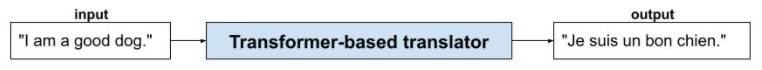
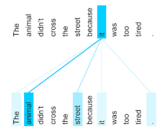

# Introducción a los modelos de lenguaje grandes

## ¿Qué es un modelo de lenguaje?

Un modelo de lenguaje estima la probabilidad de que un token o una secuencia de tokens aparezcan dentro de una secuencia más 
larga de tokens. Un token puede ser una palabra, una subpalabra (un subconjunto de una palabra) o incluso un solo carácter.

La mayoría de los modelos de lenguaje modernos tokenizan por subpalabras, es decir, por fragmentos de texto que contienen 
significado semántico. Los fragmentos pueden variar en longitud, desde caracteres únicos, como signos de puntuación o la s 
posesiva, hasta palabras completas. Los prefijos y sufijos se pueden representar como subpalabras separadas. Por ejemplo, 
la palabra unwatched podría representarse con las siguientes tres subpalabras:
- un (el prefijo)
- watch(la raíz)
- ed (el sufijo)

La palabra cats podría representarse con las siguientes dos subpalabras:
- cat(la raíz)
- s(el sufijo)

Una palabra más compleja, como "antidisestablishmentarianism", podría representarse como seis subpalabras:
- anti
- dis
- establish
- ment
- arian
- ism

La tokenización es específica para cada idioma, por lo que la cantidad de caracteres por token varía según el idioma. En inglés,
un token corresponde a aproximadamente 4 caracteres o a 3/4 de una palabra, por lo que 400 tokens equivalen a 300 palabras en inglés.

Los tokens son la unidad atómica o la unidad más pequeña del modelado del lenguaje.
Los tokens ahora también se aplican correctamente a la [visión por computadora](https://ai.googleblog.com/2023/03/scaling-vision-transformers-to-22.html) 
y la [generación de audio](https://ai.googleblog.com/2022/10/audiolm-language-modeling-approach-to.html).

Analiza la siguiente oración y los tokens que podrían completarla:
> When I hear rain on my roof, I _______ in my kitchen.

Un modelo de lenguaje determina las probabilidades de diferentes tokens o secuencias de tokens para completar ese espacio en
blanco. Por ejemplo, la siguiente tabla de probabilidades identifica algunos tokens posibles y sus probabilidades:

| Probabilidad | Tokens                |
|--------------|-----------------------|
| 9.4%         | cocinar sopa          |
| 5.2%         | calentar una tetera   |
| 3.6%         | acobardarse           |
| 2.5%         | siesta                |
| 2.2%         | relajarse             |

En algunas situaciones, la secuencia de tokens podría ser una oración, un párrafo o incluso un ensayo completo.

Una aplicación puede usar la tabla de probabilidades para hacer predicciones. La predicción puede ser la probabilidad más alta 
(por ejemplo, "cocinar sopa") o una selección aleatoria de tokens que tengan una probabilidad superior a un umbral determinado.

Estimar la probabilidad de lo que completa el espacio en blanco en una secuencia de texto se puede extender a tareas más complejas, 
como las siguientes:
- Se está generando el texto.
- Traduce texto de un idioma a otro.
- Resumir documentos.

Al modelar los patrones estadísticos de los tokens, los modelos de lenguaje modernos desarrollan representaciones internas extremadamente 
potentes del lenguaje y pueden generar lenguaje plausible.

### Modelos de lenguaje de n-gramas
Los n-gramas son secuencias ordenadas de palabras que se usan para crear modelos de lenguaje, donde N es la cantidad de palabras
en la secuencia. Por ejemplo, cuando N es 2, el N-grama se denomina 2-grama (o bigrama); cuando N es 5, el N-grama se denomina 5-grama. 
Dada la siguiente frase en un documento de entrenamiento:
> you are very nice

Los 2-gramas resultantes son los siguientes:
- you are
- are very
- very nice

Cuando N es 3, el n-grama se denomina 3-grama (o trigrama). Con esa misma frase, los trigramas resultantes son los siguientes:
- you are very
- are very nice

Con dos palabras como entrada, un modelo de lenguaje basado en trigramas puede predecir la probabilidad de la tercera palabra. 
Por ejemplo, dadas las siguientes dos palabras:
> orange is

Un modelo de lenguaje examina todos los trigramas diferentes derivados de su corpus de entrenamiento que comienzan con orange is 
para determinar la tercera palabra más probable. Cientos de trigramas podrían comenzar con las dos palabras orange is, pero puedes
enfocarte solo en las siguientes dos posibilidades:
> orange is ripe

> orange is cheerful

La primera posibilidad (orange is ripe) se refiere a la fruta naranja, mientras que la segunda (orange is cheerful) se refiere 
al color naranja.

### Contexto

En los modelos de lenguaje, el contexto es información útil antes o después del token objetivo. El contexto puede ayudar a
un modelo de lenguaje a determinar si "naranja" se refiere a una fruta cítrica o a un color.

El contexto puede ayudar a un modelo de lenguaje a realizar mejores predicciones, pero ¿un 3-grama proporciona suficiente contexto?
Lamentablemente, el único contexto que proporciona un trigrama son las dos primeras palabras. Por ejemplo, las dos palabras orange 
is no proporcionan suficiente contexto para que el modelo de lenguaje prediga la tercera palabra. Debido a la falta de contexto, 
los modelos de lenguaje basados en trigramas cometen muchos errores.

Los N-gramas más largos sin duda proporcionarían más contexto que los más cortos. Sin embargo, a medida que N aumenta, la ocurrencia 
relativa de cada instancia disminuye. Cuando N se vuelve muy grande, el modelo de lenguaje suele tener solo una instancia de cada
ocurrencia de N tokens, lo que no es muy útil para predecir el token objetivo.

### Redes neuronales recurrentes
Las redes neuronales recurrentes proporcionan más contexto que los n-gramas. Una red neuronal recurrente es un tipo de red neuronal 
que se entrena en una secuencia de tokens. Por ejemplo, una red neuronal recurrente puede aprender gradualmente (y aprender a ignorar) 
el contexto seleccionado de cada palabra en una oración, de manera similar a como lo harías cuando escuchas a alguien hablar. Una red 
neuronal recurrente grande puede obtener contexto de un pasaje de varias oraciones.

Si bien las redes neuronales recurrentes aprenden más contexto que los N-gramas, la cantidad de contexto útil que pueden intuir sigue
siendo relativamente limitada. Las redes neuronales recurrentes evalúan la información "token por token". En cambio, los modelos de
lenguaje grandes pueden evaluar todo el contexto a la vez.

Ten en cuenta que el entrenamiento de redes neuronales recurrentes para contextos largos está limitado por el problema de la 
desaparición del gradiente.

 ## ¿Qué es un LLM?

Una tecnología más reciente, los modelos de lenguaje grandes (LLM), predicen un token o una secuencia de tokens, a veces muchos 
párrafos de tokens predichos. Recuerda que un token puede ser una palabra, una subpalabra (un subconjunto de una palabra) o incluso 
un solo carácter. Los LLM realizan predicciones mucho mejores que los modelos de lenguaje de N-gramas o las redes neuronales recurrentes
por los siguientes motivos:
- Los LLM contienen muchos más parámetros que los modelos recurrentes.
- Los LLM recopilan mucho más contexto.

### ¿Qué es un Transformer?
Los Transformers son la arquitectura más avanzada para una amplia variedad de aplicaciones de modelos de lenguaje, como la traducción:



Los Transformers completos constan de un codificador y un decodificador:
- Un codificador convierte el texto de entrada en una representación intermedia. Un codificador es una enorme red neuronal.
- Un decodificador convierte esa representación intermedia en texto útil. Un decodificador también es una red neuronal enorme.

También existen arquitecturas solo con codificador y solo con decodificador:
- Las arquitecturas que solo incluyen un codificador asignan el texto de entrada a una representación intermedia (a menudo, una 
capa de embedding). Los casos de uso de las arquitecturas solo de codificador incluyen los siguientes:
  - Predecir cualquier token en la secuencia de entrada (que es el rol convencional de los modelos de lenguaje).
  - Crear una incorporación sofisticada que podría servir como entrada para otro sistema, como un clasificador
- Las arquitecturas solo de decodificador generan tokens nuevos a partir del texto ya generado. Por lo general, los modelos solo de 
decodificador se destacan en la generación de secuencias. Los modelos modernos solo de decodificador pueden usar su capacidad de
generación para crear continuaciones de historiales de diálogo y otras instrucciones.

#### ¿Qué es la autoatención?
Para mejorar el contexto, los modelos Transformer se basan en gran medida en un concepto llamado autoatención. De manera efectiva, 
en nombre de cada token de entrada, la autoatención hace la siguiente pregunta:
> "¿Cuánto afecta cada otro token de entrada a la interpretación de este token?"

El término "auto" en "autoatención" hace referencia a la secuencia de entrada. Algunos mecanismos de atención ponderan las relaciones
de los tokens de entrada con los tokens de una secuencia de salida, como una traducción, o con los tokens de alguna otra secuencia. 
Sin embargo, la autoatención solo pondera la importancia de las relaciones entre los tokens de la secuencia de entrada.

Para simplificar las cosas, supón que cada token es una palabra y que el contexto completo es solo una oración. Considera la siguiente 
oración:
> The animal didn't cross the street because it was too tired.

La oración anterior contiene once palabras. Cada una de las once palabras presta atención a las otras diez y se pregunta qué importancia
tiene cada una de ellas para sí misma. Por ejemplo, observa que la oración contiene el pronombre it. Los pronombres suelen ser ambiguos.
Por lo general, el pronombre it hace referencia a un sustantivo o una frase nominal recientes, pero, en la oración de ejemplo, 
¿a qué sustantivo reciente hace referencia it: al animal o a la calle?

El mecanismo de autoatención determina la relevancia de cada palabra cercana para el pronombre it. En la figura 3, se muestran los 
resultados: cuanto más azul es la línea, más importante es esa palabra para el pronombre it. Es decir, animal es más importante que 
calle para el pronombre it.



Por el contrario, supongamos que la última palabra de la oración cambia de la siguiente manera:
> The animal didn't cross the street because it was too wide.

En esta oración revisada, la autoatención debería calificar calle como más relevante que animal para el pronombre lo.

Algunos mecanismos de autoatención son bidireccionales, lo que significa que calculan las puntuaciones de relevancia para los
tokens que preceden y siguen a la palabra a la que se presta atención. Por ejemplo, en la figura 3, observa que se examinan las 
palabras a ambos lados de it. Por lo tanto, un mecanismo de autoatención bidireccional puede recopilar contexto de las palabras
a ambos lados de la palabra a la que se presta atención. Por el contrario, un mecanismo de autoatención unidireccional solo puede
recopilar contexto de las palabras que se encuentran a un lado de la palabra a la que se presta atención. La autoatención bidireccional
es especialmente útil para generar representaciones de secuencias completas, mientras que las aplicaciones que generan secuencias 
token por token requieren autoatención unidireccional. Por este motivo, los codificadores usan la autoatención bidireccional, mientras
que los decodificadores usan la unidireccional.

#### ¿Qué es la autoatención multicabezal y multicapa?
Por lo general, cada capa de autoatención se compone de varios cabezales de autoatención. El resultado de una capa es una operación 
matemática (por ejemplo, promedio ponderado o producto escalar) del resultado de los diferentes encabezados.

Dado que los parámetros de cada encabezado se inicializan con valores aleatorios, los diferentes encabezados pueden aprender diferentes 
relaciones entre cada palabra a la que se presta atención y las palabras cercanas. Por ejemplo, el encabezado de autoatención descrito
en la sección anterior se centró en determinar a qué sustantivo se refería el pronombre it. Sin embargo, otros encabezados de autoatención
dentro de la misma capa pueden aprender la relevancia gramatical de cada palabra para todas las demás, o bien aprender otras interacciones.

Un modelo Transformer completo apila varias capas de autoatención una sobre otra. La salida de la capa anterior se convierte en la 
entrada de la siguiente. Este apilamiento permite que el modelo cree comprensiones del texto progresivamente más complejas y abstractas.
Si bien las capas anteriores pueden enfocarse en la sintaxis básica, las capas más profundas pueden integrar esa información para comprender
conceptos más matizados, como el sentimiento, el contexto y los vínculos temáticos en toda la entrada.

La autoatención obliga a cada palabra del contexto a aprender la relevancia de todas las demás palabras del contexto. Por lo tanto, 
es tentador proclamar que este es un problema de O(N2), donde:
- N es la cantidad de tokens en el contexto.

Como si la notación Big O anterior no fuera lo suficientemente inquietante, los Transformers contienen varias capas de autoatención y
varios encabezados de autoatención por capa de autoatención, por lo que la notación Big O es en realidad la siguiente:
- $O(N^2 · S · D)$

Donde:
- Aquí, S es la cantidad de capas de autoatención.
- D es la cantidad de encabezados por capa.

Es probable que nunca entrenes un LLM desde cero. Entrenar un LLM de nivel industrial requiere enormes cantidades de experiencia en AA, 
recursos de procesamiento y tiempo. 

El ingrediente principal para crear un LLM es una cantidad fenomenal de datos de entrenamiento (texto), que suelen estar algo filtrados. 
La primera fase del entrenamiento suele ser alguna forma de aprendizaje no supervisado sobre esos datos de entrenamiento. Específicamente, 
el modelo se entrena con predicciones enmascaradas, lo que significa que ciertos tokens en los datos de entrenamiento se ocultan de forma 
intencional. El modelo se entrena intentando predecir esos tokens faltantes. Por ejemplo, supongamos que la siguiente oración forma parte
de los datos de entrenamiento:
> The residents of the sleepy town weren't prepared for what came next.

Se quitan los tokens aleatorios, por ejemplo:
> The ___ of the sleepy town weren't prepared for ___ came next.

Un LLM es solo una red neuronal, por lo que la pérdida (la cantidad de tokens enmascarados que el modelo consideró correctamente) guía
el grado en que la propagación inversa actualiza los valores de los parámetros.

Un modelo basado en Transformer entrenado para predecir datos faltantes aprende gradualmente a detectar patrones y estructuras 
de orden superior en los datos para obtener pistas sobre el token faltante. Considera el siguiente ejemplo de instancia enmascarada:
> Oranges are traditionally ___ by hand. Once clipped from a tree, __ don't ripen.

El entrenamiento exhaustivo con una enorme cantidad de ejemplos enmascarados permite que un LLM aprenda que "cosechó" o 
"recolectó" son coincidencias con alta probabilidad para el primer token, y que "naranjas" o "ellos" son buenas opciones para
el segundo token.

Un paso de entrenamiento adicional opcional llamado [ajuste de instrucciones](https://developers.google.com/machine-learning/glossary?hl=es-419#instruction-tuning)
puede mejorar la capacidad de un LLM para seguir instrucciones.

### ¿Por qué los Transformers son tan grandes?

Los Transformers contienen cientos de miles de millones o incluso billones de parámetros. En general, en este curso se recomienda 
crear modelos con una menor cantidad de parámetros en lugar de aquellos con una mayor cantidad. Después de todo, un modelo con una 
menor cantidad de parámetros usa menos recursos para generar predicciones que un modelo con una mayor cantidad de parámetros. Sin embargo,
las investigaciones demuestran que los transformadores con más parámetros superan de forma constante a los que tienen menos parámetros.

### Pero ¿cómo genera texto un LLM?
Viste cómo los investigadores entrenan a los LLM para predecir una o dos palabras faltantes, y es posible que no te haya impresionado. 
Después de todo, predecir una o dos palabras es esencialmente la función de autocompletar integrada en varios softwares de texto, 
correo electrónico y creación. Es posible que te preguntes cómo los LLM pueden generar oraciones, párrafos o haikus sobre el arbitraje.

De hecho, los LLM son, en esencia, mecanismos de autocompletar que pueden predecir (completar) automáticamente miles de tokens. 
Por ejemplo, considera una oración seguida de una oración enmascarada:
> My dog, Max, knows how to perform many traditional dog tricks.

> ___ (masked sentence)

Un LLM puede generar probabilidades para la oración enmascarada, incluidas las siguientes:
| Probabilidad | Palabra(s)                |
|--------------|-----------------------|
| 3.1%         | Por ejemplo, puede sentarse, quedarse y darse la vuelta.          |
| 2.9%         | Por ejemplo, sabe cómo sentarse, quedarse quieto y darse la vuelta.   |

Un LLM lo suficientemente grande puede generar probabilidades para párrafos y ensayos completos. Puedes considerar las preguntas 
de un usuario a un LLM como la oración "dada" seguida de una máscara imaginaria. Por ejemplo:
> User's question: What is the easiest trick to teach a dog?

> LLM's response:  ___

El LLM genera probabilidades para varias respuestas posibles.

Como otro ejemplo, un LLM entrenado con una gran cantidad de "problemas verbales" matemáticos puede dar la apariencia de 
realizar un razonamiento matemático sofisticado. Sin embargo, esos LLM básicamente solo completan automáticamente una instrucción
de problema de palabras.

### Beneficios de los LLMs
Los LLM pueden generar texto claro y fácil de entender para una amplia variedad de públicos objetivo. Los LLMs pueden hacer 
predicciones sobre las tareas para las que se entrenaron de forma explícita. Algunos investigadores afirman que los LLM también 
pueden hacer predicciones para las entradas con las que no se entrenaron de forma explícita, pero otros investigadores refutaron 
esta afirmación.

### Problemas con los LLMs
Entrenar un LLM implica muchos problemas, incluidos los siguientes:
- Recopilación de un enorme conjunto de entrenamiento.
- Consumen varios meses y enormes recursos de procesamiento y electricidad.
- Resolver desafíos de paralelismo.

Usar LLMs para inferir predicciones causa los siguientes problemas:
- Los LLMs alucinan, lo que significa que sus predicciones suelen contener errores.
- Los LLM consumen enormes cantidades de recursos de procesamiento y electricidad. Por lo general, entrenar LLMs con conjuntos 
de datos más grandes reduce la cantidad de recursos necesarios para la inferencia, aunque los conjuntos de entrenamiento más
grandes requieren más recursos de entrenamiento.
- Al igual que todos los modelos de AA, los LLM pueden mostrar todo tipo de sesgos.

## Ajuste, destilación e ingeniería de instrucciones
En el punto anterior hemos visto los LLM de uso general, que se conocen también como:
- foundation LLMs
- base LLMs
- LLMs previamente entrenados

Un LLM de base se entrena con suficiente lenguaje natural para “saber” una cantidad notable sobre gramática, palabras y modismos.
Un modelo de lenguaje de base puede generar oraciones útiles sobre los temas en los que se entrena. Además, un LLM de base puede realizar
ciertas tareas que tradicionalmente se denominan “creativas”, como escribir poesía. Sin embargo, el resultado de texto generativo de un LLM
de base no es una solución para otros tipos de problemas comunes de AA, como la regresión o la clasificación. Para estos casos de uso, un 
LLM de base puede funcionar como una plataforma en lugar de una solución.

Transformar un LLM de base en una solución que cumpla con las necesidades de una aplicación requiere un proceso llamado ajuste fino.
Un proceso secundario llamado destilación genera una versión más pequeña (con menos parámetros) del modelo ajustado.

### Ajuste
Las investigaciones demuestran que las capacidades de reconocimiento de patrones de los modelos de lenguaje de base son tan potentes
que, a veces, requieren relativamente poca capacitación adicional para aprender tareas específicas. Ese entrenamiento adicional ayuda
al modelo a realizar mejores predicciones sobre una tarea específica. Este entrenamiento adicional, llamado ajuste fino, desbloquea el
lado práctico de un LLM.

El ajuste fino se entrena con ejemplos específicos para la tarea que realizará tu aplicación. A veces, los ingenieros pueden ajustar 
un LLM de base en solo unos cien o unos pocos miles de ejemplos de entrenamiento.

A pesar de la cantidad relativamente pequeña de ejemplos de entrenamiento, el ajuste fino estándar a menudo es costoso en términos 
de procesamiento. Esto se debe a que el ajuste fino estándar implica actualizar el peso y el sesgo de cada parámetro en cada iteración de
retropropagación. Afortunadamente, un proceso más inteligente llamado ajuste eficiente de parámetros puede ajustar un LLM ajustando 
solo un subconjunto de parámetros en cada iteración de retropropagación.

Por lo general, las predicciones de un modelo optimizado son mejores que las del LLM básico. Sin embargo, un modelo ajustado contiene la misma
cantidad de parámetros que el LLM de base. Por lo tanto, si un LLM de base contiene diez mil millones de parámetros, la versión ajustada
también contendrá diez mil millones de parámetros.

### Extracción

La mayoría de los LLM mejor ajustados contienen una enorme cantidad de parámetros. En consecuencia, los LLM de base requieren
enormes recursos computacionales y ambientales para generar predicciones. Ten en cuenta que grandes porciones de esos parámetros 
suelen ser irrelevantes para una aplicación específica.

La [destilación](https://developers.google.com/machine-learning/glossary?hl=es-419#distillation) crea una versión más pequeña de un LLM. El LLM destilado genera predicciones mucho más rápido y requiere menos
recursos computacionales y ambientales que el LLM completo. Sin embargo, las predicciones del modelo sintetizado, por lo general,
no son tan buenas como las del LLM original. Recuerda que los LLM con más parámetros casi siempre generan mejores predicciones que
los LLM con menos parámetros.

La forma más común de destilación usa la inferencia masiva para etiquetar datos. Luego, estos datos etiquetados se usan para 
entrenar un modelo nuevo y más pequeño (conocido como el modelo de estudiante) que se puede entregar de forma más asequible.
Los datos etiquetados sirven como un canal a través del cual el modelo más grande (conocido como el modelo de profesor) canaliza 
su conocimiento al modelo más pequeño.

A veces, un modelo de profesor puede proporcionar más datos etiquetados que los que se usaron para entrenarlo. Como alternativa, 
un modelo de profesor puede canalizar una puntuación numérica en lugar de una etiqueta binaria al modelo de estudiante. Una puntuación 
numérica proporciona un indicador de entrenamiento más rico que una etiqueta binaria, lo que permite que el modelo del estudiante 
prediga no solo clases positivas y negativas, sino también clases limítrofes.

### Ingeniería de instrucciones

La ingeniería de instrucciones permite que los usuarios finales de un LLM personalicen el resultado del modelo. Es decir,
los usuarios finales aclaran cómo debe responder el LLM a su instrucción.

Los humanos aprenden bien de los ejemplos. Los LLM también lo hacen. Mostrar un ejemplo a un LLM se llama instrucción con un solo ejemplo.
Por ejemplo, supongamos que deseas que un modelo use el siguiente formato para mostrar la familia de una fruta:
> El usuario ingresa el nombre de una fruta: el LLM muestra la clase de esa fruta.

Una instrucción única muestra al LLM un solo ejemplo del formato anterior y, luego, le pide que complete una consulta en función
de ese ejemplo. Por ejemplo:

```
peach: drupe
apple: ______
```

A veces, un solo ejemplo es suficiente. Si es así, el LLM genera una predicción útil. Por ejemplo:
```
apple: pome
```

En otras situaciones, un solo ejemplo no es suficiente. Es decir, el usuario debe mostrarle al LLM varios ejemplos. Por ejemplo,
la siguiente instrucción contiene dos ejemplos:
```
plum: drupe
pear: pome
lemon: ____
```

Proporcionar varios ejemplos se denomina instrucciones con ejemplos limitados. Puedes considerar las dos primeras líneas de 
la instrucción anterior como ejemplos de entrenamiento.

¿Puede un LLM proporcionar predicciones útiles sin ejemplos (instrucciones sin ejemplos)? A veces, pero los LLMs les gusta
el contexto. Sin contexto, la siguiente instrucción sin ejemplos podría mostrar información sobre la empresa de tecnología 
en lugar de la fruta:
```
apple: _______
```

> Nota: La ingeniería de instrucciones no altera los parámetros del modelo. Las instrucciones aprovechan las capacidades de reconocimiento de patrones del LLM existente.

### Inferencia sin conexión

A veces, la cantidad de parámetros en un LLM es tan grande que la inferencia en línea es demasiado lenta para ser práctica
en tareas del mundo real, como la regresión o la clasificación. En consecuencia, muchos equipos de ingeniería dependen de la 
inferencia sin conexión (también conocida como inferencia masiva o inferencia estática). En otras palabras, en lugar de responder
a las consultas en el momento de la publicación, el modelo entrenado realiza predicciones con anticipación y, luego, almacena 
en caché esas predicciones.

No importa si un LLM tarda mucho tiempo en completar su tarea si solo tiene que realizarla una vez a la semana o una vez al mes.

Por ejemplo, la Búsqueda de Google usó un LLM para realizar inferencias sin conexión con el fin de almacenar en caché una lista 
de más de 800 sinónimos para vacunas contra el COVID-19 en más de 50 idiomas. Luego, la Búsqueda de Google usó la lista almacenada 
en caché para identificar consultas sobre vacunas en el tráfico en vivo.

### Usa LLM de manera responsable
Al igual que cualquier forma de aprendizaje automático, los LLM suelen compartir los sesgos de lo siguiente:
- Los datos con los que se entrenaron.
- Los datos en los que se basaron.

Usa los LLM de forma justa y responsable, siguiendo los lineamientos que se presentan en los módulos de datos y en el módulo de equidad.


