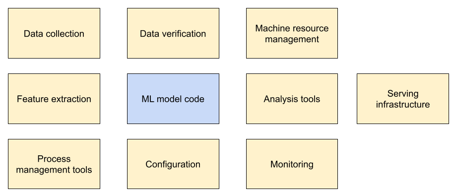
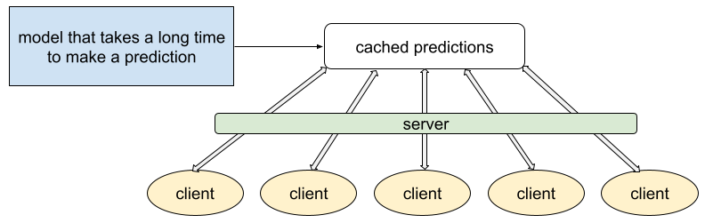
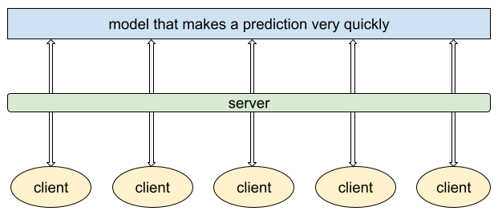

# Sistemas de AA de producción

## Introducción

Los sistemas de AA de producción del mundo real son grandes de ecosistemas nuevos y el modelo es solo una parte única y relativamente
pequeña.

El AA es el centro de un sistema de producción de aprendizaje automático del mundo real pero a menudo representa solo el 5% o menos de 
la base de código total el sistema. No es un error tipográfico; es significativamente menor de lo que lo que espera. Ten en cuenta que
un sistema de producción de AA dedica recursos considerables a los datos de entrada: recopilarlos, verificarlos y extraer atributos.

## Entrenamiento estático o dinámico

En términos generales, puedes entrenar un modelo de dos maneras:
- El **entrenamiento estático** (también llamado entrenamiento sin conexión) significa que entrenas un modelo solo una vez. Luego, 
puedes entregar ese mismo modelo entrenado durante un tiempo.
- El **entrenamiento dinámico** (también llamado entrenamiento en línea) significa que entrenas un modelo de forma continua o, 
al menos, con frecuencia. Por lo general, se entrega el modelo más recién entrenado.

|             | Entrenamiento estático | Entrenamiento dinámico |
|-------------|------------------------|------------------------|
| Ventajas    | **Más simple.** Solo debes desarrollar y probar el modelo una vez. | **Más adaptable.** Tu modelo se mantendrá al día con cualquier cambio en la relación entre los atributos y las etiquetas. |
| Desventajas | **A veces, más inactivos.** Si la relación entre los atributos y las etiquetas cambia con el tiempo, las predicciones de tu modelo se degradarán. | **Más trabajo.** Debes compilar, probar y lanzar un producto nuevo todo el tiempo. |

Si tu conjunto de datos realmente no cambia con el tiempo, elige el entrenamiento estático, ya que es más económico crearlo y 
mantenerlo que el entrenamiento dinámico. Sin embargo, los conjuntos de datos suelen cambiar con el tiempo, incluso aquellos con 
atributos que crees que son tan constantes como, por ejemplo, el nivel del mar. Conclusión: Incluso con el entrenamiento estático, 
debes supervisar los datos de entrada en busca de cambios.

Por ejemplo, considera un modelo entrenado para predecir la probabilidad de que los usuarios comprarán flores. Debido a la presión
del tiempo, el modelo se entrena solo una vez con un conjunto de datos del comportamiento de compra de flores durante julio y agosto.
El modelo funciona bien durante varios meses, pero luego hace predicciones terribles alrededor del Día de San Valentín porque el 
comportamiento de los usuarios durante ese período de festividades florales cambia de forma drástica.

Para explorar con más detalle el entrenamiento estático y dinámico, consulta el curso [Cómo administrar proyectos de AA](https://developers.google.com/machine-learning/managing-ml-projects/pipelines?hl=es-419).

## Inferencia estática o dinámica

La inferencia es el proceso de realizar predicciones mediante la aplicación de un modelo entrenado a ejemplos sin etiqueta. En términos 
generales, un modelo puede inferir predicciones de una de las siguientes dos maneras:
- La **inferencia estática** (también llamada **inferencia sin conexión** o **inferencia por lotes**) significa que el modelo realiza predicciones 
sobre un conjunto de ejemplos sin etiqueta comunes y, luego, almacena en caché esas predicciones en algún lugar.
- La **inferencia dinámica** (también llamada **inferencia en línea** o **inferencia en tiempo real**) significa que el modelo solo realiza
predicciones a pedido, por ejemplo, cuando un cliente solicita una predicción.

Para usar un ejemplo extremo, imagina un modelo muy complejo que toma una hora para inferir una predicción. Esta probablemente sería
una excelente situación para la inferencia estática:

Supongamos que este mismo modelo complejo usa por error la inferencia dinámica en lugar de la inferencia estática. Si muchos clientes
solicitan predicciones al mismo tiempo, la mayoría de ellos no las recibirán durante horas o días.

Ahora, considera un modelo que infiere rápidamente, quizás en 2 milisegundos, con un mínimo relativo de recursos computacionales. En esta 
situación, los clientes pueden recibir predicciones de forma rápida y eficiente a través de la inferencia dinámica, como se sugiere en 
la siguiente Figura.

### Inferencia estática
Ventajas:
- No te preocupes demasiado por el costo de inferencia.
- Puede realizar la verificación posterior de las predicciones antes de enviarlas.

Desventajas:
- Solo puede entregar predicciones almacenadas en caché, por lo que es posible que el sistema no pueda entregar predicciones para 
ejemplos de entrada poco comunes.
- Es probable que la latencia de actualización se mida en horas o días.

### Inferencia dinámica
Ventajas:
- Puede inferir una predicción sobre cualquier elemento nuevo a medida que llega, lo que es ideal para las predicciones de cola larga 
(menos comunes).

Desventajas:
- Son intensivos en procesamiento y sensibles a la latencia. Esta combinación puede limitar la complejidad del modelo; es decir, 
es posible que debas crear un modelo más simple que pueda inferir predicciones más rápido que un modelo complejo.
- Las necesidades de supervisión son más intensivas.

## ¿Cuándo transformar los datos?

Los datos sin procesar deben ser procesados mediante ingeniería de atributos (transformación). ¿Cuándo debes transformar los datos? 
En términos generales, puedes realizar la ingeniería de atributos durante cualquiera de los siguientes dos períodos:
- Antes de entrenar el modelo.
- Mientras entrenas el modelo.

### Transforma los datos antes del entrenamiento

En este enfoque, sigues dos pasos:
1. Escribe código o usa herramientas especializadas para transformar los datos sin procesar.
2. Almacena los datos transformados en un lugar donde el modelo pueda transferirlos, como en el disco.

Ventajas:
- El sistema transforma los datos sin procesar solo una vez.
- El sistema puede analizar todo el conjunto de datos para determinar la mejor estrategia de transformación.

Desventajas:
- Debes volver a crear las transformaciones en el momento de la predicción. Ten cuidado con el sesgo entre el entrenamiento y la entrega.

El sesgo de entrenamiento-deriva es más peligroso cuando el sistema realiza inferencias dinámicas (en línea). En un sistema que usa 
inferencia dinámica, el software que transforma el conjunto de datos sin procesar suele diferir del software que entrega las predicciones,
lo que puede causar un sesgo entre el entrenamiento y la entrega. Por el contrario, los sistemas que usan inferencia estática (sin conexión)
a veces pueden usar el mismo software.

### Transforma datos durante el entrenamiento

En este enfoque, la transformación forma parte del código del modelo. El modelo transfiere datos sin procesar y los transforma.

Ventajas:
- Puedes seguir usando los mismos archivos de datos sin procesar si cambias las transformaciones.
- Te garantizamos las mismas transformaciones en el momento del entrenamiento y la predicción.

Desventajas:
- Las transformaciones complicadas pueden aumentar la latencia del modelo.
- Las transformaciones se producen para cada lote.

Transformar los datos por lote puede ser complicado. Por ejemplo, supongamos que deseas usar la normalización de puntuación z para 
transformar datos numéricos sin procesar. La normalización de puntuación z requiere el promedio y la desviación estándar del atributo.
Sin embargo, las transformaciones por lote significan que solo tendrás acceso a un lote de datos, no al conjunto de datos completo. 
Por lo tanto, si los lotes varían mucho, una puntuación Z de, por ejemplo, -2.5 en un lote no tendrá el mismo significado que -2.5 en 
otro lote. Como solución alternativa, el sistema puede precalcular la media y la desviación estándar en todo el conjunto de datos y, 
luego, usarlas como constantes en el modelo.

## Pruebas de implementación

Un sistema de aprendizaje automático completo requiere pruebas para lo siguiente:
- Valida los datos de entrada.
- Validación de la ingeniería de atributos.
- Validar la calidad de las versiones nuevas del modelo
- Valida la infraestructura de publicación.
- Evaluar la integración entre componentes de canalización

Muchos ingenieros de software prefieren el desarrollo basado en pruebas (TDD). En el TDD, los ingenieros de software escriben
pruebas antes de escribir el código fuente “real”. Sin embargo, la TDD puede ser complicada en el aprendizaje automático. Por ejemplo,
antes de entrenar tu modelo, no puedes escribir una prueba para validar la pérdida. En su lugar, primero debes descubrir la pérdida 
alcanzable durante el desarrollo del modelo y luego probar las versiones nuevas del modelo en función de la pérdida alcanzable.

### Prueba las actualizaciones de modelos con un entrenamiento reproducible

Quizás quieras seguir mejorando tu modelo. Por ejemplo, supongamos que realizas ingeniería de atributos adicional en un atributo
determinado y, luego, vuelves a entrenar el modelo con la esperanza de obtener mejores resultados (o al menos los mismos). Lamentablemente,
a veces es difícil reproducir el entrenamiento del modelo. Para mejorar la reproducibilidad, sigue estas recomendaciones:
- Inicializa de forma determinística el generador de números aleatorios. Para obtener más información, consulta aleatorización en la 
generación de datos.
- Inicializa los componentes del modelo en un orden fijo para asegurarte de que obtengan el mismo número aleatorio del generador de 
números aleatorios en cada ejecución. Por lo general, las bibliotecas de aprendizaje automático manejan este requisito automáticamente.
- Toma el promedio de varias ejecuciones del modelo.
- Usa el control de versión, incluso para las iteraciones preliminares, de modo que puedas identificar el código y los parámetros cuando investigues tu modelo o canalización.

Incluso después de seguir estos lineamientos, es posible que aún existan otras fuentes de no determinismo.

### Prueba las llamadas a la API de aprendizaje automático
¿Cómo pruebas las actualizaciones de las llamadas a la API? Podrías volver a entrenar tu modelo, pero eso requiere mucho tiempo. En su 
lugar, escribe una prueba de unidades para generar datos de entrada aleatorios y ejecuta un solo paso de descenso del gradiente. Si este
paso se completa sin errores, es probable que las actualizaciones de la API no hayan arruinado tu modelo.

### Cómo escribir pruebas de integración para componentes de canalización
En una canalización de IA, los cambios en un componente pueden causar errores en otros componentes. Para verificar que los componentes
funcionen en conjunto, escribe una **prueba de integración** que ejecute toda la canalización **de extremo a extremo**.

Además de ejecutar pruebas de integración de forma continua, debes ejecutar pruebas de integración cuando envíes modelos y versiones de 
software nuevos. La lentitud de ejecutar toda la canalización dificulta las pruebas de integración continua. Para ejecutar pruebas de 
integración más rápido, entrena en un subconjunto de los datos o con un modelo más simple. Los detalles dependen de tu modelo y tus datos. 
Para obtener una cobertura continua, debes ajustar las pruebas más rápidas para que se ejecuten con cada versión nueva del modelo o software. Mientras tanto, las pruebas lentas se ejecutarían de forma continua en segundo plano.

### Valida la calidad del modelo antes de publicarlo
Antes de enviar una versión nueva del modelo a producción, prueba los siguientes dos tipos de degradaciones de calidad:
- **Degradación repentina**. Un error en la versión nueva podría causar una calidad mucho más baja. Para validar las versiones nuevas, 
verifica su calidad en comparación con la versión anterior.
- **Degradación lenta**.Es posible que la prueba de degradación repentina no detecte una degradación lenta de la calidad del modelo en 
varias versiones. En su lugar, asegúrate de que las predicciones de tu modelo en un conjunto de datos de validación cumplan con un umbral
fijo. Si tu conjunto de datos de validación se desvía de los datos en vivo, actualízalo y asegúrate de que tu modelo siga cumpliendo con
el mismo umbral de calidad.

### Valida la compatibilidad del modelo con la infraestructura antes de la publicación
Si tu modelo se actualiza más rápido que el servidor, es posible que tenga dependencias de software diferentes, lo que podría causar 
incompatibilidades. Para asegurarte de que las operaciones que usa el modelo estén presentes en el servidor, realiza la etapa de pruebas 
del modelo en una versión de zona de pruebas del servidor.

## Supervisión de canalizaciones

Tu modelo debería ejecutarse las 24 horas, todos los días, sin problemas. Para asegurarte de que lo haga, debes supervisar tu canalización de aprendizaje automático (AA).

### Escribe un esquema de datos para validar los datos sin procesar

Para supervisar tus datos, debes verificarlos continuamente en relación con los valores estadísticos esperados escribiendo reglas que 
los datos deben satisfacer. Esta colección de reglas se denomina esquema de datos. Para definir un esquema de datos, sigue estos pasos:
1. Comprende el rango y la distribución de tus atributos. Para los atributos categóricos, comprender el conjunto de valores posibles
2. Codifica tu comprensión en el esquema de datos. A continuación, se muestran ejemplos de reglas:
    - Asegúrate de que las calificaciones enviadas por los usuarios siempre estén en el rango de 1 a 5.
    - Verifica que la palabra the aparezca con mayor frecuencia (para una función de texto en inglés).
    - Verifica que cada atributo categórico esté establecido en un valor de un conjunto fijo de valores posibles.
3. Prueba tus datos con el esquema de datos. Tu esquema debe detectar errores de datos, como los siguientes:
    - Anomalías
    - Valores inesperados de variables categóricas
    - Distribuciones de datos inesperadas

### Escribe pruebas de unidades para validar la ingeniería de atributos

Si bien tus datos sin procesar pueden pasar el esquema de datos, tu modelo no se entrena con datos sin procesar. En cambio, tu modelo 
se entrena con datos que se sometieron a ingeniería de atributos. Por ejemplo, tu modelo se entrena con atributos numéricos normalizados 
en lugar de datos numéricos sin procesar. Dado que los datos creados con ingeniería de atributos pueden ser muy diferentes de los datos de
entrada sin procesar, debes verificar los datos creados con ingeniería de atributos por separado de las verificaciones de los datos de 
entrada sin procesar.

Escribe pruebas de unidades según tu comprensión de los datos diseñados con ingeniería de atributos. Por ejemplo, puedes escribir pruebas
de unidades para verificar condiciones como las siguientes:
- Todas las características numéricas se ajustan, por ejemplo, entre 0 y 1.
- Los vectores con codificación one-hot solo contienen un 1 y N-1 ceros.
- Las distribuciones de datos después de la transformación cumplen con las expectativas. Por ejemplo, si normalizaste los datos con puntuaciones Z, la media de las puntuaciones Z debería ser 0.
- Se controlan los valores atípicos, por ejemplo, mediante el escalamiento o el recorte.

### Verifica las métricas para encontrar porciones de datos importantes
A veces, un todo exitoso oculta un subconjunto fallido. En otras palabras, un modelo con métricas generales excelentes podría seguir
haciendo predicciones terribles para ciertas situaciones. Por ejemplo:

> Tu modelo de unicornios tiene un buen rendimiento en general, pero no es bueno cuando hace predicciones para el desierto del Sahara.

Si eres el tipo de ingeniero que se conforma con un AUC general excelente, es posible que no notes los problemas del modelo en el 
desierto del Sahara. Si es importante hacer buenas predicciones para cada región, debes hacer un seguimiento del rendimiento en cada 
una de ellas. Los subconjuntos de datos, como el que corresponde al desierto del Sahara, se denominan **segmentos de datos**.

Identifica las segmentaciones de datos de interés. Luego, compara las métricas del modelo para estas segmentaciones de datos con las 
métricas de todo tu conjunto de datos. Comprobar que tu modelo funcione bien en todas las segmentaciones de datos ayuda a eliminar la
parcialidad. 
> Consulta la lección de Equidad: Evaluación del sesgo para saber más.

### Usa métricas del mundo real

Las métricas del modelo no necesariamente miden el impacto real de tu modelo. Por ejemplo, cambiar un hiperparámetro podría aumentar
el AUC de un modelo, pero ¿cómo afectó el cambio a la experiencia del usuario? Para medir el impacto en el mundo real, debes definir 
métricas independientes. Por ejemplo, podrías encuestar a los usuarios de tu modelo para confirmar que realmente vieron un unicornio 
cuando el modelo predijo que lo harían.

### Verifica si hay sesgo entre el entrenamiento y la entrega
El sesgo entre el entrenamiento y la entrega significa que los datos de entrada durante el entrenamiento difieren de los datos de entrada 
en la entrega. En la siguiente tabla, se describen los dos tipos importantes de sesgo:

| Tipo | Definición | Ejemplo | Solución |
|------|------------|---------|----------|
| **Sesgo del esquema** | Los datos de entrada de entrenamiento y de entrega no se ajustan al mismo esquema. | El formato o la distribución de los datos de entrega cambian mientras tu modelo sigue entrenándose con datos antiguos. | Usa el mismo esquema para validar los datos de entrenamiento y de entrega. Asegúrate de verificar por separado las estadísticas que no revisa tu esquema, como la fracción de valores faltantes. |
| **Sesgo de atributos** | Los datos diseñados difieren entre el entrenamiento y la entrega. | El código de ingeniería de atributos difiere entre el entrenamiento y la entrega, lo que genera datos procesados diferentes. | Al igual que con el sesgo de esquema, aplica las mismas reglas estadísticas a los datos diseñados de entrenamiento y de entrega. Realiza un seguimiento de la cantidad de atributos sesgados detectados y la proporción de ejemplos sesgados por atributo. |

Las causas del sesgo entre el entrenamiento y la entrega pueden ser sutiles. Siempre ten en cuenta qué datos están disponibles 
para tu modelo en el momento de la predicción. Durante el entrenamiento, usa solo las funciones que estarán disponibles cuando 
se realice la entrega.

> La regla de oro: Asegúrate de que el entrenamiento y la producción se imiten lo más posible. Cuanto más se parezca tu tarea de entrenamiento a tu tarea de predicción, mejor será el rendimiento de tu sistema de AA.

### Verifica si hay filtración de etiquetas

La filtración de etiquetas significa que las etiquetas de verdad fundamental que intentas predecir se ingresaron de forma inadvertida
en tus atributos de entrenamiento. A veces, la filtración de etiquetas es muy difícil de detectar.

### Supervisa la antigüedad del modelo a lo largo de la canalización

Si los datos de entrega evolucionan con el tiempo, pero tu modelo no se vuelve a entrenar con regularidad, verás una disminución 
en la calidad del modelo. Realiza un seguimiento del tiempo transcurrido desde que se volvió a entrenar el modelo con datos nuevos 
y establece una antigüedad límite para las alertas. Además de supervisar la antigüedad del modelo en la etapa de entrega, debes supervisar
la antigüedad del modelo en toda la canalización para detectar interrupciones.

### Probar que los pesos y los resultados del modelo sean estables numéricamente

Durante el entrenamiento del modelo, los pesos y las salidas de las capas no deben ser NaN (no es un número) ni Inf (infinito). 
Escribe pruebas para verificar los valores NaN y los valores Inf de tus pesos y salidas de capas. Además, prueba que más de la mitad 
de los resultados de una capa no sean cero.

### Supervisa el rendimiento del modelo

Tu predictor fue más popular de lo esperado. Recibes muchas solicitudes de predicción y aún más datos de entrenamiento. Crees que 
eso es genial hasta que te das cuenta de que tu modelo requiere cada vez más memoria y tiempo para entrenarse. Decides supervisar 
el rendimiento de tu modelo siguiendo estos pasos:
- Realiza un seguimiento del rendimiento del modelo según las versiones de código, modelo y datos. Este seguimiento te permite identificar la causa exacta de cualquier degradación del rendimiento.
- Prueba los pasos de entrenamiento por segundo de una nueva versión del modelo en comparación con la versión anterior y con un umbral fijo.
- Detecta fugas de memoria estableciendo un umbral para el uso de memoria.
- Supervisa los tiempos de respuesta de la API y haz un seguimiento de sus percentiles. Si bien los tiempos de respuesta de la API pueden estar fuera de tu control, las respuestas lentas podrían generar métricas deficientes en el mundo real.
- Supervisa la cantidad de preguntas respondidas por segundo.

### Probar la calidad del modelo activo en los datos publicados

Validaste tu modelo. Pero, ¿qué sucede si los escenarios del mundo real, como el comportamiento de los unicornios, cambian después
de registrar tus datos de validación? Entonces, la calidad de tu modelo publicado se degradará. Sin embargo, probar la calidad en 
la publicación es difícil porque los datos del mundo real no siempre están etiquetados. Si tus datos de publicación no están etiquetados,
considera estas pruebas:
- Genera etiquetas con evaluadores humanos.
- Investiga los modelos que muestran un sesgo estadístico significativo en las predicciones.
- Realiza un seguimiento de las métricas del mundo real para tu modelo. Por ejemplo, si clasificas spam, compara tus predicciones con el spam que denunciaron los usuarios.
- Mitiga la posible divergencia entre los datos de entrenamiento y los de entrega publicando una nueva versión del modelo en una fracción
de tus búsquedas. A medida que valides tu nuevo modelo de entrega, cambia gradualmente todas las búsquedas a la nueva versión.

Cuando uses estas pruebas, recuerda supervisar la degradación repentina y lenta de la calidad de la predicción.

### Aleatorización

Haz que tu canalización de generación de datos sea reproducible. Supongamos que deseas agregar un atributo para ver cómo afecta
la calidad del modelo. Para que el experimento sea justo, tus conjuntos de datos deben ser idénticos, excepto por esta nueva función. 
En ese sentido, asegúrate de que cualquier aleatorización en la generación de datos pueda ser determinística:
- **Inicializa tus generadores de números aleatorios (RNG)**. La inicialización garantiza que el RNG genere los mismos valores en
el mismo orden cada vez que lo ejecutes, lo que recrea tu conjunto de datos.
- Usa **claves hash invariantes**. El algoritmo hash es una forma común de dividir o muestrear datos. Puedes generar un hash 
para cada ejemplo y usar el número entero resultante para decidir en qué división colocar el ejemplo. Las entradas de tu función 
hash no deberían cambiar cada vez que ejecutes el programa de generación de datos. No uses la hora actual ni un número aleatorio 
en tu hash, por ejemplo, si deseas volver a crear tus hashes a pedido.

Los enfoques anteriores se aplican tanto al muestreo como a la división de tus datos.

#### Consideraciones para el hashing

Imagina de nuevo que recopilaste búsquedas y usaste el hash para incluirlas o excluirlas. Si la clave hash solo usara la búsqueda, 
en varios días de datos, siempre incluirías esa búsqueda o siempre la excluirías. Siempre incluir o siempre excluir una búsqueda es 
malo por los siguientes motivos:
- Tu conjunto de entrenamiento verá un conjunto menos diverso de búsquedas.
- Tus conjuntos de evaluación serán artificialmente difíciles, ya que no se superpondrán con tus datos de entrenamiento. 
En realidad, en el momento de la publicación, habrás visto parte del tráfico en vivo en tus datos de entrenamiento, por lo 
que tu evaluación debería reflejar eso.

En su lugar, puedes generar un hash en función de la búsqueda y la fecha de la búsqueda, lo que generaría un hash diferente para cada día.

> Nota: Debido a que estas claves hash usan la fecha en la que se registró la búsqueda (en lugar de la fecha actual), el proceso de hashing es determinístico. Es decir, el hash de "Día uno" será el mismo independientemente de cuándo se genere.

## Preguntas para hacer sobre los sistemas de AA de producción

En esta lección, se enfocan las preguntas que debes hacer sobre tus datos y tu modelo en los sistemas de producción.

### ¿Cada función es útil?

Debes supervisar tu modelo de forma continua para quitar las características que contribuyen poco o nada a la capacidad predictiva 
del modelo. Si los datos de entrada de esa función cambian de forma abrupta, el comportamiento de tu modelo también podría cambiar de 
forma abrupta de maneras no deseadas.

Además, ten en cuenta la siguiente pregunta relacionada:
- ¿La utilidad de la función justifica el costo de incluirla?

Siempre es tentador agregar más funciones al modelo. Por ejemplo, supongamos que encuentras una función nueva cuya adición mejora 
un poco las predicciones de tu modelo. Las predicciones ligeramente mejores parecen ser mejores que las predicciones ligeramente peores.
Sin embargo, la función adicional aumenta tu carga de mantenimiento.

### ¿Tu fuente de datos es confiable?

Preguntas para hacer sobre la fiabilidad de los datos de entrada:
- ¿La señal siempre estará disponible o proviene de una fuente que no es confiable? Por ejemplo:
  - ¿La señal proviene de un servidor que falla con una carga pesada?
  - ¿El indicador proviene de personas que se van de vacaciones todos los agostos?
- ¿El sistema que calcula los datos de entrada de tu modelo cambia alguna vez? Si es así, haz lo siguiente:
  - ¿Cada cuánto tiempo?
  - ¿Cómo sabrás cuándo cambie ese sistema?

Considera crear tu propia copia de los datos que recibes del proceso upstream. Luego, avanza a la siguiente versión de los datos 
upstream solo cuando tengas la seguridad de que es seguro hacerlo.

### ¿Tu modelo forma parte de un ciclo de retroalimentación?

A veces, un modelo puede afectar sus propios datos de entrenamiento. Por ejemplo, los resultados de algunos modelos, a su vez,
se convierten (directa o indirectamente) en atributos de entrada para ese mismo modelo.

A veces, un modelo puede afectar a otro. Por ejemplo, considera dos modelos para predecir los precios de las acciones:
- El modelo A, que es un modelo predictivo malo.
- El modelo B.

Como el modelo A tiene errores, decide comprar acciones de Stock X por error. Esas compras aumentan el precio de las acciones X. El 
modelo B usa el precio de las acciones X como un atributo de entrada, por lo que puede llegar a algunas conclusiones falsas sobre el 
valor de las acciones X. Por lo tanto, el modelo B podría comprar o vender acciones de la acción X en función del comportamiento con 
errores del modelo A. El comportamiento del modelo B, a su vez, puede afectar al modelo A, lo que podría activar una manía de tulipanes
o una disminución en las acciones de la empresa X.

