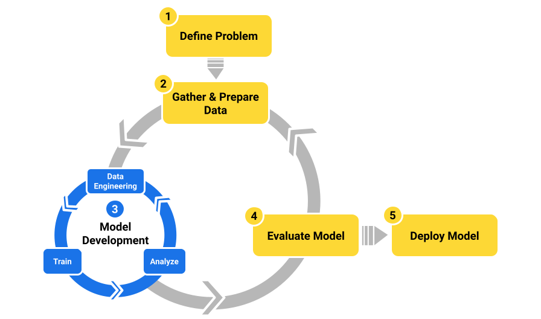

# Aprendizaje automático automatizado (AutoML)
## Introducción

Si estás comenzando un nuevo proyecto de aprendizaje automático (AA), es posible que te preguntes si el entrenamiento manual es
tu única opción para crear un modelo de AA. Con el entrenamiento manual, escribes código con un framework de AA para crear un modelo.
Durante este proceso, eliges qué algoritmos explorar y ajustas iterativamente los hiperparámetros para encontrar el modelo correcto.

Por supuesto, el entrenamiento del modelo no es lo único en lo que debes pensar. En la práctica, crear un modelo de aprendizaje 
automático desde el prototipo hasta la producción implica tareas repetitivas y habilidades especializadas. Un flujo de trabajo de 
aprendizaje automático exploratorio simple se ve de la siguiente manera:

**Tareas repetitivas**: El flujo de trabajo de AA puede implicar trabajo repetitivo y experimentación. Por ejemplo, durante 
el desarrollo del modelo, por lo general, debes explorar diferentes combinaciones de algoritmos e hiperparámetros para identificar 
el modelo más adecuado. Con el entrenamiento manual, escribes código especializado para entrenar el modelo y, luego, lo ajustas 
para ejecutar experimentos con diferentes algoritmos e hiperparámetros de AA para encontrar el mejor modelo. Para proyectos pequeños
o exploratorios, este proceso manual puede no ser un problema, pero para proyectos más grandes, estas tareas repetitivas pueden llevar 
mucho tiempo.

**Habilidades especializadas**: El desarrollo manual de un modelo de AA requiere habilidades especializadas. En la práctica, es 
posible que no todos los equipos que planean desarrollar un modelo de aprendizaje automático tenga estas habilidades. Si un equipo 
no tiene un científico de datos dedicado, es posible que ni siquiera sea factible realizar este trabajo de forma manual.

Por suerte, ciertos pasos en el desarrollo de modelos se pueden automatizar para reducir el trabajo repetitivo y la necesidad de 
habilidades especializadas. La automatización de estas tareas es el tema de este módulo sobre el aprendizaje automático automatizado (AutoML).

### ¿Qué es AutoML?

AutoML es un proceso de automatización de ciertas tareas en un flujo de trabajo de aprendizaje automático. Puedes considerar AutoML 
como un conjunto de herramientas y tecnologías que hacen que la compilación de modelos de aprendizaje automático sea más rápida y 
accesible para un grupo más amplio de usuarios. Si bien la automatización puede ayudar en todo el flujo de trabajo de AA, las tareas 
que a menudo se asocian con AutoML son las que se incluyen en el ciclo de desarrollo del modelo que se muestra en la Figura 1. Entre 
estas tareas repetitivas, se incluyen las siguientes:
- Ingeniería de datos
  - Ingeniería de atributos.
  - Selección de los atributos.
- Capacitación
  - Identificar un algoritmo de AA adecuado
  - Selecciona los mejores hiperparámetros.
- Análisis
  - Evaluar las métricas generadas durante el entrenamiento en función de los conjuntos de datos de prueba y validación

Con AutoML, puedes enfocarte en tu problema y tus datos de AA en lugar de la selección de atributos, el ajuste de hiperparámetros 
y la elección del algoritmo correcto.

## Beneficios y limitaciones de AutoML

### Beneficios
Estos son algunos de los motivos más comunes por los que puedes elegir usar AutoML:
- Para **ahorrar tiempo**: Muchas personas eligen AutoML para ahorrar tiempo evitando exhaustiva experimentación manual para 
encontrar el mejor modelo.
- Para **mejorar la calidad del modelo de AA**: Las herramientas de AutoML pueden realizar búsquedas exhaustivas. para 
obtener el modelo de más alta calidad.
- Para **compilar un modelo de AA sin necesidad de habilidades especializadas**: Un efecto secundario de automatizar tareas del AA 
es que democratiza el AA. Los usuarios no necesitan tener una comprensión profunda de los algoritmos de aprendizaje automático o de
la programación para desarrollar un modelo de AA.
- Para **realizar una prueba de humo de un conjunto de datos**: Incluso si eres un creador de modelos experto, AutoML pueden darte 
rápidamente una estimación de referencia para saber si un conjunto de datos la señal en todo su ruido. Si la herramienta AutoML 
no puede crear ni siquiera un modelo, puede que no valga la pena dedicar tiempo a crear un buen modelo manualmente.
- Para **evaluar un conjunto de datos**: Muchos sistemas de AutoML ayudan a evaluar no solo los modelos que producen, sino que también
ayudan a evaluar las funciones que se para entrenar esos modelos. Incluso si no usas el modelo resultante, AutoML las herramientas 
pueden ayudarte a determinar cuáles de tus atributos pueden no valer recopilando e incluyendo en tu conjunto de datos final.
- Para **aplicar las prácticas recomendadas**: La automatización incluye asistencia integrada para aplicar Prácticas 
recomendadas del AA para la búsqueda de cada modelo

### Limitaciones
Sin embargo, antes de elegir AutoML hay algunas limitaciones que debes tener en cuenta:
- **La calidad del modelo puede no ser tan buena como el entrenamiento manual**. Usar un modelo generalizado de optimización para encontrar 
la mejor combinación de arquitectura los hiperparámetros y la ingeniería de atributos para cualquier conjunto de datos aleatorio 
que un experto motivado con el tiempo suficiente pueda crear un modelo con una mejor calidad de predicción.
- **La búsqueda de modelos y la complejidad pueden ser opacas**. Con AutoML, es difícil obtener información sobre cómo la herramienta
llegó al mejor modelo. De hecho, los modelos de salida pueden estar creados a partir de diferentes arquitecturas, hiperparámetros y
estrategias de ingeniería de atributos. Modelos generados con AutoML son difíciles de reproducir de forma manual.
- **Múltiples ejecuciones de AutoML podrían mostrar más varianza**.  Debido a cómo el algoritmo de optimización encuentra de forma iterativa los valores 
que considera que son los mejores para crear el modelo, distintas ejecuciones de AutoML pueden buscar distintas partes del espacio y
terminar de forma moderada (o incluso significativa) en diferentes lugares. Volver a ajustar con AutoML para crear una nueva arquitectura de modelo
puede mostrar más varianza que simplemente volver a entrenar el modelo de resultados anterior arquitectura.
- **Los modelos no se pueden personalizar durante el entrenamiento**. Si tu caso de uso requiere personalización o ajustes durante 
el proceso de entrenamiento, es posible que AutoML no sea la opción correcta para ti.

### Requisitos de los datos

Ya sea que uses entrenamiento personalizado o un sistema de AutoML, una cosa que tienes que tener en cuenta cuando creas un modelo desde cero es
que necesitarás grandes cantidades de datos. La ventaja de AutoML es que puedes ignorar la búsqueda de hiperparámetros y arquitectura,
y enfocarse principalmente en la calidad del tus datos.

También hay sistemas especializados de AutoML que pueden entrenar modelos con muchos menos datos porque usan aprendizaje por transferencia.
Por ejemplo, en lugar de necesitar cientos de miles de ejemplos para compilar de clasificación de imágenes, estos sistemas especializados 
de AutoML pueden usar unos pocos cientos de imágenes etiquetadas junto con el aprendizaje por transferencia de una red de clasificación de
imágenes.

### ¿AutoML es adecuado para tu proyecto?

AutoML puede ayudar a todos, desde principiantes hasta expertos, a usar el AA para crear productos y resolver problemas. Si estás 
tratando de decidir si AutoML es adecuado para tu proyecto, considera estos aspectos:
- **AutoML** es una opción excelente para equipos con poca experiencia en la creación de modelos ML, o equipos experimentados que buscan 
mejoras en la productividad y no tienen requisitos de personalización.
- El **entrenamiento personalizado (manual)** es más adecuado cuando la calidad del modelo es importante y el equipo debe poder 
personalizar el modelo. En estos casos, el entrenamiento manual puede requerir más tiempo para la experimentación y crear una solución, pero 
el equipo a menudo puede lograr un modelo de mayor calidad que con una solución de AutoML.

## Cómo comenzar

### Herramientas de AutoML

Las herramientas de AutoML se dividen en dos categorías principales:
- Las **herramientas que no requieren programación** suelen adoptar la forma de aplicaciones web que te permiten configurar y 
ejecutar experimentos a través de una interfaz de usuario para encontrar el mejor modelo para tus datos sin escribir código.
- Las **herramientas de API y CLI** proporcionan funciones de automatización avanzadas, pero requieren más (a veces, mucho más) 
experiencia en programación y AA.

Las herramientas de AutoML que requieren programación pueden ser más potentes y flexibles que las herramientas sin código, pero también 
pueden ser más difíciles de usar. En este módulo, se enfoca en las opciones sin código para el desarrollo de modelos, pero ten en cuenta 
que las opciones de API y CLI pueden ayudarte si necesitas automatización personalizada.

### Flujo de trabajo de AutoML

Los pasos de alto nivel del flujo de trabajo son los mismos que los que usas para el entrenamiento personalizado. La principal diferencia es que AutoML
controla algunas tareas por ti.

#### 1. Definición del problema

El primer paso de cualquier flujo de trabajo de AA es definir el problema. Cuando uses AutoML, asegúrate de que la herramienta que elijas 
pueda admitir los objetivos de tu proyecto de AA. La mayoría de las herramientas de AutoML admiten una variedad de algoritmos de aprendizaje
automático supervisado y tipos de datos de entrada.

Para obtener más información sobre el planteamiento de problemas, consulta el módulo sobre 
[Introducción al planteamiento de problemas de ML](https://developers.google.com/machine-learning/problem-framing?hl=es). 

#### 2. Obtención de datos

Antes de comenzar a trabajar con una herramienta de AutoML, debes recopilar tus datos en una sola fuente de datos. Consulta la documentación
del producto para asegurarte de que tu herramienta admita la fuente de datos, los tipos de datos y el tamaño del conjunto de datos.

#### 3. Preparación de datos

La preparación de datos es un área en la que las herramientas de AutoML pueden ayudarte, pero ninguna puede hacer todo automáticamente, 
así que debes hacer algunos trabajos antes de poder importar tus datos a la herramienta. La preparación de datos para AutoML es similar
a lo que deberías hacer para entrenar un modelo de forma manual.

Antes de importar tus datos para el entrenamiento de AutoML, debes completar estos pasos:
- **Etiqueta tus datos**. Cada ejemplo de tu conjunto de datos necesita una etiqueta.
- **Limpia y da formato a los datos**. Los datos del mundo real suelen ser desordenados, por lo que debes 
limpiarlos antes de usarlos. Incluso con AutoML, debes determinar los mejores tratamientos para tu conjunto de datos y problema en 
particular. Esto puede requerir cierta exploración y, posiblemente, varias ejecuciones de AutoML antes de obtener los mejores resultados.
- **Realiza las transformaciones de atributos**. Algunas herramientas de AutoML controlan ciertas transformaciones de atributos por ti. 
Sin embargo, si la herramienta que usas no admite una transformación de componentes que necesitas o no la admite bien, es posible que debas
realizar las transformaciones con anticipación.

#### 4. Desarrollo de modelos (con AutoML sin código)

AutoML hace el trabajo por ti durante el entrenamiento. Sin embargo, antes de comenzar la capacitación, debes configurar el experimento. Para configurar una 
ejecución de entrenamiento de AutoML, por lo general, debes especificar estos pasos de alto nivel:
1. Importa tus datos 
   - Para importar tus datos, especifica la fuente de datos. Durante el proceso de importar, la herramienta de AutoML asigna un tipo de datos semántico a cada valor de datos.
2. Analiza tus datos
   - Los productos de AutoML suelen proporcionar herramientas para analizar tu conjunto de datos antes y después del entrenamiento. Como práctica recomendada, te recomendamos que uses estas herramientas de análisis para comprender y verificar tus datos antes de iniciar una ejecución de AutoML.
3. Define mejor tus datos
  - Las herramientas de AutoML suelen proporcionar mecanismos para ayudarte a definir mejor tus datos después de importar y antes de entrenar. Estas son algunas tareas que te recomendamos completar para definir mejor tus datos:
    - Verificación semántica: Durante la importación, las herramientas de AutoML intentan determinar el tipo semántico correcto para cada atributo, pero estas son solo conjeturas. Debes verificar los tipos designados a todas las funciones y cambiarlos si se asignaron de forma incorrecta. Por ejemplo, es posible que tengas códigos postales almacenados como números en una columna de tu base de datos. La mayoría de los sistemas de AutoML detectarían los datos como datos numéricos continuos. Esto sería incorrecto para un código postal, y es probable que el usuario desee cambiar el tipo de semántica a categórica en lugar de continua para esta columna de atributos.
    - Transformaciones: Algunas herramientas permiten a los usuarios personalizar las transformaciones de datos como parte del proceso de perfeccionamiento. A veces, esto es necesario cuando un conjunto de datos tiene características potencialmente predictivas que deben transformarse o combinarse de una manera que es difícil para las herramientas de AutoML determinar sin ayuda. Por ejemplo, considera un conjunto de datos de viviendas que usas para predecir el precio de venta de una casa. Supongamos que hay una función que representa la descripción de una ficha de casa llamada description y que te gustaría usar estos datos para crear una función nueva llamada description_length. Algunos sistemas de AutoML ofrecen formas de usar transformaciones personalizadas. En este ejemplo, podría haber una función LENGTH para generar una nueva función de longitud de descripción como esta: LENGTH(description).
4. Configura los parámetros de ejecución de AutoML 

El último paso antes de ejecutar el experimento de entrenamiento es elegir algunos parámetros de configuración para indicarle a
la herramienta cómo quieres que entrene tu modelo. Aunque cada herramienta de AutoML tiene su propio conjunto único de opciones de 
configuración, estas son algunas de las tareas de configuración significativas que es posible que debas completar:
- Selecciona el tipo de problema de AA que planeas resolver. Por ejemplo, ¿estás resolviendo un problema de clasificación o de regresión?
- Selecciona qué columna de tu conjunto de datos es la etiqueta.
- Selecciona el conjunto de atributos que se usarán para entrenar el modelo.
- Selecciona el conjunto de algoritmos de aprendizaje automático que AutoML considera en la búsqueda de modelos.
- Selecciona la métrica de evaluación que usa AutoML para elegir el mejor modelo.

Después de configurar tu experimento de AutoML, ya puedes comenzar la ejecución de entrenamiento. El entrenamiento puede tardar un tiempo en completarse (alrededor de horas).

#### 5. Evaluar el modelo

Después del entrenamiento, puedes examinar los resultados con las herramientas que te proporciona tu producto de AutoML para ayudarte a hacer lo siguiente:
- Para evaluar tus atributos, examina las métricas de importancia de los atributos.
- Para comprender tu modelo, examina la arquitectura y los hiperparámetros que se usaron para compilarlo.
- Evalúa el rendimiento del mejor modelo con gráficos y métricas recopilados durante el entrenamiento del modelo de salida.

#### 6. Producción

Aunque está fuera del alcance de este módulo, algunos sistemas de AutoML pueden ayudarte a probar e implementar tu modelo.

#### 7. Cómo reentrenar el modelo

Es posible que debas volver a entrenar el modelo con datos nuevos. Esto puede suceder después de que evalúes la ejecución de entrenamiento de AutoML o después de que tu modelo esté 
en producción durante un tiempo. De cualquier manera, los sistemas de AutoML también pueden ayudar con el reentrenamiento. No es extraño volver a analizar tus datos después
de una ejecución de AutoML y volver a entrenar con un conjunto de datos mejorado.

